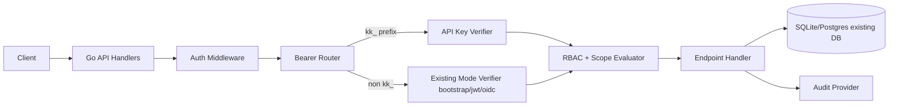
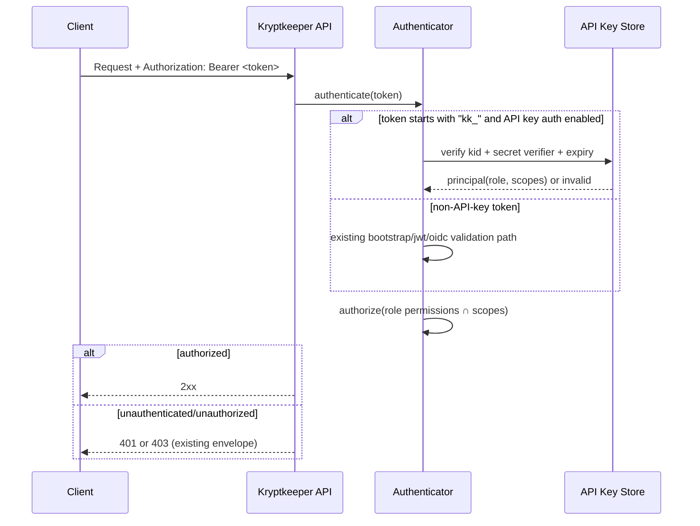

# WS-02 MVP API Design — Identity & Access (Go Bootstrap)

## Summary

This document defines a **minimal-infrastructure WS-02 MVP** for Kryptkeeper’s Go bootstrap service covering:

1. `login` + `refresh` token flow
2. API key authentication path (`Authorization: Bearer kk_<kid>_<secret>`)
3. RBAC enforcement matrix aligned to **DEC-001..DEC-005**
4. Backward-compatible behavior with existing bearer auth modes (`bootstrap|jwt|oidc`)
5. Incremental implementation order with ship-safe smoke tests

Design goals for MVP:

- **No new hard infra dependencies** (no Redis, no message bus)
- Reuse existing runtime patterns (`/api/v1`, kebab-case resources, JSON, current 401 envelope)
- Preserve existing endpoint behavior by default; new capabilities are additive and flag-gated

---

## Subtask Decomposition

1. **[1] Capture constraints from existing contracts + DEC decisions** — DONE
2. **[2] Define WS-02 MVP resource model and auth decision flow** — DONE
3. **[3] Specify concrete endpoint contracts (login/refresh/api-keys)** — DONE
4. **[4] Define RBAC + scopes enforcement matrix aligned to DEC-001..DEC-005** — DONE
5. **[5] Define incremental rollout order + fallback compatibility + smoke tests** — DONE

---

## Constraints and Decision Alignment

### DEC-001 (canonical V1 roles)

MVP role set (no deviations):

- `pki-admin`
- `pki-operator`
- `pki-viewer`
- `pki-auditor`
- `discovery-operator`
- `service-account`

### DEC-002 (custom roles deferred)

- No custom role CRUD in WS-02 MVP.
- API contracts remain extension-ready (`role` as enum now; can become registry-backed later).

### DEC-003 (API key semantics)

- Token format: `kk_<kid>_<secret>`
- Store only `kid` + verifier (`HMAC-SHA-256` with server-side pepper)
- Effective permissions: **role permissions ∩ API key scopes**
- Scopes can only restrict, never elevate.

### DEC-004 (audit log ID type)

- Auth/API-key events continue to emit into `/api/v1/audit` with `id` as `int64`/BIGINT-compatible.

### DEC-005 (naming)

- Canonical endpoint path: `/api/v1/api-keys` (kebab-case plural)

---

## MVP Architecture (Minimal Infra)



Infra posture:

- **Required**: existing app process + existing DB provider path already used by service.
- **Not required**: Redis/session store/queue/external policy engine.
- Refresh token state stored in DB table (or in-memory fallback for local dev only).

---

## Auth Decision Flow (Backward-Compatible)



Compatibility rules:

1. Existing bearer token modes remain intact for all current endpoints.
2. API key path is additive and can be enabled by feature flag.
3. Existing 401 envelope remains unchanged for protected v1 endpoints:

```json
{
  "error": "unauthorized",
  "message": "invalid or missing bearer token"
}
```

---

## Endpoint Contracts (WS-02 MVP)

## 1) `POST /api/v1/auth/login`

Authenticate local user credentials and mint access + refresh tokens.

- **Auth required**: No
- **Rate limit**: 10 req/min per source IP

### Request body

```json
{
  "email": "alex@example.com",
  "password": "correct horse battery staple"
}
```

### 200 response

```json
{
  "data": {
    "access_token": "eyJhbGciOiJIUzI1NiIsInR5cCI6IkpXVCJ9...",
    "token_type": "Bearer",
    "expires_in": 900,
    "refresh_token": "rfr_2jY...",
    "refresh_expires_in": 2592000,
    "principal": {
      "user_id": "550e8400-e29b-41d4-a716-446655440000",
      "email": "alex@example.com",
      "role": "pki-operator"
    }
  }
}
```

### Error statuses

- `400` invalid/missing fields
- `401` invalid credentials
- `403` account inactive
- `429` too many attempts

### Error example (`401`)

```json
{
  "error": "unauthorized",
  "message": "invalid credentials"
}
```

---

## 2) `POST /api/v1/auth/refresh`

Rotate refresh token and issue a new access token.

- **Auth required**: No bearer header required; uses refresh token in body
- **Rate limit**: 30 req/min per source IP

### Request body

```json
{
  "refresh_token": "rfr_2jY..."
}
```

### 200 response

```json
{
  "data": {
    "access_token": "eyJhbGciOiJIUzI1NiIsInR5cCI6IkpXVCJ9...",
    "token_type": "Bearer",
    "expires_in": 900,
    "refresh_token": "rfr_9Lk...",
    "refresh_expires_in": 2592000
  }
}
```

### Error statuses

- `400` missing token
- `401` invalid/expired/replayed refresh token
- `429` too many attempts

### Error example (`401`)

```json
{
  "error": "unauthorized",
  "message": "invalid refresh token"
}
```

---

## 3) `GET /api/v1/api-keys`

List API keys.

- **Auth required**: yes (bearer JWT/OIDC/bootstrap/API key)
- **Pagination**: required (`limit` default 25, max 100, `cursor` opaque string)
- **Rate limit**: 120 req/min per principal

### Query params

- `limit` (optional int)
- `cursor` (optional string)
- `user_id` (optional UUID, admin-only)

### 200 response

```json
{
  "data": [
    {
      "id": "4d6f8b10-2e31-4c9c-9a43-d8e3fcb11a9c",
      "name": "ci-prod",
      "kid": "a1b2c3d4",
      "key_prefix": "kk_a1b2c3d4_",
      "role": "service-account",
      "scopes": ["certificates:read", "certificates:write"],
      "expires_at": "2026-10-01T00:00:00Z",
      "last_used_at": "2026-04-07T11:00:00Z",
      "created_at": "2026-04-07T10:00:00Z",
      "user_id": "550e8400-e29b-41d4-a716-446655440000"
    }
  ],
  "meta": {
    "total": 1,
    "limit": 25,
    "next_cursor": null,
    "prev_cursor": null
  }
}
```

### Status codes

- `200` success
- `401` unauthenticated
- `403` forbidden (cross-user access)

---

## 4) `POST /api/v1/api-keys`

Create API key (secret returned once).

- **Auth required**: yes
- **Rate limit**: 20 req/min per principal

### Request body

```json
{
  "name": "ci-prod",
  "role": "service-account",
  "scopes": ["certificates:read", "certificates:write"],
  "expires_at": "2026-10-01T00:00:00Z"
}
```

### 201 response

Headers:

- `Location: /api/v1/api-keys/{id}`

```json
{
  "data": {
    "id": "4d6f8b10-2e31-4c9c-9a43-d8e3fcb11a9c",
    "name": "ci-prod",
    "kid": "a1b2c3d4",
    "token": "kk_a1b2c3d4_zNfA...",
    "role": "service-account",
    "scopes": ["certificates:read", "certificates:write"],
    "expires_at": "2026-10-01T00:00:00Z",
    "created_at": "2026-04-07T10:00:00Z"
  }
}
```

### Status codes

- `201` created
- `400` invalid role/scope/expiry
- `401` unauthenticated
- `403` forbidden (e.g., non-admin attempting elevated role)

---

## 5) `DELETE /api/v1/api-keys/{id}`

Revoke API key.

- **Auth required**: yes
- **Rate limit**: 60 req/min per principal

### Response

- `204 No Content`

### Status codes

- `204` revoked
- `401` unauthenticated
- `403` forbidden
- `404` not found

---

## RBAC Enforcement Matrix (MVP, DEC-001-aligned)

Legend: ✅ allowed, ❌ denied. For API-key auth path, final decision is `role_allow && scope_allow`.

| Endpoint group | pki-admin | pki-operator | pki-viewer | pki-auditor | discovery-operator | service-account |
|---|---|---|---|---|---|---|
| `POST /api/v1/auth/login` | ✅ | ✅ | ✅ | ✅ | ✅ | ❌ |
| `POST /api/v1/auth/refresh` | ✅ | ✅ | ✅ | ✅ | ✅ | ✅ |
| `GET /api/v1/authz-check` | ✅ | ✅ | ✅ | ✅ | ✅ | ✅ |
| `GET /api/v1/protected/*` | ✅ | ✅ | ✅ | ✅ | ✅ | ✅ |
| `GET /api/v1/cas*` | ✅ | ✅ | ✅ | ✅ | ✅ | scope-limited |
| `POST/PATCH/DELETE /api/v1/cas*` | ✅ | ❌ | ❌ | ❌ | ❌ | ❌ |
| `GET /api/v1/templates*` | ✅ | ✅ | ✅ | ✅ | ✅ | scope-limited |
| `POST/PUT/PATCH/DELETE /api/v1/templates*` | ✅ | ✅ | ❌ | ❌ | ❌ | scope-limited |
| `GET /api/v1/certificates*` | ✅ | ✅ | ✅ | ✅ | ✅ | scope-limited |
| `POST /api/v1/certificates` issue/import/renew/revoke | ✅ | ✅ | ❌ | ❌ | ❌ | scope-limited |
| `GET /api/v1/audit` | ✅ | ❌ | ❌ | ✅ | ❌ | ❌ |
| `GET /api/v1/api-keys` (own) | ✅ | ✅ | ✅ | ✅ | ✅ | ✅ |
| `GET /api/v1/api-keys?user_id=*` (all) | ✅ | ❌ | ❌ | ✅ (read-only all) | ❌ | ❌ |
| `POST /api/v1/api-keys` | ✅ | ✅ | ✅ | ✅ | ✅ | ❌ |
| `DELETE /api/v1/api-keys/{id}` own | ✅ | ✅ | ✅ | ✅ | ✅ | ✅ |

### Scope catalog (MVP)

- `cas:read`, `cas:write`
- `templates:read`, `templates:write`
- `certificates:read`, `certificates:write`
- `audit:read`
- `api-keys:read`, `api-keys:write`
- `protected:read`

Enforcement examples:

- `pki-admin` + `scopes=["certificates:read"]` => cannot issue/revoke certs.
- `pki-viewer` + `scopes=["cas:write"]` => still cannot mutate CAs (role denies).

---

## Fallback-Compatible Strategy for Existing Bearer Modes

1. **Do not change existing mode semantics** for `AUTH_MODE=bootstrap|jwt|oidc`.
2. Introduce API key verification as an additive path behind `APP_API_KEYS_ENABLED` (default `false`).
3. Bearer router behavior:
   - If token prefix is `kk_` and API key mode enabled => API key verification.
   - Else => existing `AUTH_MODE` verification path unchanged.
4. Existing endpoints (`/api/v1/authz-check`, `/api/v1/protected/*`) keep response shape and status semantics.
5. Rollout flag progression:
   - Stage A: flag off in all envs (no behavior change)
   - Stage B: on in dev/staging with observe-only audit
   - Stage C: on in prod with deny enforcement and alerting

---

## Safe Incremental Implementation Order

1. **Wave 1 — Policy and auth-context foundation**
   - Add canonical role constants (DEC-001)
   - Add scope evaluator (`role ∩ scopes`) without wiring decisions yet
   - Add audit event taxonomy for auth/api-key decisions
   - Ship check: no API behavior change; all current smoke passes

2. **Wave 2 — Login endpoint (`POST /auth/login`)**
   - Local-user credential validation against existing users store
   - Mint short-lived access token + refresh token
   - Ship check: new endpoint smoke only; existing matrix unchanged

3. **Wave 3 — Refresh endpoint (`POST /auth/refresh`)**
   - Token rotation + replay rejection
   - DB-backed refresh token store (minimal dependency)
   - Ship check: refresh replay negative test passes

4. **Wave 4 — API key management endpoints (`/api-keys`)**
   - list/create/revoke + one-time token return
   - verifier hashing uses HMAC-SHA-256 + pepper (DEC-003)
   - Ship check: key lifecycle smoke passes

5. **Wave 5 — API key bearer auth path (flag-gated)**
   - `kk_` token detection and verify path in middleware
   - principal context includes role + scopes
   - Ship check: existing jwt/oidc/bootstrap bearer tests still green

6. **Wave 6 — RBAC enforcement rollout by endpoint groups**
   - Enforce matrix on low-risk reads first (`/protected`, `/api-keys`)
   - Then high-impact writes (`/certificates`, `/cas`, `/templates`)
   - Ship check: role matrix smoke + regression smoke pass before each expansion

---

## Smoke Test Plan (MVP)

Run via existing harness entrypoint:

```bash
KRYPTKEEPER_SMOKE_MODE=local scripts/test/run.sh --suite smoke
```

Add WS-02 smoke assertions:

1. `POST /api/v1/auth/login`
   - valid creds => `200`, has `access_token` + `refresh_token`
   - bad creds => `401`

2. `POST /api/v1/auth/refresh`
   - valid refresh => `200` new access token
   - reused refresh token => `401`

3. `POST /api/v1/api-keys`
   - valid bearer + role => `201`, token returned once
   - invalid scope => `400`

4. `GET /api/v1/api-keys`
   - returns paginated `data` + `meta`
   - non-admin `user_id` override => `403`

5. API-key auth path on existing protected endpoint
   - `GET /api/v1/protected/whoami` with valid `kk_...` => `200`
   - same key without required scope => `403`

6. Backward-compat matrix (must remain green)
   - bootstrap bearer on `/api/v1/authz-check` => unchanged behavior
   - jwt bearer on `/api/v1/authz-check` + `/protected/*` => unchanged
   - oidc bearer on `/api/v1/authz-check` + `/protected/*` => unchanged

---

## Confidence Scores

| Subtask | Confidence (1-10) | Notes |
|---|---:|---|
| [1] Constraints + DEC alignment | 9 | Decisions mapped directly from approved record |
| [2] Resource model + flow | 8 | Fits current bootstrap architecture with additive path |
| [3] Endpoint contracts | 8 | Concrete request/response/status definitions included |
| [4] RBAC matrix | 8 | Canonical roles + scope-intersection semantics captured |
| [5] Rollout + compatibility + smoke plan | 9 | Incremental, flag-gated, regression-safe strategy |
