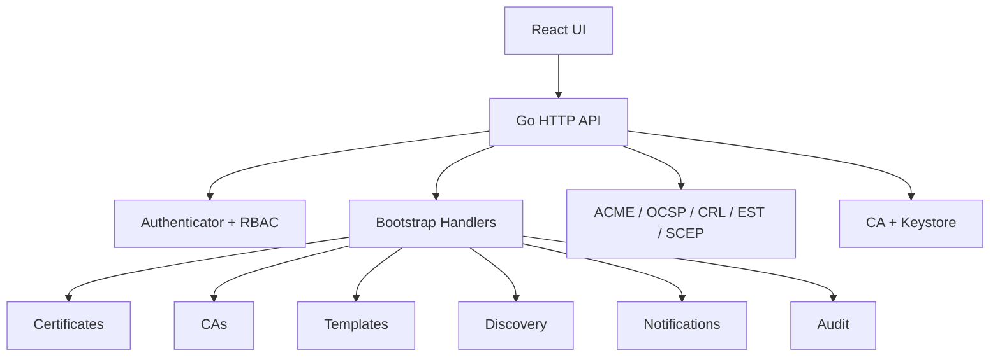
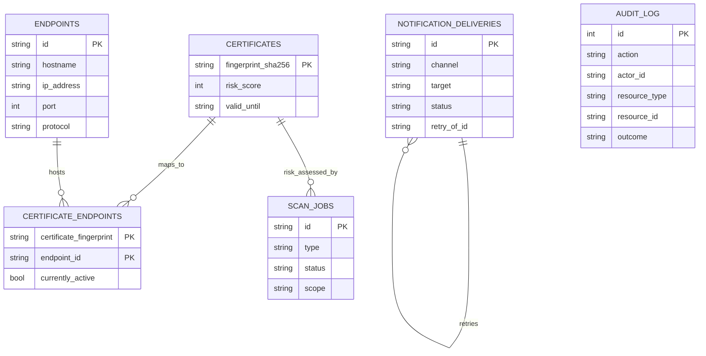

# Component & Data Model Review

## Scope
This review focuses on the current codebase structure, the runtime data model inferred from handlers/providers/tests, and the patterns that shape maintainability.

## High-level architecture
- Single Go binary entrypoint (`cmd/kryptkeeper/main.go`)
- UI is a separate React/Vite app in `ui/`
- Most runtime behavior is wired in `internal/bootstrap/`
- Domain protocol servers live in dedicated packages (`internal/acme`, `internal/ocsp`, `internal/crl`, `internal/est`, `internal/scep`)

## Component structure

### Entry and wiring
- `cmd/kryptkeeper/main.go` assembles providers, protocol muxes, and startup mode.
- `internal/bootstrap/server.go` owns HTTP server lifecycle and graceful shutdown.
- `internal/bootstrap/handlers.go` registers all routes and enforces non-nil dependencies.

### API surface
- `internal/bootstrap/handlers_*.go` implement route groups by concern:
  - auth and API keys
  - certificates and templates
  - CAs and audit
  - discovery, notifications, dashboards
  - protected utility routes

### Domain services
- `internal/ca` and `internal/keystore` manage issuance and key storage.
- `internal/acme`, `internal/ocsp`, `internal/crl`, `internal/est`, `internal/scep` expose protocol endpoints.
- `internal/discovery/scanner` and `internal/notifications/delivery` support automation flows.
- `internal/pqc`, `internal/cipheraudit`, `internal/codesign`, `internal/sshkeys`, `internal/adsync` provide analysis/assessment features.

## Data model (inferred from runtime queries + tests)

### Core tables actually exercised today

| Table | Purpose | Key fields / shape |
|---|---|---|
| `certificates` | Certificate inventory and risk/expiry summary | fingerprint, valid_until, risk_score |
| `endpoints` | Discovered hosts/services | id, hostname, ip_address, port, protocol, timestamps |
| `certificate_endpoints` | Mapping between certificates and endpoints | certificate_fingerprint, endpoint_id, currently_active |
| `scan_jobs` | Discovery job queue/history | id, type, connector, scope, status, error_message, created_at |
| `notification_deliveries` | Delivery queue/history | id, channel, target, status, retry_of_id, queued_at, delivered_at, acknowledged_at |
| `audit_log` | Append-only event history | id, timestamp, action, actor/resource, trace_id, outcome |

### Config/state objects in code
- CA metadata and templates are modeled as provider objects with file-backed defaults.
- Auth state includes principals, roles, access tokens, refresh tokens, and API keys.
- Dashboard action history is derived from `audit_log` records.

### Mermaid ERD (current operational model)

Dashboard action history is currently derived from `audit_log` rows whose action starts with `dashboard.action.`.

## Patterns observed

### 1. Interface-driven providers
Every major domain uses a Go interface (`CertificateProvider`, `DiscoveryProvider`, `NotificationProvider`, `AuditProvider`, etc.) so handlers can depend on contracts instead of concrete stores.

### 2. Fail-closed DB startup
DB-backed providers return an error object when DSN/open/ping fails, then handlers surface the failure rather than panicking mid-request.

### 3. Env-based runtime selection
`APP_*_PROVIDER` and `KRYPTKEEPER_DB_MODE` choose file vs DB vs crypto mode at startup.

### 4. Pagination and bounds enforcement
List endpoints clamp limits to 100 and normalize negative offsets/cursors.

### 5. Audit-first behavior
High-risk mutations emit audit events and often depend on audit history for UI state.

### 6. Default file-backed behavior
Most providers default to file mode, with DB mode optional. This is good for local bootstrapping, but it can hide production misconfiguration if not validated early.

## Robustness findings

### Strengths
- Clear package boundaries
- Good use of interfaces
- Separate protocol engines from HTTP bootstrap
- Many tests already cover DB-backed behavior
- UI and backend both build successfully

### Gaps
- Bootstrap layer is very large and centralizes too much policy
- Several providers repeat the same SQLite/Postgres open/ping boilerplate
- Error handling is sometimes string-matched or generic
- Startup configuration errors are not consistently reported in a structured way
- UI currently exposes summary status more than operational workflows

## Maintainability recommendations
1. Extract a shared DB provider factory to remove repetition.
2. Replace string-matched auth errors with typed errors.
3. Add a structured startup validation report before server bind.
4. Introduce dedicated detail endpoints for list/detail workflows.
5. Add a shared frontend state system for loading/error/empty/loaded views.

## Overall assessment
The architecture is directionally strong for a PKI operations platform, but it is still more “wired together” than “composed.” The biggest improvement opportunity is to separate operational workflows from bootstrap plumbing and turn summary-only UI into task-oriented screens.
