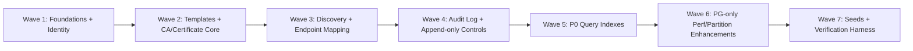
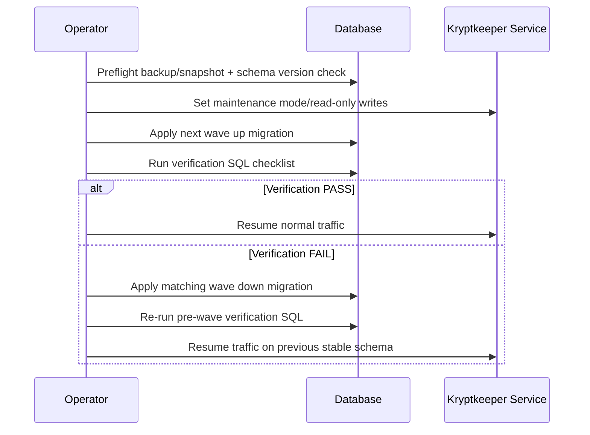

# Kryptkeeper Phase 4 — Migration & Data-Access Implementation Plan

## Summary

This document translates Phase 3 database design into an implementation-ready Phase 4 plan with:
- ordered migration waves (with explicit dependencies and reversible up/down strategy),
- PostgreSQL + SQLite compatibility mitigations,
- index rollout priorities tied directly to API/query patterns,
- CI seed/test data strategy,
- integrity checks and post-migration verification SQL.

Scope inputs:
- `docs/sdlc/phase-3-design/DATABASE.md`
- `docs/sdlc/phase-2-requirements/SRS.md` (FR-010/011/012/013/014/020/030/034/040/044/045/052 and related NFRs)

---

## 1) Ordered Migration Waves with Dependencies (Wave 1..N)

### 1.1 Wave dependency map



### 1.2 Migration waves (implementation-ready)

> Numbering convention follows Phase 3 design: `000001_...` sequential SQL migrations under:
> - `internal/db/migrations/postgres/`
> - `internal/db/migrations/sqlite/`

| Wave | Migration IDs (recommended) | Purpose | Depends On |
|---|---|---|---|
| **Wave 1** | `000001_foundations_identity` | Create `users`, `notification_policies`, `teams`, `team_members`, `api_keys`; core constraints and FK-safe baseline | none |
| **Wave 2** | `000002_templates_ca_certs_core` | Create `certificate_templates`, `certificate_authorities`, `certificates`; resolve circular FK (`certificate_authorities.certificate_fingerprint_sha256` ↔ `certificates.ca_id`) with staged FK adds | Wave 1 |
| **Wave 3** | `000003_discovery_endpoints` | Create `scan_jobs`, `endpoints`, `scan_results`, `certificate_endpoints`; add deferred FK for `endpoints.last_scan_job_id` after both tables exist | Wave 2 |
| **Wave 4** | `000004_audit_log_append_only` | Create `audit_log`; PostgreSQL partitioned parent + initial partitions + append-only controls (policy/trigger-based enforcement) | Wave 1 |
| **Wave 5** | `000005_p0_indexes` | Add hot-path indexes for expiry, risk, lookup, audit range/resource, discovery joins | Waves 2,3,4 |
| **Wave 6** | `000006_pg_perf_extensions` + sqlite equivalent | PG-only optimizations: `pg_trgm`, GIN/trigram search, additional partition bootstrap; SQLite FTS5/json index mitigations | Wave 5 |
| **Wave 7** | `000007_seed_baseline_data` (non-prod gated), test-only seed scripts | Deterministic CI seed set for FR coverage and migration verification | Waves 1-6 |

### 1.3 Per-wave deliverables (up/down contents)

#### Wave 1 — Foundations + Identity
- **Up**:
  - Create `users`, `notification_policies`, `teams`, `team_members`, `api_keys`
  - Add `UNIQUE` and `CHECK` constraints per design
  - Add immediate FK indexes: `team_members.user_id`, `api_keys.user_id`, `teams.notification_policy_id`
- **Down**:
  - Drop in strict reverse dependency order: `api_keys` → `team_members` → `teams` → `notification_policies` → `users`

#### Wave 2 — Templates + CA/Certificate Core
- **Up**:
  - Create `certificate_templates`
  - Create `certificate_authorities` **without** FK to `certificates` initially
  - Create `certificates` with FK to `certificate_authorities`, `certificate_templates`, `teams`, self-referential renewal links
  - Add `ALTER TABLE certificate_authorities ... REFERENCES certificates(fingerprint_sha256)` after both tables exist
  - Add uniqueness/index set including `(serial_number, ca_id)` unique index
- **Down**:
  - Drop late-added FK first
  - Drop dependent indexes
  - Drop `certificates` then `certificate_authorities` then `certificate_templates`

> **Amendment (S-51, migration 000042):** the `certificates.template_id` and
> `certificates.team_id` FKs described above were dropped. Neither
> referenced table is authoritative in a default install: `certificate_templates`
> is file-backed (`APP_TEMPLATE_PROVIDER`), and `team_id` is actually
> populated from the issuing principal's identifier
> (`handlers_certificates.go`'s `authorizeCertificateMutationRequest`), never
> a row in `teams`. Both FKs independently rejected every real issuance, and
> the write failure went unnoticed because the persist error was discarded
> (S-50) — every certificate the API reported as issued vanished on restart.
> On Postgres, 000042 also widens `template_id`/`team_id` from `UUID` to
> `TEXT` — both were UUID-typed from 000002, but real values are never
> UUIDs, so dropping the FK alone still left every real issuance failing with
> SQLSTATE 22P02 (invalid input syntax for type uuid). SQLite's columns were
> already untyped `TEXT`, so only Postgres needed the widening.
> `certificates.ca_id` and the self-referential `predecessor_fingerprint`/
> `successor_fingerprint` FKs are untouched; `certificate_authorities` is
> genuinely authoritative (CAs are only ever created through the app, never
> file-backed). See `000042_certificates_drop_nonauthoritative_fks.{up,down}.sql`.

#### Wave 3 — Discovery + Endpoint Mapping
- **Up**:
  - Create `scan_jobs` first
  - Create `endpoints` without `last_scan_job_id` FK; then create `scan_results`, `certificate_endpoints`
  - Add FK for `endpoints.last_scan_job_id` via `ALTER TABLE`
  - Add indexes for `scan_jobs(status,type,created_at)`, `scan_results(scan_job_id,certificate_fingerprint)`, `certificate_endpoints` joins
- **Down**:
  - Remove FK from `endpoints.last_scan_job_id`
  - Drop `certificate_endpoints` → `scan_results` → `endpoints` → `scan_jobs`

#### Wave 4 — Audit Log + Append-only
- **Up (PostgreSQL)**:
  - Create partitioned `audit_log` parent
  - Create current + next 2 monthly partitions
  - Apply append-only controls (recommended: trigger to reject UPDATE/DELETE, plus role grants)
  - Create partition indexes: `(timestamp DESC)`, `(resource_type, resource_id)`, `(actor_id)`
- **Up (SQLite)**:
  - Create unpartitioned `audit_log`
  - Add application-enforced append-only behavior + optional trigger to block UPDATE/DELETE
- **Down**:
  - Drop controls then partitions then parent (PG)
  - Drop table (SQLite)

#### Wave 5 — P0 indexes
- **Up**: add all P0 indexes in §4 (including composite indexes tied to API patterns)
- **Down**: drop those indexes only (no table drops)

#### Wave 6 — PG/SQLite perf divergence
- **Up (PG)**: `CREATE EXTENSION pg_trgm`; add trigram GIN indexes for inventory search; optional partial indexes for hot dashboards
- **Up (SQLite)**: FTS5 virtual table + triggers (or normalized search cache table) for CN/subject search parity
- **Down**: remove extension-dependent indexes first; drop FTS artifacts in SQLite

#### Wave 7 — Seed + verification harness
- **Up**:
  - Seed minimal baseline tenants/users/templates/CAs/certs/endpoints/scan jobs/audit rows
  - Add CI-only idempotent seed scripts (not production auto-applied)
- **Down**:
  - Delete seeded rows by deterministic IDs/prefixes only

---

## 2) Reversible Migration Strategy (up/down) and Rollback Playbook

### 2.1 Reversibility rules (enforced)

1. Every `*.up.sql` has exact inverse `*.down.sql`.
2. No irreversible DDL in same release (especially column drops/type narrowing).
3. FK additions that close cycles are isolated in same wave but separate statements for deterministic rollback.
4. Seed migrations are deterministic and delete-by-key in down scripts.
5. CI gate: `up -> verify -> down -> verify clean` for both PostgreSQL and SQLite.

### 2.2 Rollback runbook (release-time)



### 2.3 Rollback decision matrix

| Failure point | Action | Max rollback scope |
|---|---|---|
| DDL failure during wave | automatic transaction rollback (if supported) | current migration file |
| Post-DDL verification failure | execute paired `down` for same wave | current wave |
| Cross-wave regression after multiple waves | rollback in reverse order (Wn…W1) until checks pass | full release |
| Data corruption suspicion | restore DB snapshot, then re-run from last known good tag | full environment |

### 2.4 Operational rollback checklist

- [ ] Snapshot/backup completed and restore tested
- [ ] Current migration version captured
- [ ] App write paths paused (or maintenance mode)
- [ ] Target wave up applied
- [ ] Post-wave verification SQL passed
- [ ] If fail: paired down applied and baseline verification re-run
- [ ] Release notes updated with version + evidence links

---

## 3) PostgreSQL vs SQLite Compatibility Concerns + Mitigations

| Concern | PostgreSQL plan | SQLite plan | Mitigation detail |
|---|---|---|---|
| UUID PKs | native `UUID` + `gen_random_uuid()` | `TEXT` UUID generated by app | Repository layer owns UUID generation for SQLite parity |
| `TIMESTAMPTZ` | native timezone-safe | `TEXT` ISO-8601 UTC | Store UTC only; parse/format in data access layer |
| `INET` in `endpoints.ip_address` | native `INET` | `TEXT` | Validate IP format in app before write |
| Arrays (`TEXT[]`) | native arrays + GIN | JSON text arrays | For SQLite queries, use `json_each`/`json_extract` helper views |
| `JSONB` | native JSONB operators/indexing | JSON text | Introduce adapter methods for filter extraction |
| `INTERVAL` | native interval fields | integer seconds | Normalize at DAL boundary (`duration_seconds`) |
| Partitioned audit log | monthly partitions | single table | enforce time-window queries + periodic archival job |
| Trigram/GIN search | `pg_trgm` + GIN | FTS5 (or LIKE fallback) | Provide capability flag in repository for search strategy |
| Append-only audit control | DB-level trigger/policies | trigger + app enforcement | tests must assert UPDATE/DELETE rejection in both engines |
| RLS behavior | available | unavailable | enforce access in app service layer; integration tests validate role filtering |

**Implementation requirement:** maintain two migration tracks (`postgres/`, `sqlite/`) with identical logical schema semantics, even when physical types differ.

---

## 4) Index Priority List (P0/P1/P2) Aligned to API Queries

### 4.1 P0 — required before production traffic

| Priority | Query / API pattern | FR mapping | Index |
|---|---|---|---|
| P0 | Expiry dashboard: certificates expiring in N days ordered by `valid_until` | FR-013, FR-080 | `certificates(valid_until)` (`idx_cert_valid_until`) |
| P0 | Certificate by fingerprint | FR-010/011/012 | PK on `certificates(fingerprint_sha256)` |
| P0 | Duplicate serial guard in issuance per CA | FR-005/010 | `UNIQUE (serial_number, ca_id)` (`idx_cert_serial_ca`) |
| P0 | Risk leaderboard (`risk_score > x ORDER BY risk_score DESC`) | FR-013, dashboard FRs | `certificates(risk_score DESC)` |
| P0 | Revocation/status filters | FR-012/040 | `certificates(renewal_status)` + optional `(revoked_at)` |
| P0 | Endpoint-to-certificate active join | FR-061/062 inventory | `certificate_endpoints(certificate_fingerprint)`, `(endpoint_id)`, `(currently_active)` |
| P0 | Scan operational views (`status`, recency) | FR-060+ discovery set | `scan_jobs(status)`, `scan_jobs(created_at DESC)` |
| P0 | Audit timeline and resource drilldown | C-Sec02, FR-045 auth/audit | `audit_log(timestamp DESC)`, `audit_log(resource_type, resource_id)` |

### 4.2 P1 — add before scale testing

| Priority | Query / API pattern | Index |
|---|---|---|
| P1 | SAN exact match search | `GIN(subject_alt_names)` (PG) / JSON search helper (SQLite) |
| P1 | Risk flag contains (`EXPIRED`, `WEAK_KEY`) | `GIN(risk_flags)` (PG) / JSON helper index strategy (SQLite) |
| P1 | Team ownership dashboards | `certificates(team_id)` |
| P1 | CA tree traversal | `certificate_authorities(parent_ca_id)` |
| P1 | Template admin filters | `certificate_templates(active)`, `(oid)` |
| P1 | API key auth lookup | `api_keys(key_hash)` |

### 4.3 P2 — optimization after telemetry confirms need

| Priority | Query / API pattern | Index |
|---|---|---|
| P2 | Inventory fuzzy search CN/subject | `pg_trgm` GIN (`common_name`, `subject_dn`) / SQLite FTS5 |
| P2 | Partial index for high-risk slice | e.g., `certificates(risk_score DESC) WHERE risk_score > 40` (PG) |
| P2 | Composite endpoint access path | `(hostname, port)` or `(ip_address, port, sni_name)` depending on trace data |

---

## 5) Seed/Test Data Strategy for CI

### 5.1 Dataset tiers

1. **Smoke dataset (fast, <2s load):** validates schema/FKs.
2. **Functional dataset (FR coverage):** covers issuance, renewal, revocation, expiry, discovery, alert ownership.
3. **Scale-lite dataset (~50k certificates):** validates query plans/index use in CI nightly.

### 5.2 Deterministic seed principles

- Fixed UUIDs/fingerprints prefixes for deterministic assertions.
- Stable timestamps relative to a fixed anchor (`2026-01-01T00:00:00Z`) for expiry tests.
- Include edge-case rows:
  - expired cert,
  - cert expiring in 7/30/90-day windows,
  - renewal chain length >= 4,
  - revoked and certificateHold states,
  - duplicate SAN across multiple certs,
  - one endpoint with SNI variants,
  - orphan-attempt rows (expected to fail insert).

### 5.3 CI execution flow

1. Provision DB (PG and SQLite jobs).
2. Run all migrations up.
3. Load smoke + functional seeds.
4. Execute integration tests for FR-critical flows.
5. Run verification SQL suite (Section 6).
6. Run migrations down to zero.
7. Assert schema clean.

### 5.4 Seed isolation policy

- Seed scripts are **test-only** (never auto-run in production startup).
- Every seed row must carry deterministic marker (`created_by='ci-seed'` in metadata where available, or UUID namespace).
- Down-seed deletes by marker/ID only; never broad deletes.

---

## 6) Data Integrity Checks and Post-Migration Verification SQL

Run after each wave and before release cut.

### 6.1 Structural checks (tables, constraints, indexes)

```sql
-- filename: docs/DATABASE.md
-- PostgreSQL: confirm critical tables exist
SELECT tablename
FROM pg_tables
WHERE schemaname = 'public'
  AND tablename IN (
    'users','teams','team_members','api_keys','notification_policies','notification_channels',
    'certificate_templates','certificate_authorities','certificates',
    'scan_jobs','scan_results','endpoints','certificate_endpoints','audit_log'
  )
ORDER BY tablename;
```

```sql
-- filename: docs/DATABASE.md
-- PostgreSQL: confirm critical indexes exist
SELECT indexname, tablename
FROM pg_indexes
WHERE schemaname = 'public'
  AND indexname IN (
    'idx_cert_valid_until','idx_cert_risk_score','idx_cert_serial_ca','idx_cert_sans','idx_cert_risk_flags',
    'idx_ce_cert','idx_ce_endpoint','idx_scan_status','idx_scan_created'
  )
ORDER BY indexname;
```

### 6.2 Referential integrity checks (should all be zero)

> **Removed (S-51):** this section used to include an "Orphan certificate ->
> team" check (`certificates.team_id` vs `teams.id`). Gone as of migration
> 000042: `team_id` holds the issuing principal's identifier, not a `teams`
> row, so a non-zero count is expected in a default install, not a sign of
> corruption -- keeping the check here would misdirect exactly the
> release-verification checklist this section exists for. The same applies
> to `template_id` vs `certificate_templates.id`, which this section never
> had a check for.

```sql
-- filename: docs/DATABASE.md
-- Orphan certificate -> CA
SELECT COUNT(*) AS orphan_cert_ca
FROM certificates c
LEFT JOIN certificate_authorities ca ON ca.id = c.ca_id
WHERE c.ca_id IS NOT NULL AND ca.id IS NULL;
```

```sql
-- filename: docs/DATABASE.md
-- Orphan certificate_endpoints rows
SELECT COUNT(*) AS orphan_ce_cert
FROM certificate_endpoints ce
LEFT JOIN certificates c ON c.fingerprint_sha256 = ce.certificate_fingerprint
WHERE c.fingerprint_sha256 IS NULL;
```

```sql
-- filename: docs/DATABASE.md
SELECT COUNT(*) AS orphan_ce_endpoint
FROM certificate_endpoints ce
LEFT JOIN endpoints e ON e.id = ce.endpoint_id
WHERE e.id IS NULL;
```

### 6.3 Business-rule checks (FR-aligned)

```sql
-- filename: docs/DATABASE.md
-- Serial uniqueness per CA must hold (expect zero rows)
SELECT serial_number, ca_id, COUNT(*)
FROM certificates
GROUP BY serial_number, ca_id
HAVING COUNT(*) > 1;
```

```sql
-- filename: docs/DATABASE.md
-- Risk score must be within 0..100 (expect zero rows)
SELECT COUNT(*) AS out_of_range_risk
FROM certificates
WHERE risk_score < 0 OR risk_score > 100;
```

```sql
-- filename: docs/DATABASE.md
-- Renewal chain referential sanity (expect zero rows)
SELECT COUNT(*) AS broken_predecessor_links
FROM certificates c
LEFT JOIN certificates p ON p.fingerprint_sha256 = c.predecessor_fingerprint
WHERE c.predecessor_fingerprint IS NOT NULL AND p.fingerprint_sha256 IS NULL;
```

### 6.4 Query-plan verification (index usage)

```sql
-- filename: docs/DATABASE.md
EXPLAIN ANALYZE
SELECT fingerprint_sha256, valid_until
FROM certificates
WHERE valid_until < NOW() + INTERVAL '30 days'
ORDER BY valid_until ASC
LIMIT 100;
```

```sql
-- filename: docs/DATABASE.md
EXPLAIN ANALYZE
SELECT fingerprint_sha256, risk_score
FROM certificates
WHERE risk_score > 40
ORDER BY risk_score DESC
LIMIT 50;
```

```sql
-- filename: docs/DATABASE.md
EXPLAIN ANALYZE
SELECT e.id
FROM endpoints e
JOIN certificate_endpoints ce ON ce.endpoint_id = e.id
WHERE ce.certificate_fingerprint = $1
  AND ce.currently_active = TRUE;
```

### 6.5 Append-only audit enforcement checks

```sql
-- filename: docs/DATABASE.md
-- Should succeed
INSERT INTO audit_log(action, actor_type, actor_id, resource_type, resource_id, details)
VALUES ('test.insert', 'system', 'system', 'migration', 'verify', '{}'::jsonb);
```

```sql
-- filename: docs/DATABASE.md
-- Should fail (append-only)
UPDATE audit_log
SET action = 'test.update'
WHERE action = 'test.insert';
```

```sql
-- filename: docs/DATABASE.md
-- Should fail (append-only)
DELETE FROM audit_log
WHERE action = 'test.insert';
```

### 6.6 Release verification checklist

- [ ] All expected tables/columns/constraints present
- [ ] All P0 indexes present
- [ ] Referential integrity orphan counts are zero
- [ ] FR business-rule checks pass
- [ ] `EXPLAIN ANALYZE` confirms index scans on hot paths
- [ ] Append-only audit controls reject UPDATE/DELETE
- [ ] Up/down migration cycle passes in CI on PostgreSQL and SQLite

---

## 7) Confidence Scores (Reasoning Loop)

| Subtask | Confidence (1-10) | Notes |
|---|---:|---|
| [1] Ordered migration waves with dependencies | 9 | Derived directly from FK graph and Phase 3 table definitions |
| [2] Reversible migration + rollback playbook | 9 | Includes operational gates and deterministic rollback scope |
| [3] PostgreSQL vs SQLite compatibility plan | 9 | Mapped type/index/feature differences to DAL + migration mitigations |
| [4] Index priority aligned to API/query patterns | 8 | Aligned to SRS FRs and Phase 3 access patterns; telemetry can refine P2 |
| [5] Seed/test data strategy for CI | 8 | Concrete dataset tiers and execution sequence |
| [6] Integrity + verification SQL checklist | 9 | Includes structural, referential, rule, and plan-level checks |

All subtasks are at confidence **>= 7**.
