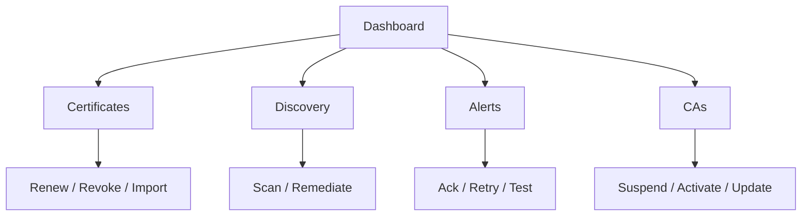

# Feature Context

## Feature
Make Kryptkeeper useful for enterprise and standard business users to manage inventory and automate PKI/crypto operations.

## Why it matters
Organizations need a single place to see certificate inventory, endpoint risk, CA posture, and notification/scan automation so they can reduce manual work and avoid outages or compliance drift.

## Users
- **PKI admins**: manage certificates, CAs, templates, renewals, revocations.
- **Security ops**: monitor risk, discovery, and alert failures.
- **App/service owners**: find their inventory and act on expiring assets.
- **Auditors/compliance**: verify who did what and when.

## Success criteria
- Users can identify urgent work quickly.
- Users can drill from summary to detail to action.
- Users can search and filter inventory at org scale.
- Users can automate routine PKI/crypto work.
- Users can prove actions through audit/history.

## Existing UX direction already confirmed
- `docs/design/UX_SPEC.md`
- `docs/UX_BACKLOG.md`
- `docs/FULL_IMPROVEMENT_PLAN.md`

## Current product shape
Kryptkeeper already exposes:
- certificate inventory
- CAs
- discovery
- notifications
- dashboards
- auth and audit
- protocol status

## Constraints
- Keep the current Go + React architecture.
- Prefer additive changes over breaking API changes.
- Preserve auditability and access control.
- Keep file-backed fallback behavior where it helps local/dev use.

## Risks
- UX improvements can outpace backend support.
- Bootstrap complexity can slow feature delivery.
- Large-data inventory views need strong filtering/pagination.

## Recommended feature shape
The feature should be implemented as a set of connected workflows:
1. Triage on the dashboard
2. Drill into inventory lists
3. Open detail views
4. Take actions
5. Record everything in audit/history
