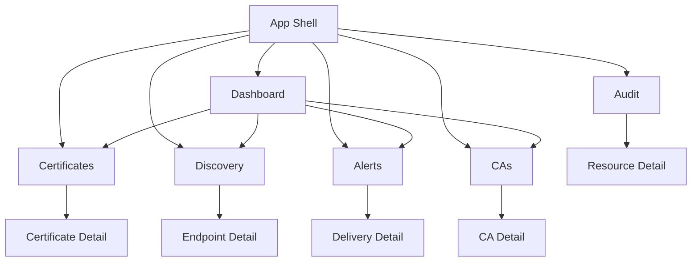

# Feature UI Specification

## Goal
Improve Kryptkeeper's UI so small PKI teams can manage inventory and automate routine PKI/crypto operations without leaving the product.

## Product shape
The app should become a workflow-driven operations console with a risk-first dashboard and deep drill-down pages for core inventory objects.

## Current state vs target state

| Area | Current | Target |
|---|---|---|
| Dashboard | summary cards only | action-first triage with ranked next steps |
| Certificates | basic table | searchable/filterable inventory + detail/action page |
| Discovery | summary + table | inventory management + endpoint detail + scan workflow |
| Alerts | summary only | delivery center with retry/ack/test flows |
| CAs | simple cards | CA detail + status + actions |
| Audit | backend only | visible history/evidence surfaces |

## Screen-by-screen design

### 1) Dashboard
Purpose: answer “what needs attention now?”

Required UI:
- risk command rail
- urgent items sorted by severity
- summary metrics that link to filtered lists
- action buttons for review, renew, revoke, acknowledge, retry
- loading/empty/error states

Behavior:
- clicking a metric opens the relevant filtered page
- urgent items are prioritized by expiry, failure, and risk
- actions should never be passive labels only

### 2) Certificates
Purpose: manage inventory at scale.

Required UI:
- search box
- filters: CA, team, status, expiry, risk, grade
- sortable table
- pagination
- row click or detail button
- bulk selection placeholder for later phase

Detail page:
- subject / issuer / chain
- ownership and environment
- risk and renewal state
- certificate history
- action panel: renew / revoke / import

### 3) Discovery
Purpose: identify risky or unknown infrastructure.

Required UI:
- endpoint table with filters by protocol and risk
- summary cards for discovered, mapped, risky, active scan jobs
- detail view for endpoint history and certificate mappings
- scan queue management

### 4) Alerts / Notifications
Purpose: make automation visible and actionable.

Required UI:
- pending deliveries
- escalations
- recent failures
- delivery list with status and channel
- retry / acknowledge / test actions

### 5) CAs
Purpose: manage the trust backbone.

Required UI:
- CA list with status and storage type
- detail page with trust posture, issuance impact, and lifecycle state
- suspend / activate / update actions

### 6) Audit / History
Purpose: prove what happened.

Required UI:
- timeline or table of actions
- filters by actor, resource, status, category
- drill-down to resource from history entry

## Component patterns to build
- AppShell
- RiskCommandRail
- FilterToolbar
- DataTable
- DetailPanel
- StatusBadge
- ActionDialog
- EmptyState
- ErrorState
- LoadingSkeleton

## Navigation structure

## UX rules
- Prefer task-based labels over technical labels.
- Always show the next useful action.
- Use dense layouts without feeling cramped.
- Explain risk in plain language.
- Make error states actionable.
- Use progressive disclosure for deep crypto detail.

## Accessibility requirements
- Keyboard operable everywhere
- Visible focus states
- No color-only meaning
- Proper table semantics
- Accessible dialogs and forms
- AA contrast minimum

## Acceptance criteria
- User can go from dashboard to action in 1–2 clicks.
- User can find any certificate using search and filters.
- User can inspect detail before acting.
- User can see delivery/scan state without going to logs.
- User can understand trust posture from the CA screen.
