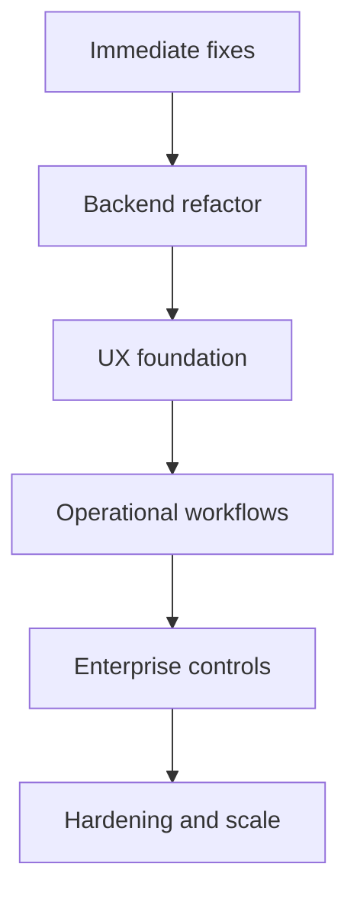

# Full Improvement Plan

## Objective
Turn Kryptkeeper into a reliable enterprise PKI and crypto operations platform: easy to understand, safe to operate, and strong enough for large organizations managing certificates, CAs, discovery, and notifications at scale.

## What we found

### Strengths
- Backend is already modular and testable.
- Core auth, audit, and DB-backed flows exist.
- UI exists and builds successfully.
- The product already exposes the right domains: certs, discovery, alerts, CAs, protocols.

### Main gaps
- Bootstrap/wiring is too central and repetitive.
- UI is mostly a status console, not a workflow tool.
- Error feedback is too generic.
- List/detail/action flows are incomplete.
- Enterprise UX needs prioritization, drill-down, bulk actions, and audit proof.

## Plan overview

1. **Immediate fixes** — reduce fragility and unblock safer iteration.
2. **Backend refactor** — simplify provider wiring and error handling.
3. **UX foundation** — make the UI task-oriented.
4. **Operational workflows** — add detail pages and action flows.
5. **Enterprise controls** — bulk actions, role-based views, audit exports.
6. **Hardening and scale** — observability, performance, accessibility, and consistency.

## Phase 1 — Immediate fixes (1-2 weeks)

### Goals
- Make the system safer to change.
- Reduce duplicate wiring.
- Improve error clarity.

### Work items
1. Extract a shared DB provider factory for SQLite/Postgres open/ping/config.
2. Replace string-matched auth/domain errors with typed errors.
3. Add a structured startup validation report.
4. Standardize handler error responses.
5. Add/expand tests around startup and failure paths.

### Success criteria
- Fewer duplicated provider blocks.
- Startup failures are obvious and actionable.
- Errors map cleanly to user-facing messages.

## Phase 2 — Backend refactor (1-3 weeks)

### Goals
- Move from “wired together” to “composed.”
- Make modules easier to add without touching bootstrap everywhere.

### Work items
1. Split bootstrap into smaller modules by domain.
2. Create a shared query/filter helper for list endpoints.
3. Add shared pagination, validation, and authorization helpers.
4. Separate route registration from provider initialization.
5. Introduce a consistent detail endpoint pattern.

### Success criteria
- Bootstrap file shrinks and becomes orchestration-only.
- New routes can be added without copying existing patterns.
- List/detail endpoints behave consistently across domains.

## Phase 3 — UX foundation (1-2 weeks)

### Goals
- Convert the UI into an action-oriented operations console.

### Work items
1. Add a persistent risk command rail on the dashboard.
2. Make all summary cards clickable into filtered lists.
3. Add consistent loading/error/empty states.
4. Add shared table toolbar: search, filters, sort, pagination.
5. Add detail page skeletons for certificates, discovery, alerts, and CAs.

### Success criteria
- Users can answer “what’s urgent?” in under 10 seconds.
- Users can drill from overview to action in 1–2 clicks.
- The UI feels like a work queue, not a reporting page.

## Phase 4 — Operational workflows (2-4 weeks)

### Goals
- Support the actual daily work of PKI teams.

### Work items
1. Certificate detail page with chain, risk, owner, lifecycle, history.
2. Renew / revoke / import flows with confirmation.
3. Discovery detail page with endpoint history and mappings.
4. Scan job management and remediation queue.
5. Alerts center with acknowledge/retry/test flows.
6. CA detail page with status, storage, issuance posture.

### Success criteria
- PKI admins can do real work in the product.
- Security ops can move from alert to remediation.
- Auditors can inspect what happened and when.

## Phase 5 — Enterprise controls (2-3 weeks)

### Goals
- Make the platform viable for larger organizations.

### Work items
1. Role-based navigation and action visibility.
2. Bulk operations for certs, endpoints, and alerts.
3. Audit evidence views and export.
4. Ownership and escalation views.
5. Global search across certificates, endpoints, and delivery records.

### Success criteria
- Large fleets can be operated without one-by-one work.
- Users see only the actions relevant to their role.
- Compliance review becomes self-service.

## Phase 6 — Hardening and scale (ongoing)

### Goals
- Ensure the product stays fast, accessible, and diagnosable.

### Work items
1. Add observability around auth, scan jobs, delivery retries, and CA actions.
2. Tighten performance for list/detail endpoints.
3. Add accessibility audits and keyboard flow checks.
4. Add rate limits and abuse checks where needed.
5. Expand regression tests for all critical workflows.

### Success criteria
- Faster troubleshooting.
- Stable user experience at larger data volumes.
- No major accessibility regressions.

## Suggested execution order

### Wave A — stabilize the core
- Shared DB factory
- Typed errors
- Startup validation
- Test coverage for failures

### Wave B — make it useful
- Dashboard triage
- Certificates list/filter/detail
- Discovery list/filter/detail
- Alerts center

### Wave C — make it operational
- Renew/revoke/import
- Scan management
- CA detail
- History and audit trails

### Wave D — make it enterprise-ready
- Bulk actions
- Role-based views
- Audit export
- Global search

### Wave E — make it durable
- Monitoring
- Performance tuning
- Accessibility hardening
- Regression automation

## Recommended backend changes
- Add detail endpoints for certificates, endpoints, scan jobs, deliveries, and CAs.
- Add mutation endpoints for renew, revoke, import, acknowledge, retry, and scan queueing.
- Normalize pagination/filtering across list endpoints.
- Use typed errors and consistent HTTP status mapping.
- Centralize DB provider initialization and DSN parsing.

## Recommended UI changes
- Build a reusable filtered-table page template.
- Add a detail drawer or detail route for every core entity.
- Add a universal action confirmation dialog.
- Add consistent empty, loading, retry, and permission-denied states.
- Add a risk-first dashboard with ranked next actions.

## Risks and mitigations

| Risk | Mitigation |
|---|---|
| Repeated bootstrap wiring | Shared factory + smaller modules |
| Adding UI before APIs exist | Ship backend contracts first |
| UX sprawl | Use one task-oriented screen pattern |
| Enterprise complexity | Add role-based navigation and progressive disclosure |
| Regression risk | Expand tests with every workflow |

## Metrics to track
- Time to identify urgent work
- Time to renew/revoke a cert
- Number of clicks from dashboard to action
- Failed notification recovery rate
- Discovery-to-remediation cycle time
- Test coverage for critical paths

## Definition of done
The platform is “robust” when an organization can:
- see what needs attention,
- understand why it matters,
- take action quickly,
- prove what happened later,
- and do it safely at scale.

## Bottom line
Do not just polish the dashboard. Rebuild the product around operational flows: identify, prioritize, inspect, act, and audit.
