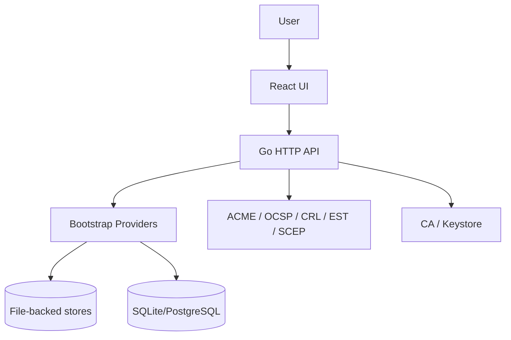

# Landscape

## Tech Stack
- Backend: Go 1.25
- HTTP server: `net/http`
- Persistence: `database/sql` with SQLite and PostgreSQL drivers
- Crypto/protocols: ACME, OCSP, CRL, EST, SCEP
- Frontend: React 19 + TypeScript + Vite

## Project Metrics
- Go packages: multiple internal modules under `internal/`
- Primary binary: `cmd/kryptkeeper/main.go`
- UI build: passes (`npm --prefix ui run build`)
- Backend tests: pass (`go test ./...`)

## Directory Structure
- `cmd/kryptkeeper/` — app entry point
- `internal/bootstrap/` — wiring, handlers, providers, auth, server startup
- `internal/acme|ocsp|crl|est|scep/` — protocol servers
- `internal/ca|keystore/` — CA and key management
- `internal/discovery|notifications|sshkeys|pqc|cipheraudit|codesign/` — domain features and analysis
- `ui/` — React dashboard
- `docs/` — design and operational docs

## UI Detection
UI-bearing: YES
- Evidence: `ui/package.json` depends on `react`, `react-dom`, `react-router-dom`
- Evidence: `ui/src/` contains a Vite React app

## What the system appears to do
Kryptkeeper is a certificate lifecycle and crypto operations platform with a dashboard,
auth-protected API, and protocol endpoints for PKI workflows.

## Current strengths
- Clear feature-oriented package layout inside `internal/`
- Good separation between protocol servers and dashboard/API concerns
- Existing tests cover many core packages
- UI and backend both build successfully

## Robustness opportunities
- Centralize provider initialization to reduce bootstrap complexity
- Replace panic-based wiring failures with explicit startup validation
- Standardize DB access patterns across file/DB providers
- Tighten error typing so handlers can return consistent API errors
- Add startup/health checks for external dependencies and provider modes
- Expand observability around auth, protocol handlers, and background jobs

## Recent activity
- Recent commits focus on CA-backed issuance, protocol server wiring, scanner/delivery providers, and smoke fixes for crypto mode.
- That suggests the system is in active feature expansion and needs hardening around launch paths.
