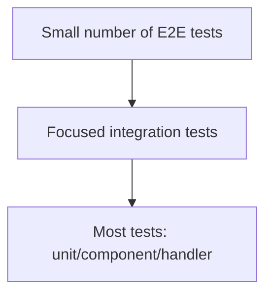

# Test Strategy

## Summary
Kryptkeeper already has strong backend coverage for core PKI/crypto domains and a successful UI build, but it lacks dedicated frontend test tooling. The best strategy is to protect the high-risk flows first: authentication, inventory discovery, certificate lifecycle actions, CA changes, notification delivery, and audit history.

## What we verified
- `go test ./...` passes
- `npm --prefix ui run build` passes
- `npm --prefix ui test` passes
- Backend tests already exist across bootstrap, CA, discovery, notifications, ACME/OCSP/EST/SCEP, and keystore code
- UI now has a configured Vitest + React Testing Library setup in `package.json`

## Current test shape

### Backend
Observed patterns:
- table-driven or scenario-based tests in `internal/bootstrap/*_test.go`
- SQLite fixtures for provider behavior
- auth and response envelope tests
- direct handler and provider tests for critical flows

### UI
Observed patterns:
- no test framework configured yet
- current validation is build/lint only

## Risk-based priorities

### Must test first
1. Authentication and authorization
2. Certificate inventory list/detail/action flows
3. Discovery and scan workflows
4. Notification delivery retry/ack/test workflows
5. CA state changes
6. Audit/history visibility

### Important but secondary
- Dashboard summary rendering and empty/error states
- Global filters, sorting, pagination
- Role-based navigation/action visibility
- Accessibility and keyboard navigation

## Test pyramid for this feature

### Target mix
- **70% unit/component tests**
- **20% integration tests**
- **10% E2E tests**

## Recommended frameworks

### Backend
- Go `testing`
- `httptest`
- SQLite fixtures for provider/integration behavior
- **Gated live-hardware tests**, established by W18-06 (2026-09-10): a test
  file targeting real, reachable-but-not-always-present hardware (e.g.
  `internal/agentdiscovery/live_winrm_test.go` against a live Windows host)
  is skipped by default and opts in via an env var (`KK_LIVE_WINRM=1`,
  mirroring `KRYPTKEEPER_TEST_POSTGRES_DSN` for live Postgres). Use this
  pattern for anything that needs a real external system rather than a fake
  — never let such a test run unconditionally in the default `go test ./...`
  gate.

### Frontend
- Add **Vitest** for component and state tests
- Add **React Testing Library** for user-facing component behavior
- Add **Playwright** for end-to-end flows

## Test scope by area

### 1) Dashboard
Tests to add:
- summary renders with real counts
- loading and error states
- urgent actions appear when risk thresholds are exceeded
- clicking summary cards navigates to the correct filtered view

### 2) Certificates
Tests to add:
- list loads and renders rows
- filters affect query parameters and results
- empty state when no certificates match
- detail page renders certificate identity, chain, and history
- renew/revoke/import actions validate inputs and update state

### 3) Discovery
Tests to add:
- discovered endpoint summary renders correctly
- protocol/risk filters work
- scan job list shows queued/running/failed states
- endpoint detail shows mappings and history

### 4) Alerts / Notifications
Tests to add:
- summary shows pending, escalations, and failures
- delivery list filters by status/channel
- retry/ack/test actions succeed and show updated state
- invalid channels/statuses are rejected

### 5) CAs
Tests to add:
- list shows CA state and storage type
- detail page shows trust posture and lifecycle state
- activate/suspend/update flows are authorized and validated

### 6) Audit / History
Tests to add:
- audit list filtering and pagination
- resource history visibility from downstream pages
- action events are recorded on success/failure/denial

## Backend test strategy

### Unit tests
Use for:
- error mapping
- limit/offset parsing
- authorization checks
- response envelope formatting
- risk ranking or triage heuristics

### Integration tests
Use for:
- SQLite-backed provider behavior
- end-to-end request → handler → provider → response
- state transitions for certs, discovery jobs, notification deliveries, and CA actions

### E2E tests
Use for:
- login/auth flow if UI auth is enabled
- dashboard triage
- certificate search + detail + action
- discovery to remediation workflow
- notification retry/ack flow

## Frontend test strategy

### Component tests
Add tests for:
- dashboard cards/rail
- certificates table and filter toolbar
- discovery endpoint list
- alerts center
- CA cards/detail layout
- shared loading/error/empty states

### E2E tests
Keep to a small set of critical workflows:
1. user opens dashboard and reaches urgent inventory
2. user filters certificates and opens a detail page
3. user opens discovery and reviews risky endpoint information
4. user reviews alerts and retries a delivery
5. user opens CA details and sees status controls

## Data strategy

### Small-team v1
- small fixture datasets
- deterministic timestamps
- a few representative certificates, endpoints, deliveries, and audit rows

### Larger-inventory simulation
- seeded fixtures with 100s of records
- pagination and filtering edge cases
- long lists and boundary values

### Time-dependent data
- freeze time in tests where expiry/status matters
- assert relative behavior instead of fragile exact timestamps where possible

## Coverage targets
- Auth/authorization: high confidence, near-complete coverage of branches
- Inventory lists/actions: cover all success, denial, invalid-input, and not-found paths
- UI critical screens: each screen should have loading, empty, error, and success coverage
- E2E: one test per critical workflow, not every branch

## Accessibility and regression
- Add keyboard and focus tests for new UI primitives
- Verify dialog behavior and visible focus
- Ensure table semantics and accessible labels
- Add a small regression suite for filter/search/action flows

## Gaps in current setup
- No Playwright project config found yet
- UI API models are still loosely typed in several pages
- Search is still client-side fanout rather than server-side lookup

## Recommended next steps
1. Add Vitest + React Testing Library to `ui/`
2. Add Playwright for a small E2E suite
3. Add backend tests for the new v1 UI flows before implementing UI changes
4. Build one test file per critical workflow area

## Definition of done
The test strategy is complete when every critical PKI/crypto workflow has at least one meaningful test at the right level, and the UI has dedicated component/E2E coverage for the new usability improvements.
