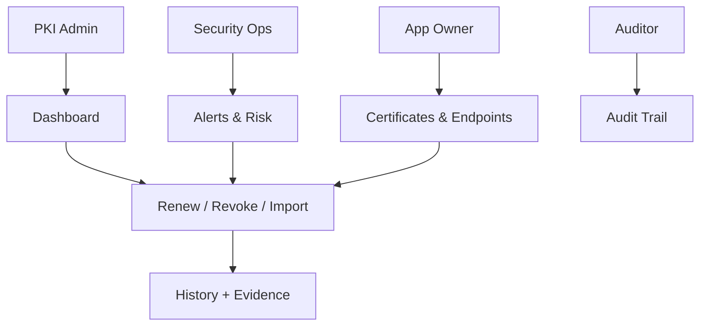

# UX Improvement Plan

## Goal
Turn Kryptkeeper from a status dashboard into an operational platform for PKI and crypto infrastructure teams.

## Primary users

### 1. PKI Admin
- Manages CAs, templates, issuance, revocation, and renewal.
- Needs fast access to risky assets and bulk operations.

### 2. Security Operations
- Watches posture, alerts, and compliance drift.
- Needs prioritization, escalation, and audit trails.

### 3. App/Service Owner
- Owns a set of certificates or endpoints.
- Needs simple ownership, expiry visibility, and guided renewal.

### 4. Auditor / Compliance
- Reviews evidence and control history.
- Needs immutable history, filters, exports, and clear status.

## Core jobs to support
- Find what is expiring soon
- Identify risky or noncompliant endpoints
- Renew/revoke/import certificates
- Track discovery and notification automation
- Prove what happened and who approved it

## Priority 1 — make the UI operational

1. **Action-first dashboard**
   - Surface expiring certs, risky endpoints, failed notifications, and scan backlog.
   - Add clear CTAs: review, renew, revoke, acknowledge, retry.

2. **Drill-down flows**
   - Every metric should link to a filtered list.
   - Every row should open a detail view with history, dependencies, and actions.

3. **Search, filters, and sorting**
   - By CA, team, environment, expiry, risk, protocol, and status.
   - Essential for org-scale PKI inventory.

4. **Bulk operations**
   - Bulk renew, export, acknowledge, and requeue.
   - Prevents one-by-one work for large fleets.

5. **Status + provenance**
   - Show last scan, last delivery, ownership, and confidence.
   - Make automation visible and auditable.

## Priority 2 — make it safe and understandable

1. **Role-based navigation**
   - Hide irrelevant actions for auditors and app owners.

2. **Progressive disclosure**
   - Keep summary views simple; reveal crypto detail only on demand.

3. **Human-readable risk explanations**
   - Explain why a certificate or endpoint is risky.
   - Show recommended next action.

4. **Clear empty/error states**
   - Tell users what to do next when there is no data or a fetch fails.

## Priority 3 — automation support

1. **Workflow queue**
   - Pending renewals, reissues, approvals, and scan jobs.

2. **Approvals and handoffs**
   - Add approve/reject for sensitive actions.

3. **Notifications center**
   - Delivery status, retries, ownership escalation, and acknowledgement.

4. **Audit evidence export**
   - Filtered export for compliance reviews.

## Recommended UX roadmap

### Phase A — quick wins
- Improve empty/loading/error states
- Add drill-down from dashboard cards
- Add search and filters to Certificates and Discovery
- Add consistent action buttons on lists

### Phase B — operational workflows
- Certificate detail page
- Renew/revoke/import flows
- Notification delivery center
- Discovery scan management

### Phase C — enterprise controls
- Role-based views
- Approvals
- Bulk actions
- Audit export and evidence packs

## UX risks today
- Too much information is passive; too little is actionable.
- Users may not know which task is most urgent.
- Large organizations will outgrow the current flat lists quickly.
- Errors are generic, so troubleshooting will be slow.

## What success looks like
- A user can answer: “What is most urgent?” in under 10 seconds.
- A PKI admin can renew or revoke a cert in a few clicks.
- An auditor can prove activity without asking engineering.
- A security team can see automation health at a glance.

## Next recommended step
Create a screen-by-screen UX spec for:
- Dashboard
- Certificates list/detail
- Discovery list/detail
- Alerts/notifications center
- CA management

Then map those into the backend endpoints that support each workflow.
