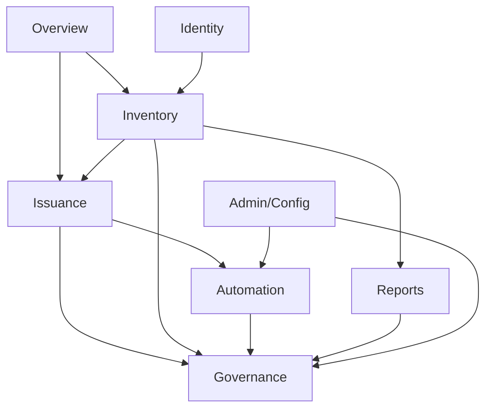

# Information Architecture

Page-complete IA reference for Kryptkeeper's UI: every routed page, its
grouping, and its route. `UX_SPEC.md` holds tasks, journeys and components;
this document holds the map.

## Navigation model

### Overview
- **Dashboard** — landing view, risk rail, first-run Onboarding embedded here. Used by Alex, Sam.
- **Search** — global cross-entity search (certs, CAs, endpoints, actors). Used by Alex, Jordan.

### Inventory
- **Certificates** — certificate list and detail (fingerprint deep link), lifecycle actions. Used by Alex, Jordan.
- **Discovery** — discovered endpoints and detail (endpoint deep link), scan backlog. Used by Riley, Alex.
- **Agents** — registered discovery/automation agents and their health. Used by Alex.

### Issuance
- **IssueWizard** — guided certificate issuance flow. Used by Alex, Jordan.
- **Templates** — issuance templates (profile, key usage, validity). Used by Alex.
- **CAs** — CA list and detail (CA-id deep link), storage and posture. Used by Alex.
- **Keys** — key inventory and storage backend status. Used by Alex.
- **CodeSigning** — code-signing certificate issuance and inventory. Used by Jordan.

### Governance
- **Approvals** — human approval queue for AI/MCP-proposed actions. Used by Sam, Alex.
- **PendingActions** — queued actions awaiting an approver. Used by Sam, Alex.
- **History** — action history and detail (action-id deep link). Used by Sam, Alex.
- **Audit** — append-only audit log and detail (audit-id deep link). Used by Sam.
- **Users** — user accounts and role assignment. Used by Sam.
- **Tenants** — tenant list and boundary configuration. Used by Sam.

### Automation
- **Automation** — automation rule configuration (renewal, discovery, delivery). Used by Alex, Jordan.
- **TargetSetup** — wizard to register a renewal/deployment target. Used by Jordan, Riley.
- **RenewalPolicy** — renewal policy configuration per target/certificate class. Used by Alex.
- **Alerts** — alert center and delivery detail (delivery-id deep link). Used by Sam, Riley.
- **Integrations** — outbound integration configuration (SIEM, ticketing, chat). Used by Sam, Jordan.

### Identity
- **Spiffe** — SPIFFE/SPIRE workload identity inventory and mapping. Used by Jordan.

### Reports
- **CAHealth** — CA operational health report (`/reports/ca-health`). Used by Alex.
- **ExpiryTimeline** — expiry forecast report (`/reports/expiry-timeline`). Used by Sam, Alex.
- **RevocationActivity** — revocation activity report (`/reports/revocation-activity`). Used by Sam.
- **IssuanceVelocity** — issuance throughput report (`/reports/issuance-velocity`). Used by Alex.
- **ChangeAudit** — change-audit report (`/reports/change-audit`). Used by Sam.
- **ComplianceEvidence** — exportable compliance evidence report (`/reports/compliance-evidence`). Used by Sam.
- **AlgorithmSunset** — deprecated-algorithm exposure report (`/reports/algorithm-sunset`). Used by Sam, Alex.
- **PQCMigration** — post-quantum migration progress report and wave journey (`/reports/pqc-migration`). Used by Sam, Alex.
- **CryptoPosture** — aggregate cryptographic posture view (`/crypto-posture`), feeds AlgorithmSunset and PQCMigration. Used by Sam.

### Admin/Config
- **Settings** — platform configuration. Used by Alex, Sam.
- **Login** — authentication entry point, outside the app shell. Used by all.

## Route table

| Route | Page component | Deep-link params |
|---|---|---|
| `/` | Dashboard (embeds Onboarding on first run) | — |
| `/search` | Search | — |
| `/certificates` | Certificates | — |
| `/certificates/issue` | IssueWizard | — |
| `/certificates/:fingerprint` | Certificates | `fingerprint` |
| `/discovery` | Discovery | — |
| `/discovery/endpoints/:id` | Discovery | `id` |
| `/agents` | Agents | — |
| `/templates` | Templates | — |
| `/cas` | CAs | — |
| `/cas/:id` | CAs | `id` |
| `/keys` | Keys | — |
| `/code-signing` | CodeSigning | — |
| `/approvals` | Approvals | — |
| `/pending-actions` | PendingActions | — |
| `/history` | History | — |
| `/history/:actionId` | History | `actionId` |
| `/audit` | Audit | — |
| `/audit/:id` | Audit | `id` |
| `/users` | Users | — |
| `/tenants` | Tenants | — |
| `/automation` | Automation | — |
| `/targets/setup` | TargetSetup | — |
| `/targets/renewal-policy` | RenewalPolicy | — |
| `/alerts` | Alerts | — |
| `/alerts/deliveries/:id` | Alerts | `id` |
| `/integrations` | Integrations | — |
| `/spiffe` | Spiffe | — |
| `/crypto-posture` | CryptoPosture | — |
| `/reports/ca-health` | CAHealth | — |
| `/reports/expiry-timeline` | ExpiryTimeline | — |
| `/reports/revocation-activity` | RevocationActivity | — |
| `/reports/issuance-velocity` | IssuanceVelocity | — |
| `/reports/change-audit` | ChangeAudit | — |
| `/reports/compliance-evidence` | ComplianceEvidence | — |
| `/reports/algorithm-sunset` | AlgorithmSunset | — |
| `/reports/pqc-migration` | PQCMigration | — |
| `/settings` | Settings | — |
| `/login` | Login | — |

Onboarding has no route: it renders inline inside Dashboard on first run and
is not directly linkable.

## Wizard, onboarding and configuration IA

The `Wizard` primitive (`ui/src/components/Wizard.tsx`, W8-01) is the shared
multi-step stepper. Four consumers:

- **IssueWizard** — full certificate issuance flow.
- **TargetSetup** — register a deployment/renewal target.
- **Onboarding** — first-run setup, embedded in Dashboard, not routed.
- **PQCMigration journey panel** (W8-09) — plan → select certs → schedule →
  propose execute; execution requires approval by a different admin
  (proposer ≠ approver), enforced by the Approvals queue.

Configuration surfaces sit outside the Wizard pattern but form a related
cluster: **Settings** (platform-wide config), **Integrations** (outbound
connectors), **TargetSetup** (per-target registration, wizard-based), and
**RenewalPolicy** (policy rules applied at renewal time). TargetSetup and
RenewalPolicy are frequently used together when onboarding a new deployment
target.

## Nav areas

