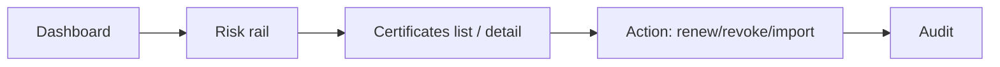
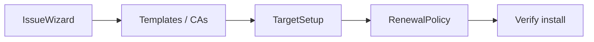
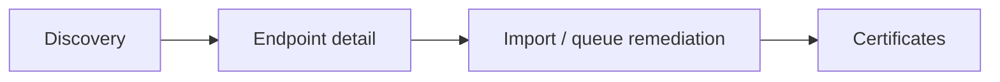
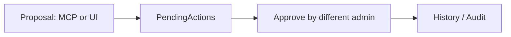
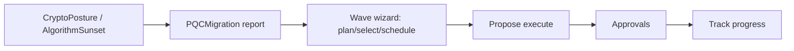
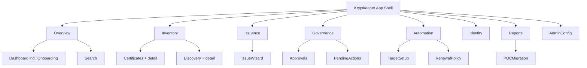

# UX Specification

Task, journey and component reference. `INFORMATION_ARCHITECTURE.md` holds
the page-complete route map and nav grouping.

## Primary Tasks
1. **See what is most urgent** — dashboard → risk rail → item detail → action.
2. **Manage certificates at scale** — search/filter list → detail → renew/revoke/import → confirm → audit trail.
3. **Monitor discovery and endpoint risk** — inventory → filter risky endpoints → mapping → remediation or scan.
4. **Track alerts and delivery automation** — delivery failures/escalations → acknowledge/retry → verify status and history.
5. **Manage CAs** — CA health and status → key storage and issuance posture → next action.
6. **Govern proposed actions** — review a proposal in PendingActions → approve as a *different* admin → outcome lands in History/Audit.
7. **Plan and execute PQC migration** — read crypto posture and algorithm-sunset exposure → run a migration wave in PQCMigration → propose execution → approve → track progress.
8. **Configure automation and renewal** — register a target → set a renewal policy → confirm automation picks it up without manual intervention.

## Journey Maps

### (a) Urgent-risk triage

### (b) Issue-to-install

### (c) Discovery-to-remediation

### (d) Approval governance

### (e) PQC migration journey

## Persona Alignment

The 5 SDLC personas (`docs/sdlc/phase-1-planning/USER_PERSONAS.md`) are
canonical. `UX_IMPROVEMENT_PLAN.md`'s 4 roles map onto them:

| UX_IMPROVEMENT_PLAN role | Canonical persona | Notes |
|---|---|---|
| PKI Admin | Alex | Direct match — CAs, templates, issuance, revocation, renewal. |
| Security Operations | Sam (operational facet) + Riley | Posture/alerts drift is Sam's; device-cert automation is Riley's. |
| App/Service Owner | Jordan | Owns certs/endpoints for services they run. |
| Auditor/Compliance | Sam (compliance facet) | Evidence, history, exports — same persona, different task. |
| — | Casey | No UI-plan role; deliberately docs/community-facing, not a UI user. |

## Component Inventory
### Layout
- AppShell
- TopNav / Sidebar
- RiskCommandRail
- SectionHeader
- PageHeader — canonical eyebrow + H1 page header
- ContentGrid
- Panel — bordered content section

### Data Display
- SummaryCard
- MetricCard — single-value stat with trend/threshold styling
- RankedQueue
- Table with sort/filter/pagination
- DetailPanel
- StatusBadge / Badge
- Timeline / history feed
- EmptyState
- StateMessage — unified loading/error/empty message block

### Forms
- SearchInput
- FilterChips
- Select
- Date/expiry filter
- Reason textarea
- Confirm action dialog
- Wizard / stepper — shared multi-step flow (issuance, target setup, onboarding, PQC wave)

### Feedback
- Loading skeletons
- Error banner with retry
- Success toast
- Inline validation errors
- Confirmation state
- Journey/result panel — step-by-step outcome summary (PQC wave, approval outcome)

### Navigation
- Left or top primary nav
- Breadcrumbs on detail pages
- In-page tabs for detail subviews

## State Matrix

| Component | Loading | Loaded | Error | Empty |
|---|---|---|---|---|
| Dashboard summary cards | Skeleton cards | Risk, expiry, and queue counts | Error banner + retry | Zero-state guidance with setup/action CTA |
| Certificates table | Skeleton rows | Filtered inventory with actions | Banner + retry + preserve filters | Empty explanation + import/scan CTA |
| Certificate detail | Skeleton panel | Identity, chain, risk, lifecycle, actions | Failure state + back link | Not found with search backout |
| Discovery list | Skeleton rows | Endpoints, scan jobs, risk scores | Retry with last known filters | "No endpoints yet" with scan CTA |
| Discovery detail | Skeleton panel | Endpoint history, mappings, scan activity | Error with retry | No mapping guidance |
| Alerts center | Skeleton cards/list | Pending, escalations, failures, history | Retry + degraded mode note | No alerts = automation healthy |
| CA list | Skeleton cards | CA status, storage type, health | Retry + outage note | No CAs configured CTA |
| PendingActions queue | Skeleton rows | Proposed actions with proposer/action | Retry + preserve filters | No pending actions |
| PQCMigration wave panel | Skeleton stepper | Plan/select/schedule/execute state | Error with retry per step | No wave started CTA |

## Key Workflows

### 1) Dashboard triage
1. User opens app.
2. Risk command rail ranks the highest-priority work.
3. User clicks an item and lands on the relevant filtered list or detail view.
4. User takes action or assigns ownership.

### 2) Certificate renewal / revocation
1. User searches or filters certificates.
2. User opens a certificate detail page.
3. UI shows chain, expiry, risk, ownership, and history.
4. User selects renew/revoke/import.
5. Confirmation dialog explains impact before commit.
6. Result lands in audit/history.

### 3) Discovery remediation
1. User views discovered endpoints and risky items.
2. Filters by protocol, team, or risk.
3. Opens endpoint detail.
4. Reviews mapping, last scan, and last seen.
5. Queues scan or remediation.

### 4) Alerts operations
1. User opens alerts center.
2. Sees pending deliveries, failures, and escalations.
3. Acknowledges or retries a delivery.
4. Status updates immediately and remains auditable.

### 5) Approval governance
1. A proposal is created via MCP or the UI (never auto-applied).
2. It appears in PendingActions.
3. A different admin from the proposer reviews and approves or rejects.
4. Outcome is recorded in History and Audit.

### 6) PQC migration wave
1. User reviews CryptoPosture / AlgorithmSunset exposure.
2. Opens PQCMigration report and starts a wave via the Wizard panel.
3. Plans, selects affected certs, and schedules the wave.
4. Proposes execution — requires a different admin's approval via Approvals.
5. Tracks wave progress back on PQCMigration.

## Accessibility Plan (WCAG 2.2 AA)
- Keyboard: all primary actions reachable in logical tab order; dialogs trap focus; escape closes dialogs.
- Focus: visible focus ring on every interactive element.
- Screen reader: landmarks, real headings, table headers, and live-region updates for action results.
- Contrast: dark theme tokens must maintain AA contrast for text and badges.
- Motion: respect `prefers-reduced-motion`; keep motion optional and brief.
- Target size: 44x44 minimum for action buttons and nav items.
- Forms: field-level errors tied to inputs; no color-only validation.

## Responsive Strategy
- **Desktop (1440):** two-column shell with persistent risk rail and main content.
- **Tablet (768):** risk rail collapses into a top summary strip; tables retain horizontal scannability.
- **Mobile (375):** single-column flow, stacked cards, compact nav, bottom-safe action spacing.

## Content Principles
- Explain risk in plain language.
- Prefer "what should I do next?" over raw metrics.
- Show provenance: last scan, last delivery, last actor, last change.
- Never use empty states that blame the user.

## Screen Hierarchy

## Backend Support Needed
- Filtered list endpoints for certificates, endpoints, alerts, and CAs
- Detail endpoints with history and dependencies
- Action endpoints for renew, revoke, import, acknowledge, retry, queue scan
- Audit trail endpoints for proof and review
- Approval-queue endpoints preserving proposer/approver separation
- PQC wave endpoints for plan/select/schedule/propose-execute
