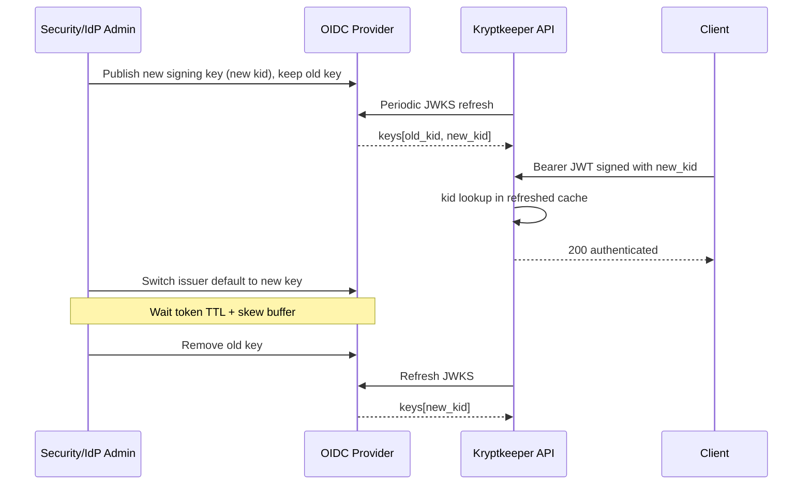

# OIDC Discovery & JWKS Rotation Runbook

## Summary

This runbook defines production operations for OIDC discovery and JWKS rotation in `AUTH_MODE=oidc`, including planned key rotation, emergency compromised-key response, cache/fetch failure handling, observability, and rollback. It is written for fail-closed behavior: if no trusted key material is available, `/api/v1/authz-check` must return `401` rather than accepting unverifiable tokens.

## Scope and Contract Cross-References

- Primary contract: `docs/sdlc/phase-4-implementation/AUTH_OIDC_DISCOVERY_CONTRACT.md`
- Base auth contract: `docs/sdlc/phase-4-implementation/AUTH_OIDC_JWKS_CONTRACT.md`
- Previous transition context: `docs/sdlc/phase-4-implementation/AUTH_JWT_TRANSITION_CONTRACT.md`

This runbook does **not** change endpoint schema/behavior. It operationalizes existing contract requirements (`200`/`401`/`405` envelopes unchanged).

---

## 1) Configuration Checklist (pre-production and pre-change)

Validate all items before enabling OIDC mode or rotating keys.

| Check | Required Value / Rule | How to Verify | Expected Output |
| --- | --- | --- | --- |
| Auth mode | `AUTH_MODE=oidc` | Inspect deployed env/config | `AUTH_MODE=oidc` present |
| Issuer URL | `APP_OIDC_ISSUER` set, HTTPS, no typo | `curl -sS "${APP_OIDC_ISSUER}/.well-known/openid-configuration"` | JSON with `issuer` and `jwks_uri` |
| Discovery URL derivation | `issuer + /.well-known/openid-configuration` | Compare configured issuer to fetched metadata `issuer` | Exact match (normalized trailing slash only) |
| Discovery timeout | `APP_OIDC_DISCOVERY_TIMEOUT_MS` positive integer (default `3000`) | Check env + startup logs | Timeout value loaded; no config error |
| JWKS timeout | `APP_OIDC_JWKS_TIMEOUT_MS` positive integer (default `3000`) | Check env + startup logs | Timeout value loaded; no config error |
| Discovery cache TTL | `APP_OIDC_DISCOVERY_CACHE_TTL_MS` positive integer (default `300000`) | Check env/runtime config endpoint or logs | TTL active and non-zero |
| JWKS refresh interval | `APP_OIDC_JWKS_REFRESH_INTERVAL_MS` positive integer (default `300000`) | Check env/runtime logs | Periodic refresh scheduler active |
| Max stale window | `APP_OIDC_JWKS_MAX_STALE_MS >= APP_OIDC_JWKS_REFRESH_INTERVAL_MS` | Compare env values | Guardrail satisfied |
| Retry policy | `APP_OIDC_HTTP_RETRY_COUNT`, `APP_OIDC_HTTP_RETRY_BACKOFF_MS` sane bounds | Check env + log sampling | Retries bounded (no retry storm) |

**Fail criteria:** Any invalid OIDC config means service remains fail-closed for JWT auth (`401` on unverifiable tokens) until fixed.

---

## 2) Normal Rotation Process (planned key rollover)

### Trigger

- Scheduled signing key rotation by IdP/security policy.
- New `kid` introduced with overlap window.

### Severity Assessment

- **P2 (Minor):** Rotation proceeding normally, no auth errors.
- **P1 (Major):** Elevated `unknown kid`/`401` errors during overlap.
- **P0 (Critical):** Broad login/API auth outage.

### Procedure (with verification + rollback per step)

| Step | Action | Verify It Worked | Rollback if Step Fails |
| --- | --- | --- | --- |
| 1 | Confirm current active JWKS contains existing signing `kid` set. | App logs show successful JWKS fetch and key count > 0; auth success baseline stable. | Pause rotation, keep existing key active at IdP, continue serving with current key set. |
| 2 | Add new signing key in IdP/JWKS (do not remove old key yet). | JWKS endpoint returns both old and new `kid` values during overlap. | Remove newly added key from IdP if malformed/incomplete; keep old key only. |
| 3 | Wait one refresh cycle (or trigger safe on-demand refresh via controlled token using new `kid`). | First request with token signed by new `kid` succeeds (`200`). | Stop issuing new-key tokens; continue issuing old-key tokens until JWKS health restored. |
| 4 | Monitor error/latency for at least 2 refresh intervals. | `401` invalid-token rate remains within baseline; no sustained discovery/JWKS fetch errors. | Extend overlap window and revert token minting to previous key only. |
| 5 | Switch token issuer default to new key after stable overlap. | Majority of new tokens show new `kid` and validate successfully. | Repoint issuer default signing key to old key while overlap remains. |
| 6 | Remove old key only after token TTL + clock-skew buffer elapsed. | No requests observed with old `kid`; no auth error spike after removal. | Re-add old key immediately to JWKS and re-enable old signer if still needed. |

### Normal Rotation Sequence



---

## 3) Emergency Key Compromise Rotation (failure playbook)

### Trigger

- Confirmed or highly suspected private key compromise.
- Abuse patterns from a specific `kid`.

### Immediate Actions (first 5 minutes)

1. Declare incident and assign commander (P0 unless proven otherwise).  
   **Verify:** Incident channel and owner acknowledged.  
   **Rollback:** N/A (organizational step).
2. Disable compromised signer in IdP immediately.  
   **Verify:** New token issuance no longer uses compromised `kid`.  
   **Rollback:** Re-enable only if declared false positive by security lead.
3. Publish replacement key and force JWKS refresh path.  
   **Verify:** JWKS now includes replacement `kid`; API fetch success logs present.  
   **Rollback:** If replacement key invalid, publish corrected key and keep compromised key disabled.
4. Revoke active sessions/tokens per identity policy (if available).  
   **Verify:** Revocation metrics/logs show propagation.  
   **Rollback:** Re-issue sessions for affected internal users if revocation was over-broad.

### Diagnosis and Mitigation Commands

> Adapt service/namespace names to environment.

- Check discovery endpoint availability:
  - `curl -sS -m 5 "${APP_OIDC_ISSUER}/.well-known/openid-configuration"`
  - Expected: HTTP `200` and JSON includes `jwks_uri`.
- Check JWKS endpoint and key IDs:
  - `curl -sS -m 5 "${JWKS_URI}"`
  - Expected: HTTP `200` and `keys` array includes replacement `kid`, excludes compromised `kid` after cutover.
- Check API auth behavior:
  - Send known-good token with replacement `kid` to `/api/v1/authz-check`
  - Expected: `200` for valid token; compromised/old invalid tokens return `401`.

### Escalation

- If not contained in 15 minutes: escalate to Security + Identity platform owners.
- If widespread auth outage persists >15 minutes: involve platform incident manager and consider temporary traffic shaping / user communication.

---

## 4) Cache Stale / Fetch Failure Handling (fail-closed expectations)

### Behavioral Expectations

1. **Cold start with no usable JWKS and fetch failure:** return `401` (fail-closed).
2. **Existing cache within max-stale during outage:** continue verification using stale keys.
3. **Stale age exceeds `APP_OIDC_JWKS_MAX_STALE_MS`:** stop trusting stale keys, return `401` until refresh succeeds.
4. **Unknown `kid`:** perform one on-demand JWKS refresh; if still unknown, return `401`.
5. **No silent bypass:** never accept token without verifiable key match.

### Decision Flow

```mermaid
graph TD
    A[Token arrives] --> B{JWT has kid?}
    B -- No --> U1[Return 401 unauthorized]
    B -- Yes --> C{kid in active cache?}
    C -- Yes --> D[Verify signature + claims]
    D --> E{Valid?}
    E -- Yes --> S1[Return 200 authenticated]
    E -- No --> U2[Return 401 unauthorized]
    C -- No --> F[Trigger one on-demand JWKS refresh]
    F --> G{Refresh succeeded?}
    G -- Yes --> H{kid now present?}
    H -- Yes --> D
    H -- No --> U3[Return 401 unauthorized]
    G -- No --> I{Stale cache exists and age <= max stale?}
    I -- Yes --> J[Attempt verification with stale keyset]
    J --> K{Valid?}
    K -- Yes --> S2[Return 200 authenticated]
    K -- No --> U4[Return 401 unauthorized]
    I -- No --> U5[Return 401 unauthorized (fail-closed)]
```

---

## 5) Observability and Alerting Signals

Monitor discovery/JWKS path separately from application auth outcomes.

### Key Signals

- **Traffic**
  - Auth check request rate (`/api/v1/authz-check`).
  - Token validation attempts by `kid`.
- **Errors**
  - `401` rate split by reason class: missing token, invalid signature, unknown `kid`, fetch timeout.
  - OIDC discovery fetch failures.
  - JWKS refresh failures and retry exhaustion.
- **Latency**
  - P95/P99 auth-check latency.
  - Discovery and JWKS fetch latency distributions.
- **Saturation**
  - HTTP client pool utilization to IdP endpoints.
  - CPU/memory pressure that can delay refresh loops.

### Recommended Alerts (starting points; tune from baseline)

- **Page (P1/P0)**
  - Auth `401` rate > 5% for 2 minutes **and** traffic > baseline minimum.
  - JWKS refresh failures continuously for > `APP_OIDC_JWKS_MAX_STALE_MS / 2`.
  - Any transition to fail-closed due to stale age exceeded.
- **Ticket (P2)**
  - Discovery/JWKS timeout rate > 1% for 15 minutes.
  - Repeated unknown `kid` refresh attempts with eventual success (possible early rotation drift).

### Required Dashboards/Logs

- Dashboard: auth success vs `401` by reason.
- Dashboard: JWKS/discovery success %, timeout %, and latency.
- Structured logs: include `kid`, issuer, refresh outcome, stale-age decision, retry count.
- Every alert must link this runbook.

---

## 6) Rollback Strategy

Use rollback to restore availability **without** violating token trust boundaries.

1. **Rotation regression during overlap**
   - Action: keep old + new keys published; revert token issuer default to old key.
   - Verify: old-key tokens return `200`, error rate returns to baseline.
2. **Bad new key published**
   - Action: remove bad key from JWKS and publish corrected key; do not remove prior known-good key until stable.
   - Verify: refresh succeeds, new known-good `kid` validates.
3. **OIDC/JWKS upstream instability**
   - Action: operate on stale cache only within max-stale; if exceeded, intentionally fail-closed (`401`) and escalate.
   - Verify: decision logs show stale-window enforcement, no unverifiable token accepted.
4. **Config rollback**
   - Action: revert OIDC env vars to last known-good release config and restart deployment using standard release rollback process.
   - Verify: startup logs show valid OIDC config; auth success/error baseline normalizes.

> Do **not** roll back to insecure “accept-all” behavior. Availability rollback must preserve signature verification requirements from contract.

---

## 7) Bearer-Token Roles and Startup Validation

Applies to `AUTH_MODE=jwt` and `AUTH_MODE=oidc` bearer tokens (audit findings A02-3, A02-4, A07-6, A2A7-009).

### Required configuration (the hub refuses to start without it)

| Setting | Rule |
| --- | --- |
| `APP_OIDC_ISSUER` and `APP_OIDC_AUDIENCE` (or DB keys `sso.oidc_issuer` / `sso.oidc_audience`) | Both required in `AUTH_MODE=oidc`. With either empty the hub exits at startup, and requests fail closed if a DB override is cleared later. Without an audience any token your IdP signs for any client would be accepted. |
| `APP_JWT_HS256_SECRET` | At least 32 bytes in `AUTH_MODE=jwt`. Generate with `openssl rand -hex 32`. |
| `APP_AUTH_LOGIN_SIGNING_SECRET` | At least 32 bytes whenever any login flow (password, OIDC SSO, SAML) is enabled. Session JWTs carry a signed role claim, so a weak secret lets anyone holding one session token forge `pki-admin` offline. |
| `nbf` | Tokens with a not-before time more than 60 s in the future are rejected (HS256 and RS256). |

Startup logs every configuration error in one `refusing to start` message. Warnings (for example a bootstrap token under 32 characters) are logged but do not stop the hub.

### Default role is read-only

A valid bearer token no longer becomes `service-account`. It is `viewer` (read-only) unless a role mapping grants more.

| Variable | Meaning |
| --- | --- |
| `APP_AUTH_ROLE_CLAIM` | Name of the token claim to read, for example `kk_role` or `groups`. A string or an array of strings. |
| `APP_AUTH_ROLE_MAP_JSON` | Ordered JSON array of `{"claim_value": "...", "role": "..."}`. The first pair whose `claim_value` appears in the claim wins; order is precedence. No match gives `viewer`. |

```bash
APP_AUTH_ROLE_CLAIM=groups
APP_AUTH_ROLE_MAP_JSON='[{"claim_value":"kk-admins","role":"pki-admin"},{"claim_value":"kk-issuers","role":"service-account"}]'
```

Rules, all enforced at startup: `role` must be a fixed role or an existing custom role; an unknown role is an error. `mcp-agent` and `bootstrap` may not be granted through the map. Pairs with a missing field are errors, as is a map without `APP_AUTH_ROLE_CLAIM`. The mapping does not apply to API keys, which keep the role stored on the key.

Migration for an existing deployment whose clients issue certificates with a bearer token: add a claim to those tokens at your IdP, then map it to `service-account` before upgrading. Without that, the clients get `403` on issue, renew and revoke.

### Bootstrap token

`KRYPTKEEPER_DISABLE_BOOTSTRAP_TOKEN=true` makes the raw `APP_BOOTSTRAP_TOKEN` never authenticate; login sessions, API keys and bearer tokens still work. Enable login (or SSO) and confirm an admin session works before turning this on. The hub logs a notice at startup when it is set. The bootstrap token is compared in constant time.

## Post-Incident Requirements

- Produce post-mortem within 48 hours (timeline, root cause, prevention actions).
- Record which step failed, time-to-detect, time-to-mitigate.
- Update this runbook and alert thresholds if any page was non-actionable.
