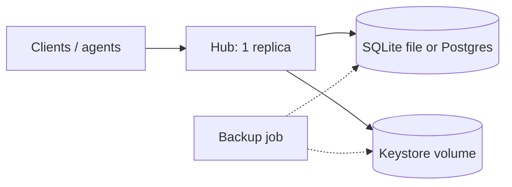
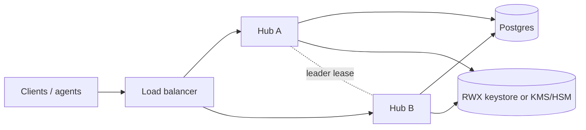
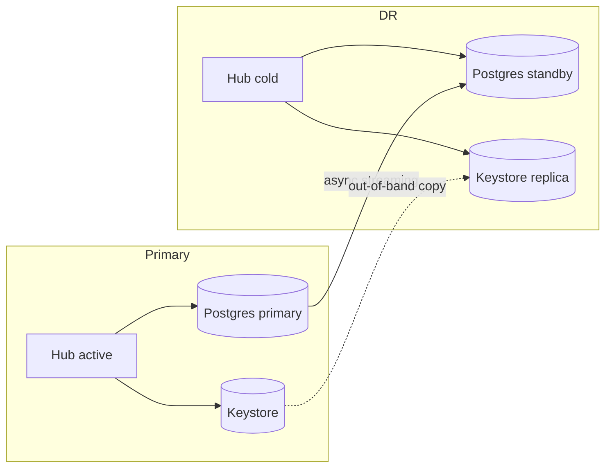

# Reference architectures

Three supported shapes. Every number below is labelled **Measured** (with date and source
file), **Extrapolated** (derived from a measurement, source named) or **Committed target (not
yet measured)**. A figure with none of those labels is a bug in this document.

Outbound connections for each shape are listed in [DATA_RESIDENCY.md](DATA_RESIDENCY.md).

## 1. Single node

Docker Compose or one Helm replica; SQLite (default) or PostgreSQL.

| Item | Value | Label |
|---|---|---|
| Memory request / limit | 512Mi / 2Gi, `GOMEMLIMIT=1600MiB` | Measured basis: `docs/perf/rc3/README.md` (H4), chart `charts/kryptkeeper/values.yaml` |
| Idle RSS, SQLite | 172 MB at 10.5k certs; 629 to 665 MB at 55k to 61k certs | Measured, RC3 (`docs/perf/rc3/03-measurements.md`), `main` at `26e17cac` |
| Rule of thumb | about 11 KB per certificate idle | Measured up to 61k certs; above that Extrapolated |
| Limit reached | somewhere above 100k certs; report calls add 300 to 380 MB transient | Extrapolated from RC3 |
| Postgres at 100k certs | PENDING-RUN: pending W30-21 (`docs/perf/rc4/03-measurements.md` does not exist yet; link it once it does) | n/a |
| RPO | time since the last backup; target < 24 h | Committed target (not yet measured as an interval; backup procedure in [DR_RUNBOOK.md](DR_RUNBOOK.md)) |
| RTO | restore time; target < 60 min | Committed target ([RESTORE_DRILL.md](RESTORE_DRILL.md)). SQLite restore of a 1.1 MB database, 3 runs: 7, 8, 10 s, Measured (`docs/ops/DR_RUNBOOK.md` "Recovery time", `RESTORE_DRILL.md`). Postgres RTO is not measured |

## 2. HA active/active

Two or more hub replicas, one PostgreSQL. Software keys live on disk, so the keystore must be
on RWX storage, or use a cloud KMS or PKCS#11 backend ([CLOUD_KMS.md](CLOUD_KMS.md)).

| Item | Value | Label |
|---|---|---|
| Per-replica sizing | as single node (512Mi / 2Gi, `GOMEMLIMIT=1600MiB`) | Measured basis as above |
| Postgres connections | about 66 for 2 replicas after 60 s idle; the harness runs `max_connections=300` | Measured, `docs/deployment.md` "PostgreSQL connection budget", `tests/live/helm-kind/README.md` |
| Schedulers | leader-elected through `HACoordinator` (`internal/bootstrap/ha_coordinator.go:25`) | Code |
| Lease takeover bound | `3 x RENEWAL_POLL_MINUTES + 10 s` (190 s at poll 1 min) | Committed bound, `tests/live/ha/README.md` |
| Lease takeover observed | 2 m 0 s after SIGKILL of the holder (poll 1 min, lease 2 min); B issued 5 of 5 certificates meanwhile | Measured, `docs/release/HA_SOAK_v0.11.md:77`, kill event in `tests/live/ha/soak-result.json` (2026-10-16) |
| RPO | 0 for a hub failure; for a database failure, the Postgres layer's own guarantee | Committed target (not yet measured for DB failure) |
| RTO | hub failure: the takeover bound above; database failure: your database platform's failover time | Takeover Measured as above; DB failover not measured |

What is NOT proven: multi-node HA. The helm-kind harness uses a ReadWriteOnce keys PVC that
two pods share only on one node (`tests/live/helm-kind/README.md`, "Does NOT prove"); real
multi-node HA needs an RWX volume or cloud KMS or PKCS#11, and that combination has not been
exercised. The HA harness is also one machine, plain HTTP, and simulates (does not perform)
a Postgres failover (`tests/live/ha/README.md`).

## 3. Active/passive DR

Primary region: active hub and Postgres primary. DR region: cold hub and a Postgres
asynchronous streaming standby. The keystore is replicated out of band.

| Item | Value | Label |
|---|---|---|
| Sizing | as topology 1 per hub; standby sized like the primary | Measured basis as above |
| RPO | <= 5 min | Committed target. Measured 1 s (0 of 119 markers lost, replication lag 0.000 s at kill), drill 2026-10-16, single-host podman, keystore replication modelled not measured |
| RTO | <= 15 min | Committed target. Measured 2 s from kill to first issuance on the DR site, drill 2026-10-16, same caveats; excludes human detection and decision time |
| Measurement | [DR_DRILL_RESULTS.md](DR_DRILL_RESULTS.md) (W30-23): failover drill row recorded. The zero-5xx rolling upgrade row and the `ha.failover` / `scheduler.failover` / `backup.stale` events are PENDING-RUN / BLOCKED there | n/a |

HSM and cloud-KMS key material is not in the database backup; its DR is the backend's own
procedure ([DR_RUNBOOK.md](DR_RUNBOOK.md)).

## Choosing

| Question | Topology |
|---|---|
| One team, a day of data loss and an hour of downtime are acceptable | 1 Single node |
| Hub restarts or node loss must not stop issuance | 2 HA active/active |
| Loss of the whole site must be survivable within minutes | 3 Active/passive DR (often combined with 2 in the primary) |
| Air-gapped | any; see [AIRGAP_INSTALL.md](AIRGAP_INSTALL.md) |

## Not covered

- Multi-region active/active.
- HSM or KMS key DR beyond pointing at the backend's own procedure (see [DR_RUNBOOK.md](DR_RUNBOOK.md)).
