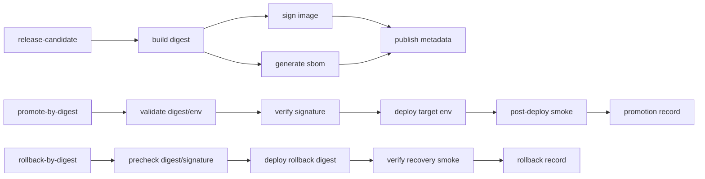

# Summary

Hardened five GitHub Actions workflows to reduce brittle failures while preserving the current release intent (build/sign/verify/promotion/rollback). Changes focus on deterministic failure behavior, bounded execution time, stricter input/secret validation, and retry logic only for transient registry/signature verification operations.

## Subtasks

1. `[DONE]` Inspect current workflow state and failure modes in scoped files.
2. `[DONE]` Design reliability hardening changes without weakening security-critical gates.
3. `[DONE]` Apply workflow edits to all scoped files.
4. `[DONE]` Validate YAML syntax for all edited workflows.
5. `[DONE]` Produce operator-facing report with secrets + branch protection requirements.

## What Was Changed (Concrete Edits)

### 1) `.github/workflows/release-candidate.yml`
- Added workflow-level concurrency:
  - `group: release-candidate-${{ github.ref }}`
  - `cancel-in-progress: false`
- Added `timeout-minutes` to all jobs.
- Hardened shell steps with `set -euo pipefail`.
- Strengthened branch ancestry gate:
  - fetches `origin/main`
  - fails if `origin/main` is not an ancestor of `HEAD`.
- Added digest format validation after build output (`sha256:<64 hex>`).
- Hardened cosign key handling:
  - `umask 077`
  - key file cleanup (`rm -f cosign.key`).

### 2) `.github/workflows/promote-by-digest.yml`
- Added workflow-level concurrency per target env:
  - `group: promote-${{ inputs.target_env }}`
  - `cancel-in-progress: false`
- Added `timeout-minutes` on all jobs.
- Added strict input validation gate:
  - `source_env` / `target_env` restricted to `staging|production`
  - block same source and target env
  - keep digest format + change ticket validation.
- Added bounded retry loops (3 attempts, backoff) for:
  - `docker buildx imagetools inspect`
  - `cosign verify`
- Added required secret checks before deploy/smoke for selected target env.
- Hardened shell mode and cosign public key handling (`umask 077`, cleanup).

### 3) `.github/workflows/rollback-by-digest.yml`
- Added workflow-level concurrency per target env:
  - `group: rollback-${{ inputs.target_env }}`
  - `cancel-in-progress: false`
- Added `timeout-minutes` on all jobs.
- Added strict `target_env` validation (`staging|production`).
- Added bounded retry loops (3 attempts, backoff) for digest inspect and signature verification.
- Added required secret checks before deploy/smoke for selected target env.
- Hardened shell mode and cosign public key handling (`umask 077`, cleanup).

### 4) `.github/workflows/ci-main.yml`
- Added `timeout-minutes` to all existing scoped jobs.
- Added `set -euo pipefail` to shell-heavy steps.
- Fixed brittle protocol suite invocation:
  - dynamically builds suite list based on existing directories
  - avoids failing on missing test directories.
- Pinned `govulncheck` install version from `@latest` to `v1.1.4` for deterministic behavior.

### 5) `.github/workflows/ci-pr.yml`
- Added `timeout-minutes` to all existing scoped jobs.
- Added `set -euo pipefail` to shell-heavy steps.
- Replaced `curl | sh` golangci install path with pinned `go install ...@v1.64.8` (more deterministic, less brittle).
- Replaced frontend lint script detection with `pnpm run lint --if-present`.
- Pinned `govulncheck` to `v1.1.4`.
- Improved optional Playwright check to command existence probe via `pnpm exec playwright --version`.

## Reliability / Security Rationale for Critical Changes

1. **Concurrency guards for release/promote/rollback**
   - Prevents overlapping deployments to same target domain (classic incident trigger during manual dispatch).

2. **Timeouts on all jobs**
   - Prevents zombie workflows consuming runners and blocking newer deploys.

3. **`set -euo pipefail`**
   - Prevents silent partial success from unset variables and masked command failures.

4. **Digest and environment input validation**
   - Fail fast on invalid operator input instead of failing late during deployment.

5. **Retry only transient network checks**
   - Retries were added only to remote registry/signature fetch checks where transient failures are common.
   - Security-critical checks are **not skipped**; they still hard-fail after bounded retries.

6. **Pinning security tools**
   - Replacing `@latest` for `govulncheck` stabilizes CI behavior across time and avoids surprise breakages.

7. **Protocol conformance test selection fix**
   - Eliminates false failures due to non-existent test directories while still executing all present suites.

## Required Secrets (Post-Hardening)

### Mandatory for release/sign/verify flows
- `COSIGN_KEY` (release-candidate signing)
- `COSIGN_PASSWORD` (release-candidate signing)
- `COSIGN_PUBLIC_KEY` (promotion + rollback verification)

### Mandatory for deploy/promotion/rollback
- `DEPLOY_CMD_STAGING`
- `DEPLOY_CMD_PRODUCTION`

### Mandatory for post-deploy verification
- `KRYPTKEEPER_SMOKE_BASE_URL_STAGING`
- `KRYPTKEEPER_SMOKE_BASE_URL_PRODUCTION`

### Used by current workflows/platform
- `GITHUB_TOKEN` (registry read/write per workflow permissions)
- `KRYPTKEEPER_OCSP_SMOKE_URL` (passed through to smoke checks)

## Branch Protection Checks Required

Configure branch protection on `main` so required checks match current CI entrypoints:

- Require status checks to pass before merging:
  - `ci-pr / lint-static`
  - `ci-pr / unit-backend`
  - `ci-pr / unit-frontend`
  - `ci-pr / integration-core`
  - `ci-pr / security-baseline`
  - `ci-pr / e2e-smoke`
  - (If intentionally required in repo) `ci-pr / p0-test-harness`
- Require merge queue checks for `merge_group` parity with above.
- Require pull request reviews (minimum 1, ideally code owner review for `.github/workflows/**`).
- Restrict direct pushes to `main`.
- Enable “Require conversation resolution before merging”.

For release/deploy control:
- Use protected GitHub Environments (`staging`, `production`) with required reviewers.
- Restrict who can trigger `workflow_dispatch` for promotion/rollback (repo write/admin policy).

## Failure-Domain View

## Validation Performed

- Parsed all 5 edited workflow YAML files using Ruby YAML parser (syntax validated).

## Gaps / Follow-ups

1. Pin third-party actions to full commit SHAs (supply-chain hardening).
2. Add `actionlint` as required check to catch expression/runner issues before merge.
3. Add environment-level secret validation automation doc/runbook for on-call onboarding.

## Confidence Scores (Reasoning Loop)

- Subtask 1: **9/10**
- Subtask 2: **8/10**
- Subtask 3: **8/10**
- Subtask 4: **8/10**
- Subtask 5: **9/10**

All subtasks are 7+; no revision pass required.

## Appendix (2026-04-06): CI Smoke Gate Hardening for Branch Protection

### Scope
- Updated `.github/workflows/ci-pr.yml` and `.github/workflows/ci-main.yml` to run the runtime smoke gate explicitly via:
  - `bash scripts/test/run.sh --suite smoke`
- Added explicit job display name for clearer branch protection targeting:
  - `Runtime smoke (test harness)`
- Added safe-skip semantics when the harness entrypoint is absent:
  - If `scripts/test/run.sh` does not exist, job emits skip marker and exits successfully.

### Failure Behavior
- Real smoke failures are hard-fail:
  - If `scripts/test/run.sh --suite smoke` returns non-zero (actual runtime smoke failure), the job fails.
- Missing prerequisite is skip-safe:
  - If harness file is absent, the job prints a clear skip message and exits 0.

### Required Check Names (for `main` branch protection)

Use the following exact check context names:

- `ci-pr / Runtime smoke (test harness)`
- `ci-pr / lint-static`
- `ci-pr / unit-backend`
- `ci-pr / unit-frontend`
- `ci-pr / integration-core`
- `ci-pr / security-baseline`
- `ci-pr / e2e-smoke`

## Appendix (2026-04-06): Protected Endpoint Coverage Expansion (Cert Summary) + Check Stability

### Summary

Runtime smoke coverage is expanded to include `GET /api/v1/protected/certs/summary` across all supported auth modes (bootstrap, jwt, oidc), and required branch-protection check context names remain unchanged.

### Runtime smoke coverage note

Protected endpoint runtime smoke now covers these resources across auth modes:

- `GET /api/v1/protected/ping`
- `GET /api/v1/protected/whoami`
- `GET /api/v1/protected/config`
- `GET /api/v1/protected/certs/summary`

Auth-mode matrix scope for coverage remains:

- `bootstrap`
- `jwt`
- `oidc`

### Required check-name stability confirmation

No branch-protection check context names changed. Required PR check contexts remain:

- `ci-pr / Runtime smoke (test harness)`
- `ci-pr / lint-static`
- `ci-pr / unit-backend`
- `ci-pr / unit-frontend`
- `ci-pr / integration-core`
- `ci-pr / security-baseline`
- `ci-pr / e2e-smoke`

`merge_group` parity requirement remains 1:1 with the same set.

## Appendix (2026-04-06): Addendum — Protected Config Coverage Across Auth Modes

### Summary

Runtime smoke coverage now includes protected config alongside protected ping and protected whoami across bootstrap, jwt, and oidc auth modes, and required branch-protection check contexts remain unchanged.

### Coverage addendum

- `GET /api/v1/protected/ping`
- `GET /api/v1/protected/whoami`
- `GET /api/v1/protected/config`

### Required check contexts (unchanged)

- `ci-pr / Runtime smoke (test harness)`
- `ci-pr / lint-static`
- `ci-pr / unit-backend`
- `ci-pr / unit-frontend`
- `ci-pr / integration-core`
- `ci-pr / security-baseline`
- `ci-pr / e2e-smoke`

## Appendix (2026-04-06): Protected Endpoint Coverage Expansion (Config) + Check Stability

### Summary

Runtime smoke coverage now includes the protected config path in addition to protected ping and whoami, and this expanded endpoint coverage is validated across the same auth-mode matrix (bootstrap, jwt, oidc) while keeping required PR check contexts unchanged.

### Runtime smoke coverage note

Protected endpoint runtime smoke now covers all three protected resources across auth modes:

- `GET /api/v1/protected/ping`
- `GET /api/v1/protected/whoami`
- `GET /api/v1/protected/config`

Auth-mode matrix scope for coverage remains:

- `bootstrap`
- `jwt`
- `oidc`

### Required check-name stability confirmation

No branch-protection check context names changed. Required PR check contexts remain:

- `ci-pr / Runtime smoke (test harness)`
- `ci-pr / lint-static`
- `ci-pr / unit-backend`
- `ci-pr / unit-frontend`
- `ci-pr / integration-core`
- `ci-pr / security-baseline`
- `ci-pr / e2e-smoke`

`merge_group` parity requirement remains 1:1 with the same set.

Merge queue (`merge_group`) should require the same set.

## Branch Protection Policy (Current)

Use this section as the source of truth for `main` branch protection required checks.

### Required status checks for `main`

Configure `main` to require these exact check contexts:

- `ci-pr / Runtime smoke (test harness)`
- `ci-pr / lint-static`
- `ci-pr / unit-backend`
- `ci-pr / unit-frontend`
- `ci-pr / integration-core`
- `ci-pr / security-baseline`
- `ci-pr / e2e-smoke`

### Merge queue parity (`merge_group`)

`merge_group` must require the same check set as pull requests to `main` (1:1 parity), so merge-queue batches are validated by the same gates as individual PRs.

### Runtime smoke check context note

The runtime smoke gate context name is intentionally:

- `ci-pr / Runtime smoke (test harness)`

This comes from workflow name `ci-pr` + job display name `Runtime smoke (test harness)` and should be used exactly in branch protection settings.

## Appendix (2026-04-06): Runtime Smoke Local-Mode Enforcement in CI

### Summary

Runtime smoke jobs in both `ci-pr` and `ci-main` now explicitly execute smoke tests in **local mode** on runners where Go can be provisioned from `go.mod`, while preserving skip-safe behavior when prerequisites are missing.

### Enforcement Update

#### Updated workflows
- `.github/workflows/ci-pr.yml`
- `.github/workflows/ci-main.yml`

#### Runtime smoke job behavior (stable job identity retained)
- Job id remains: `runtime-smoke-harness`
- Job display name remains: `Runtime smoke (test harness)`

#### New runtime smoke execution contract
1. Setup Go when `go.mod` exists:
   - `uses: actions/setup-go@v5`
   - `go-version-file: go.mod`
2. Execute smoke suite only when both prerequisites exist:
   - `go.mod`
   - `scripts/test/run.sh`
3. Force local smoke mode in CI:
   - `KRYPTKEEPER_SMOKE_MODE=local`
   - command: `bash scripts/test/run.sh --suite smoke`
4. Preserve skip-safe behavior:
   - If `go.mod` is missing: emit skip marker and exit successfully.
   - If harness script is missing (with `go.mod` present): emit skip marker and exit successfully.

### Verification signals
- **Pass/fail behavior:**
  - Non-zero exit from smoke harness fails job (real smoke failure).
  - Missing prerequisites produce explicit skip marker and do not fail workflow.
- **Branch protection stability:**
  - Check context remains unchanged because workflow + job display name are unchanged.

### Final required check names (`main` branch protection)

Use these exact required status checks:

- `ci-pr / Runtime smoke (test harness)`
- `ci-pr / lint-static`
- `ci-pr / unit-backend`
- `ci-pr / unit-frontend`
- `ci-pr / integration-core`
- `ci-pr / security-baseline`
- `ci-pr / e2e-smoke`

`merge_group` should require the same set for parity.

## Appendix (2026-04-06): Runtime Smoke Auth-Mode Matrix Expansion

### Summary

Runtime smoke in both CI entrypoints now exercises both supported auth modes in sequence when the harness prerequisites are present, improving detection of auth-mode-specific regressions without changing branch protection check identity.

### Updated workflows

- `.github/workflows/ci-pr.yml`
- `.github/workflows/ci-main.yml`

### Auth-mode execution matrix (runtime smoke job)

| Workflow | Job name | Harness command | AUTH_MODE | Additional env |
|---|---|---|---|---|
| `ci-pr` | `Runtime smoke (test harness)` | `bash scripts/test/run.sh --suite smoke` | `bootstrap` | `KRYPTKEEPER_SMOKE_MODE=local` |
| `ci-pr` | `Runtime smoke (test harness)` | `bash scripts/test/run.sh --suite smoke` | `jwt` | `KRYPTKEEPER_SMOKE_MODE=local`, `APP_JWT_HS256_SECRET=ci-smoke-jwt-hs256-test-secret` |
| `ci-main` | `Runtime smoke (test harness)` | `bash scripts/test/run.sh --suite smoke` | `bootstrap` | `KRYPTKEEPER_SMOKE_MODE=local` |
| `ci-main` | `Runtime smoke (test harness)` | `bash scripts/test/run.sh --suite smoke` | `jwt` | `KRYPTKEEPER_SMOKE_MODE=local`, `APP_JWT_HS256_SECRET=ci-smoke-jwt-hs256-test-secret` |

### Skip-safe and failure behavior

1. If `go.mod` is absent, smoke job emits skip marker and exits successfully.
2. If `scripts/test/run.sh` is absent (with `go.mod` present), smoke job emits skip marker and exits successfully.
3. If either bootstrap or jwt smoke execution fails, job fails (intended gate behavior).

### Branch protection check-name stability

- Unchanged workflow names: `ci-pr`, `ci-main`
- Unchanged runtime smoke job display name: `Runtime smoke (test harness)`
- Check context for PR protection remains:
  - `ci-pr / Runtime smoke (test harness)`

### Additional required env vars / secrets

- **New CI env var used for jwt smoke path:** `APP_JWT_HS256_SECRET`
  - Set inline in workflow as deterministic non-secret test value:
    - `ci-smoke-jwt-hs256-test-secret`
- **No additional GitHub encrypted secrets are required** for this auth-mode expansion.

## Appendix (2026-04-06): Runtime Smoke Auth-Mode Matrix Expansion (OIDC)

### Summary

Runtime smoke in both `ci-pr` and `ci-main` now includes an `oidc` execution path in addition to `bootstrap` and `jwt`, with deterministic issuer/audience values set in workflow env and no explicit `APP_OIDC_JWKS_JSON` requirement at workflow level.

### Updated workflows

- `.github/workflows/ci-pr.yml`
- `.github/workflows/ci-main.yml`

### Auth-mode execution matrix (runtime smoke job)

| Workflow | Job name | Harness command | AUTH_MODE | Additional env |
|---|---|---|---|---|
| `ci-pr` | `Runtime smoke (test harness)` | `bash scripts/test/run.sh --suite smoke` | `bootstrap` | `KRYPTKEEPER_SMOKE_MODE=local` |
| `ci-pr` | `Runtime smoke (test harness)` | `bash scripts/test/run.sh --suite smoke` | `jwt` | `KRYPTKEEPER_SMOKE_MODE=local`, `APP_JWT_HS256_SECRET=ci-smoke-jwt-hs256-test-secret` |
| `ci-pr` | `Runtime smoke (test harness)` | `bash scripts/test/run.sh --suite smoke` | `oidc` | `KRYPTKEEPER_SMOKE_MODE=local`, `APP_OIDC_ISSUER=https://ci-smoke-issuer.local`, `APP_OIDC_AUDIENCE=ci-smoke-audience` |
| `ci-main` | `Runtime smoke (test harness)` | `bash scripts/test/run.sh --suite smoke` | `bootstrap` | `KRYPTKEEPER_SMOKE_MODE=local` |
| `ci-main` | `Runtime smoke (test harness)` | `bash scripts/test/run.sh --suite smoke` | `jwt` | `KRYPTKEEPER_SMOKE_MODE=local`, `APP_JWT_HS256_SECRET=ci-smoke-jwt-hs256-test-secret` |
| `ci-main` | `Runtime smoke (test harness)` | `bash scripts/test/run.sh --suite smoke` | `oidc` | `KRYPTKEEPER_SMOKE_MODE=local`, `APP_OIDC_ISSUER=https://ci-smoke-issuer.local`, `APP_OIDC_AUDIENCE=ci-smoke-audience` |

### OIDC env contract note

- `APP_OIDC_ISSUER` and `APP_OIDC_AUDIENCE` are pinned to deterministic test values in CI.
- `APP_OIDC_JWKS_JSON` is intentionally **not** set in workflow env, assuming local OIDC artifacts are generated by the smoke harness for `AUTH_MODE=oidc`.

### Required check-name stability confirmation

Runtime smoke branch-protection check contexts are unchanged because workflow and job display names are unchanged:

- `ci-pr / Runtime smoke (test harness)`

All other `ci-pr` required checks remain unchanged from the existing policy section in this document.

## Appendix (2026-04-06): Protected Endpoint Coverage + Workflow Stability Alignment

### Summary

Runtime smoke continues to cover protected endpoint checks for both `GET /api/v1/protected/ping` and `GET /api/v1/protected/whoami` across bootstrap, jwt, and oidc auth modes, while CI workflow steps were minimally simplified to avoid conflicting `AUTH_MODE` overrides and preserve stable branch-protection check names.

### Coverage confirmation

`tests/smoke/run.sh` now validates, per auth mode (bootstrap/jwt/oidc):

- `GET /api/v1/protected/ping` (401 without bearer, 200 with valid bearer, 405 on non-GET)
- `GET /api/v1/protected/whoami` (401 without bearer, 200 with valid bearer including `resource/principal/auth_mode/timestamp`, 405 on non-GET)

### CI alignment adjustment

Updated workflows:

- `.github/workflows/ci-pr.yml`
- `.github/workflows/ci-main.yml`

Change made:

- Runtime smoke job now invokes `bash scripts/test/run.sh --suite smoke` once in local mode (`KRYPTKEEPER_SMOKE_MODE=local`) without per-step `AUTH_MODE` overrides.

Rationale:

- The smoke harness already executes the full auth-mode matrix internally; external auth-mode forcing is redundant and can create false negatives if bootstrap assertions run under non-bootstrap startup mode.

### Required check-name stability confirmation

Required PR protection contexts remain unchanged:

- `ci-pr / Runtime smoke (test harness)`
- `ci-pr / lint-static`
- `ci-pr / unit-backend`
- `ci-pr / unit-frontend`
- `ci-pr / integration-core`
- `ci-pr / security-baseline`
- `ci-pr / e2e-smoke`
