# Kryptkeeper — Software Architecture Document

**Version:** 1.0
**Date:** 2026-04-05
**Phase:** 3 — Design
**Standard:** 4+1 Architectural Views (Kruchten) with C4 Model Diagrams

> **Built reality (2026-10-09, FG-14; updated after FG-1..14 merged).** This is the 2026-04 design. The security
> statements below were checked against the code by the 2026-10-09 audit
> (`docs/security/final-report.md`); where they differ, the corrected text is in the
> Security Controls table and in `THREAT_MODEL.md` §8.10, and the current component map
> is `THREAT_MODEL.md` §8.1. In short:
> - **Router:** `net/http` `ServeMux`, not chi (`internal/bootstrap/server.go`). The ACME, EST,
>   SCEP, CMP, WSTEP, XCEP, OCSP and CRL endpoints share the hub's main listener through one
>   protocol mux (`cmd/kryptkeeper/main.go`), not the separate ports 8444-8447 drawn in C2.
> - **Authorization:** one global gate covers API *writes* (`authz_write_gate.go`); reads are
>   checked per handler. `GET /api/v1/audit` and `/audit/transparency/*` need the `audit.read` permission
>   (`handlers_audit.go`, `authz_grant.go` `requireReadPermission`); role, user and API-key grants are
>   limited to what the caller holds (FG-3).
> - **Dual control:** on by default since FG-2 (D-122) and covers key delete/rotate/export, backup, escrow, recovery and BYOK export; `KRYPTKEEPER_KEY_DUAL_CONTROL=false` opts out with a startup warning.
> - **Multi-tenancy:** EXPERIMENTAL in v0.9 (see Security Controls). ADR-006 below lists it
>   as a proprietary-tier feature, but the code is in this Apache-2.0 repository.
> - **Delivery plugins:** signature and hash checks are real; see Security Controls.
> - **Egress:** `internal/egress` guards webhooks, inventory sources and the ACME connector (FG-8); SIEM sinks and OIDC/JWKS/SAML-metadata fetches are not behind it (see Security Controls).
> - **Login and sessions:** Argon2id local login hash, logout revokes refresh tokens, refresh re-reads the role, security headers on every response (FG-7).

---

## Table of Contents

1. [Architecture Goals and Constraints](#1-architecture-goals-and-constraints)
2. [C4 Diagrams](#2-c4-diagrams)
   - [2.1 System Context (C1)](#21-system-context-c1)
   - [2.2 Container Diagram (C2)](#22-container-diagram-c2)
   - [2.3 Component Diagram — CA Core (C3)](#23-component-diagram--ca-core-c3)
   - [2.4 Component Diagram — Discovery Engine (C3)](#24-component-diagram--discovery-engine-c3)
   - [2.5 End-to-End Data Flow Diagram](#25-end-to-end-data-flow-diagram)
3. [Plugin Registry Architecture](#3-plugin-registry-architecture)
4. [Go Module Structure](#4-go-module-structure)
5. [Service Boundary Table](#5-service-boundary-table)
6. [Logical View](#6-logical-view)
7. [Process View — Critical Data Flows](#7-process-view--critical-data-flows)
   - [7.1 Certificate Issuance Flow](#71-certificate-issuance-flow)
   - [7.2 ACME Auto-Enrollment Flow](#72-acme-auto-enrollment-flow)
   - [7.3 Discovery Scan Flow](#73-discovery-scan-flow)
   - [7.4 Alert Pipeline Flow](#74-alert-pipeline-flow)
8. [Implementation View — Directory Structure](#8-implementation-view--directory-structure)
9. [Deployment View](#9-deployment-view)
10. [Architecture Decision Records](#10-architecture-decision-records)
11. [Cross-Cutting Concerns](#11-cross-cutting-concerns)

---

## 1. Architecture Goals and Constraints

### Quality Attributes

| Attribute | Target | Rationale |
|-----------|--------|-----------|
| **Security** | Audit log append-only; all signing through `crypto.Signer`. ("CA keys never exposed via API" does not hold: export, escrow and backup return key material to a pki-admin; see Security Controls) | Trust model depends entirely on key integrity |
| **Availability** | OCSP responder and CRL endpoints: 99.9% monthly SLA | Clients depend on these for real-time revocation checking |
| **Deployability** | Single `docker compose up`; working CA in under 15 minutes | Primary adoption driver for OSS community |
| **Extensibility** | New protocol, connector, or notification channel = one new file + Register() call | Single-developer project must be community-contributable |
| **Portability** | Linux x86_64 and ARM64; no Windows Server dependency | Core design principle (C-Tech06) |
| **Performance** | 10,000 TLS endpoints discovered in under 30 minutes; OCSP response under 50ms P99 | Discovery at enterprise scale; OCSP latency affects TLS handshakes |
| **Operability** | Zero required external services at startup; air-gap compatible | Enterprise deployments in restricted networks |

### Hard Architectural Constraints

The following constraints are non-negotiable and baked into every design decision. See
CONSTRAINTS.md for full rationale.

- **C-Tech03:** All CA signing operations go through Go's `crypto.Signer` interface. No
  code path calls a specific key type's signing method directly.
- **C-Tech02:** No custom cryptographic implementations. Go stdlib + Cloudflare CIRCL only.
- **C-Sec03:** No private key material in any API response.
- **C-Sec02:** Audit log is append-only — no UPDATE or DELETE on audit records.
- **C-Tech04:** Repository pattern required — PostgreSQL and SQLite share the same interface.
- **C-Tech05:** Apache 2.0 license boundary — no GPL/AGPL/LGPL in core dependencies.
- **C-Ops02:** `kk-agent` binary must remain under 15MB compressed.
- **C-Ops03:** Platform starts without an internet connection.

---

## 2. C4 Diagrams

### 2.1 System Context (C1)

The system context shows Kryptkeeper in relation to external actors and external systems.

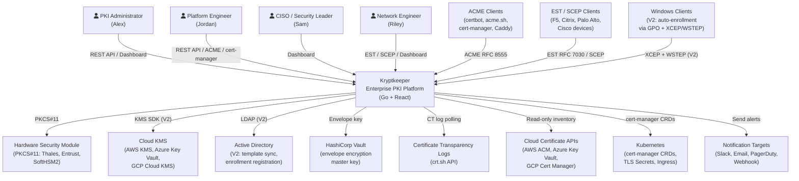

### 2.2 Container Diagram (C2)

The container diagram shows the runtime processes that make up Kryptkeeper.

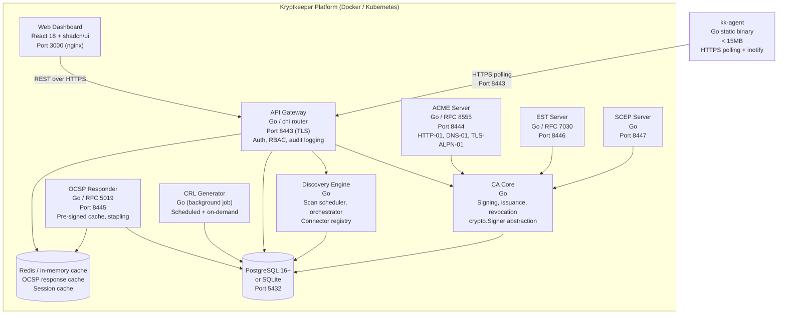

### 2.3 Component Diagram — CA Core (C3)

The CA Core is the most security-critical component. It is decomposed into tightly bounded
sub-components.

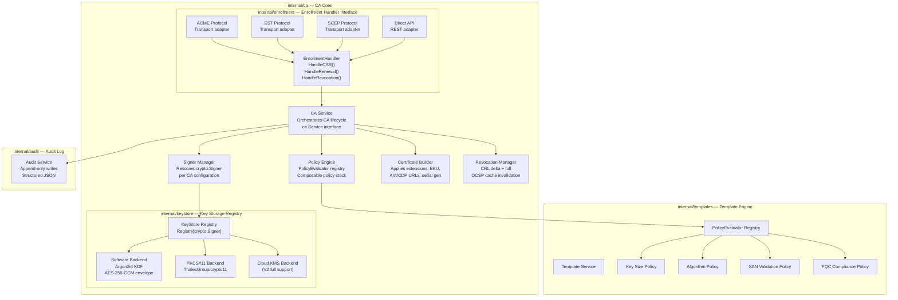

### 2.4 Component Diagram — Discovery Engine (C3)

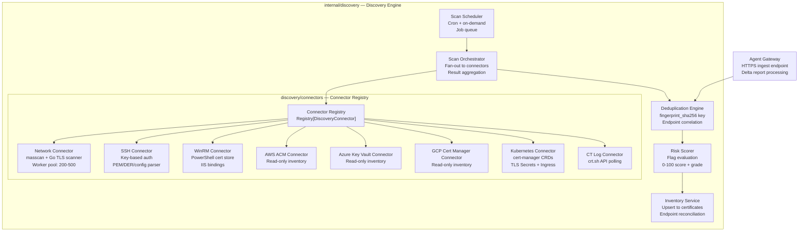

### 2.5 End-to-End Data Flow Diagram

This diagram shows how certificate data moves from issuance request through persistence,
status services (OCSP/CRL), and downstream inventory/risk workflows.

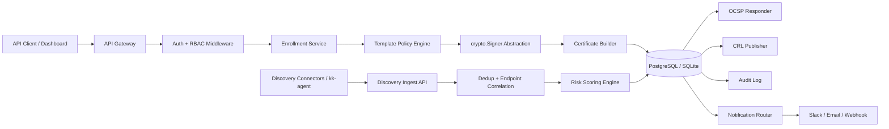

---

## 3. Plugin Registry Architecture

> **Built reality (2026-10-08):** the generic `Registry[T]` below
> (`pkg/registry/registry.go`) was never built. Extension today is a Go file
> and a `switch` per subsystem. F5 and Citrix are push targets in
> `internal/agentinstall`, not discovery connectors. Third-party, out-of-tree
> delivery plugins are designed separately in `docs/design/DELIVERY_PLUGINS.md`.

The plugin registry pattern is the central extensibility mechanism in Kryptkeeper. Every
extensible subsystem uses a generic `Registry[T]` with self-registration at init time.
Adding a new plugin requires one new file and one `Register()` call — no changes to the
core engine.

### Generic Registry

```go
// pkg/registry/registry.go

// Registry is a thread-safe generic plugin registry.
type Registry[T any] struct {
    mu      sync.RWMutex
    plugins map[string]T
}

func (r *Registry[T]) Register(name string, plugin T) {
    r.mu.Lock()
    defer r.mu.Unlock()
    r.plugins[name] = plugin
}

func (r *Registry[T]) Get(name string) (T, bool) {
    r.mu.RLock()
    defer r.mu.RUnlock()
    p, ok := r.plugins[name]
    return p, ok
}

func (r *Registry[T]) List() []string {
    r.mu.RLock()
    defer r.mu.RUnlock()
    names := make([]string, 0, len(r.plugins))
    for n := range r.plugins {
        names = append(names, n)
    }
    return names
}
```

### Extension Point 1 — Protocol Servers

Each enrollment protocol (ACME, EST, SCEP, OCSP, CRL) is a transport layer that calls
the CA core through the `EnrollmentHandler` interface. Adding a new protocol (e.g., V2
XCEP/WSTEP) is a new package that imports and calls the interface.

```go
// internal/enrollment/handler.go
type EnrollmentHandler interface {
    HandleCSR(ctx context.Context, req *CSRRequest) (*CertResponse, error)
    HandleRenewal(ctx context.Context, req *RenewalRequest) (*CertResponse, error)
    HandleRevocation(ctx context.Context, req *RevocationRequest) error
}
```

### Extension Point 2 — Discovery Connectors

```go
// internal/discovery/connector.go
type DiscoveryConnector interface {
    Name() string
    Type() ConnectorType  // network, ssh, winrm, cloud, agent
    Discover(ctx context.Context, scope ScanScope) ([]DiscoveredCert, error)
    Validate(ctx context.Context, config ConnectorConfig) error
}
```

V1 connectors: network, ssh, winrm, aws-acm, azure-keyvault, gcp-certmanager, kubernetes, ctlogs.
V2+ connectors: f5, citrix, ssh-keys, code-signing. Each is a new file + `Register()` call.

### Extension Point 3 — Key Storage Backends

The `crypto.Signer` interface is Go's stdlib abstraction for signing operations. Each backend
(software, PKCS#11, cloud KMS) implements this interface. The CA core never calls anything
other than `signer.Sign()`.

```go
// Implemented by each backend:
// crypto.Signer from Go stdlib — Public() + Sign()

// internal/keystore/backends.go
var Backends = registry.New[KeyStoreFactory]()

func init() {
    Backends.Register("software", newSoftwareBackend)
    Backends.Register("pkcs11",   newPKCS11Backend)
    Backends.Register("cloudkms", newCloudKMSBackend) // V2 full support
}
```

### Extension Point 4 — Notification Channels

```go
// internal/notifications/channel.go
type NotificationChannel interface {
    Name() string
    Send(ctx context.Context, alert Alert) error
    Validate(ctx context.Context, config ChannelConfig) error
}
```

V1 channels: email, webhook. V2+: Slack, PagerDuty, Teams. Registration pattern identical
to connectors.

### Extension Point 5 — Certificate Policy Engine

Policy evaluators are composable and stackable. Each CA or template can configure a
different ordered set of evaluators.

```go
// internal/templates/policy.go
type PolicyEvaluator interface {
    Evaluate(ctx context.Context, req *PolicyRequest) (*PolicyResult, error)
}

// Composed at runtime from the registry:
var Evaluators = registry.New[PolicyEvaluator]()
// Registered: key-size, algorithm, san-validation, pqc-compliance
```

### Extension Point 6 — Dashboard Feature Modules

The React dashboard follows a feature-sliced architecture. Each feature is a self-contained
directory. New features (e.g., V2 ADCS management, V3 PQC dashboard) are new directories
that register their routes in the central router — no modifications to existing features.

```
web/src/features/
  ca-hierarchy/         ← CA management
  certificates/         ← Inventory, search, detail
  discovery/            ← Scan management, results
  risk-dashboard/       ← Risk scoring, expiry alerts
  templates/            ← Template CRUD
  notifications/        ← Alert routing configuration
  users/                ← RBAC, user management
  api-keys/             ← API key management
```

---

## 4. Go Module Structure

```
kryptkeeper/
  cmd/
    kryptkeeper/          ← Main binary: API + CA core + protocols + discovery
      main.go             ← Wire up services, start HTTP servers
    kk-agent/             ← Discovery agent binary (<15MB target)
      main.go

  internal/               ← Private application packages (not importable externally)
    ca/                   ← CA lifecycle: create, sign, revoke, chain validation
      service.go          ← ca.Service interface + implementation
      hierarchy.go        ← Root/issuing CA tree management
      serial.go           ← RFC 5280 serial number generation (20+ bytes entropy)
    enrollment/           ← EnrollmentHandler interface + request/response types
      handler.go
    protocols/
      acme/               ← ACME server (RFC 8555): account, order, challenge, finalize
      ocsp/               ← OCSP responder: pre-signed cache, RFC 5019 lightweight
      crl/                ← CRL generator: full + delta, scheduled + on-demand
      est/                ← EST server (RFC 7030): /cacerts, /simpleenroll
      scep/               ← SCEP server: PKIOperation handler
    discovery/
      engine/             ← Scan scheduler, orchestrator, job queue
        scheduler.go
        orchestrator.go
      connectors/
        network/          ← Two-phase: masscan port detect + Go TLS cert extract
        ssh/              ← SSH agentless: PEM/DER/config discovery
        winrm/            ← WinRM agentless: PowerShell cert store enum
        awsacm/           ← AWS ACM read-only inventory
        azurekv/          ← Azure Key Vault read-only inventory
        gcpcm/            ← GCP Certificate Manager read-only inventory
        kubernetes/       ← cert-manager CRDs + TLS Secrets + Ingress
        ctlogs/           ← crt.sh API polling
    templates/            ← Template CRUD + policy evaluator registry
      service.go
      policy.go           ← PolicyEvaluator interface
      evaluators/
        keysize.go
        algorithm.go
        san.go
        pqc.go
    inventory/            ← Certificate upsert, dedup, risk scoring, ownership
      service.go
      risk.go             ← Risk flag evaluation, 0-100 score, A-F grade
      ownership.go        ← Owner resolution priority chain
    notifications/        ← Alert pipeline: routing, channel dispatch
      service.go
      channels/
        email/
        webhook/
    keystore/             ← crypto.Signer backends + registry
      backend.go          ← KeyStoreFactory interface
      backends/
        software/         ← Argon2id PKCS#8 + envelope encryption
        pkcs11/           ← ThalesGroup/crypto11 wrapper
        cloudkms/         ← AWS KMS / GCP / Azure KV (V2 full)
    api/                  ← REST API: handlers, middleware, OpenAPI spec
      router.go
      middleware/
        auth.go           ← JWT + API key validation
        rbac.go           ← Role-based access control
        audit.go          ← Request/response audit logging
        ratelimit.go
      handlers/
        ca.go
        certificates.go
        templates.go
        discovery.go
        notifications.go
        users.go
    audit/                ← Append-only audit log writer
      service.go          ← Enforces append-only; no update/delete paths
    db/                   ← Database abstraction layer
      interface.go        ← Repository interfaces (PostgreSQL + SQLite share this)
      postgres/           ← PostgreSQL implementations
      sqlite/             ← SQLite implementations
      migrations/         ← golang-migrate SQL migration files

  pkg/                    ← Public Go packages (importable by agents, external tools)
    x509util/             ← X.509 parsing helpers, chain validation, fingerprinting
    riskmodel/            ← Risk flag definitions, weights, grade calculation
    certfmt/              ← PEM/DER/PKCS#12 conversion utilities
    agentapi/             ← Agent API types (shared with kk-agent)

  web/                    ← React dashboard (separate build output)
    src/
      features/           ← Feature-sliced modules (see Extension Point 6)
      components/         ← Shared UI components (shadcn/ui wrappers)
      lib/
        api-client/       ← OpenAPI-generated TypeScript client
        auth/

  deployments/
    docker-compose.yml    ← Single-node production stack
    docker-compose.dev.yml← Development override (hot reload, SQLite)
    helm/                 ← Kubernetes Helm chart
      Chart.yaml
      values.yaml
      templates/

  docs/                   ← All documentation (sdlc phases, research, api)
  scripts/                ← Build, test, license-check scripts
```

---

## 5. Service Boundary Table

| Binary / Service | Language | Port(s) | Protocol | Depends On | V1 |
|-----------------|----------|---------|----------|-----------|-----|
| `kryptkeeper` main | Go | — | — | PostgreSQL, (optional) HSM, (optional) Vault | Required |
| API Gateway | Go (within main) | 8443 | HTTPS/REST | CA Core, Discovery, DB | Required |
| CA Core | Go (internal pkg) | — | In-process | Key Stores, DB, Audit | Required |
| ACME Server | Go (within main) | 8444 | HTTPS/ACME | CA Core | Required |
| OCSP Responder | Go (within main) | 8445 | HTTP | DB, Cache | Required |
| CRL Generator | Go (background job) | — | — | CA Core, DB | Required |
| EST Server | Go (within main) | 8446 | HTTPS/EST | CA Core | Required |
| SCEP Server | Go (within main) | 8447 | HTTP/SCEP | CA Core | Required |
| Discovery Engine | Go (within main) | — | In-process | Connector Registry, DB | Required |
| Web Dashboard | React (nginx) | 443 / 3000 | HTTPS | API Gateway | Required |
| `kk-agent` | Go (separate binary) | — (outbound only) | HTTPS poll | API Gateway | Required |
| PostgreSQL | External | 5432 | TCP | — | Required (or SQLite) |
| MS-XCEP (V2) | Go (within main) | 8448 | HTTPS/SOAP | CA Core, Templates | V2 |
| MS-WSTEP (V2) | Go (within main) | 8449 | HTTPS/SOAP | CA Core | V2 |
| AD LDAP Sync (V2) | Go (background job) | — | LDAP/S | Templates, DB | V2 |

**Note:** All protocol servers (ACME, OCSP, EST, SCEP) run within the same `kryptkeeper`
binary. This simplifies single-node deployment while keeping internal module boundaries
clean. In Kubernetes, they can be split to separate replicas by building with build tags.

---

## 6. Logical View

### Module Dependency Rules

These rules are enforced by Go's import cycle prevention and code review:

1. `internal/ca` MUST NOT import any protocol package (`protocols/acme`, `protocols/est`, etc.).
   Protocol packages import `internal/enrollment` — never the reverse.
2. `internal/api` imports `internal/ca`, `internal/discovery`, `internal/templates`, and
   `internal/notifications`. It does NOT import `internal/protocols/*` directly.
3. `internal/db` defines interfaces only. `internal/db/postgres` and `internal/db/sqlite`
   implement them. Business logic imports `internal/db` (the interface), never the concrete packages.
4. `pkg/*` packages are dependency-free (no imports of `internal/*`). They are safe for
   the agent binary and external tools to import.
5. `internal/audit` is a leaf package — nothing in `internal/audit` imports other internal
   packages. Everything that needs to log imports `internal/audit`.

### Design Patterns Used

| Pattern | Where | Why |
|---------|-------|-----|
| **Registry** | `pkg/registry`, all 6 extension points | Plugin extensibility without modifying core |
| **Repository** | `internal/db` | PostgreSQL/SQLite swap without changing business logic |
| **Interface/Adapter** | `EnrollmentHandler`, `DiscoveryConnector`, `NotificationChannel` | Protocol isolation; each is independently testable |
| **Strategy** | `PolicyEvaluator` stack | Composable, ordered policy evaluation per template |
| **Factory** | `KeyStoreFactory` in keystore registry | Deferred backend initialization with config |
| **Facade** | `ca.Service` | Simple interface over key storage, signing, cert building, revocation |

---

## 7. Process View — Critical Data Flows

### 7.1 Certificate Issuance Flow

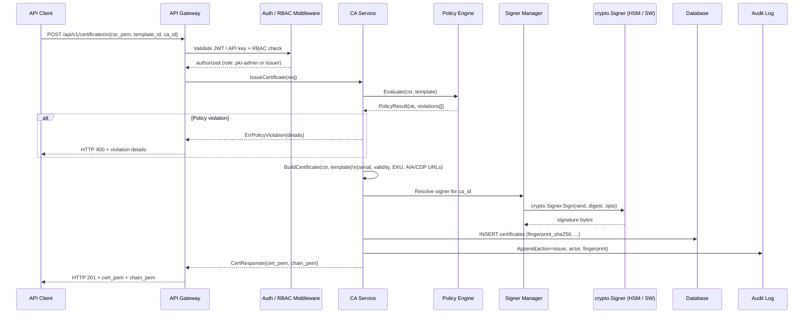

### 7.2 ACME Auto-Enrollment Flow

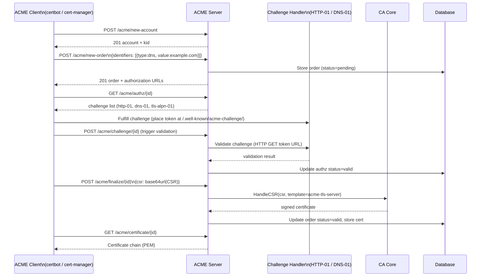

### 7.3 Discovery Scan Flow

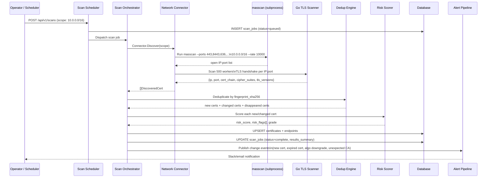

### 7.4 Alert Pipeline Flow

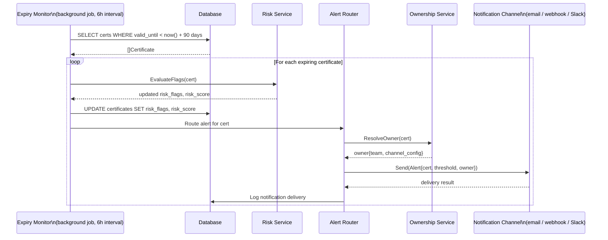

---

## 8. Implementation View — Directory Structure

See [Section 4](#4-go-module-structure) for the full annotated directory tree.

**Feature-sliced over layer-sliced (mandatory):**

The directory structure is organized by feature domain (`ca/`, `discovery/`, `templates/`,
`notifications/`), not by layer (`controllers/`, `services/`, `repositories/`). Each feature
package owns its own service logic, repository calls, and types. This ensures:
- A contributor working on SCEP does not need to understand discovery.
- The discovery engine can be handed off as a standalone module.
- Adding a new protocol is a new subdirectory, not modifications across 4 layer directories.

---

## 9. Deployment View

### Single-Node (Docker Compose)

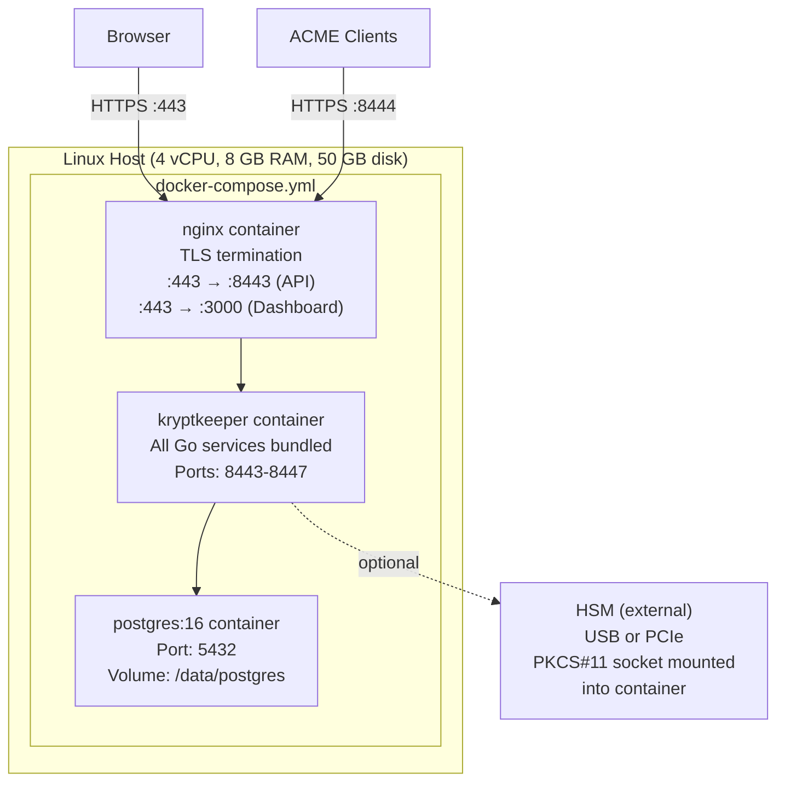

**Startup sequence:**
1. `postgres` starts (healthcheck: `pg_isready`)
2. `kryptkeeper` waits for postgres healthcheck, then runs migrations via golang-migrate
3. `nginx` starts, serves dashboard static files + proxies API

### Multi-Node (Kubernetes Helm Chart)

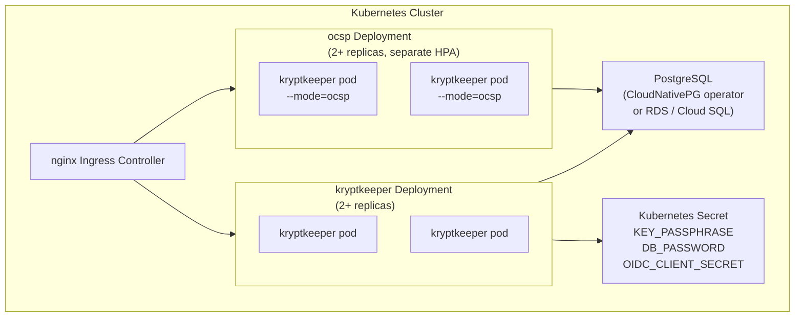

### CI/CD Pipeline

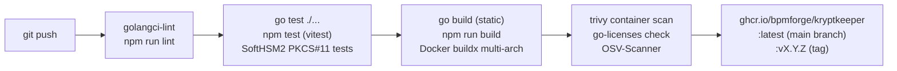

---

## 10. Architecture Decision Records

### ADR-001: Go for the CA Core and All Backend Services

| Field | Value |
|-------|-------|
| **Status** | Accepted |
| **Date** | 2026-04-05 |
| **Decision** | All backend services (CA core, protocol servers, discovery engine, API gateway, agent) are written in Go. |
| **Rationale** | Every successful modern open-source CA (step-ca, Boulder, cfssl, EJBCA's recent tooling) uses Go. The `crypto/x509` and `crypto/tls` standard libraries are battle-tested and maintained by the Go security team. Go produces a single static binary with no runtime dependencies, which is critical for the agent (<15MB) and for simple Docker deployments. The developer pool for Go in the security domain is large. |
| **Alternatives Considered** | Rust: strong memory safety but fragmented crypto ecosystem; no production CA precedent. Node/TypeScript: large developer pool but `node-forge` is unaudited; no stdlib X.509 equivalent. Java (EJBCA-style): production-proven but requires JVM runtime, complex deployment, and LGPL/proprietary license risk. |
| **Consequences** | Dashboard remains TypeScript/React — Go is the wrong tool for UI. Agent can use the same core packages as the server. |

### ADR-002: Plugin Registry Architecture for All Extensible Subsystems

| Field | Value |
|-------|-------|
| **Status** | Accepted |
| **Date** | 2026-04-05 |
| **Decision** | All six extensible subsystems (protocol servers, discovery connectors, key storage backends, notification channels, policy evaluators, dashboard feature modules) use a generic `Registry[T]` with interface-driven self-registration at `init()` time. |
| **Rationale** | Single-developer constraint (R-B03) requires the architecture to be community-contributable. A contributor adding a new discovery connector (e.g., F5 iControl) should be able to write one file, call `Register()`, and have it work — without understanding the scheduler, orchestrator, or database layer. The registry pattern enforces this boundary. |
| **Alternatives Considered** | Configuration-driven plugin loading (YAML lists connectors by name): requires a factory dispatch table in the core, which tightly couples the core to every plugin. Import-all approach (core imports all connectors): no plugin isolation, breaking changes propagate. |
| **Consequences** | All plugins must implement the relevant interface contract completely. Interface changes require updating all implementations. The `pkg/registry` package is a public API and must remain stable. |

### ADR-003: crypto.Signer as the Only Path to Private Keys

| Field | Value |
|-------|-------|
| **Status** | Accepted (non-negotiable — see C-Tech03) |
| **Date** | 2026-04-05 |
| **Decision** | All CA signing operations invoke `crypto.Signer.Sign()`. No code path accesses private key bytes directly after initial generation. |
| **Rationale** | This is the single most important architectural decision for key security. It means: (1) the HSM backend never exposes key material to Go heap memory; (2) swapping from software to PKCS#11 to cloud KMS requires zero changes to CA logic; (3) code review for key-handling can focus on a single interface boundary. |
| **Alternatives Considered** | Direct RSA/ECDSA private key access: simpler initial implementation but makes HSM integration a retrofit and creates accidental key exposure paths. |
| **Consequences** | All three key storage backends must implement `crypto.Signer`. The software backend must zero key memory after each signing operation. Cloud KMS backends must handle network latency in `Sign()`. |

### ADR-004: PostgreSQL as Primary Database with SQLite for Single-Node

| Field | Value |
|-------|-------|
| **Status** | Accepted |
| **Date** | 2026-04-05 |
| **Decision** | PostgreSQL 16+ is the production database. SQLite is supported for single-node and development deployments via the repository pattern (C-Tech04). No PostgreSQL-specific SQL (e.g., `RETURNING`, array types, JSONB operators) is used in business logic — only in the PostgreSQL repository implementation. |
| **Rationale** | PostgreSQL provides concurrent writes, JSONB for flexible metadata, declarative partitioning for the audit log, and full SQL analytics for risk reporting. SQLite provides zero-dependency setup for `docker compose up` without a separate database container, critical for the 15-minute quickstart target (C-Ops01). |
| **Alternatives Considered** | PostgreSQL only: too heavyweight for solo developers evaluating the platform. SQLite only: no concurrent write support; cannot scale to multi-replica. CockroachDB: distributed SQL adds operational complexity not warranted at V1. |
| **Consequences** | Two complete database implementations must be maintained. Schema migrations must be tested against both databases. Audit log partitioning is PostgreSQL-specific and must be simulated in SQLite with date-range queries. |

### ADR-005: Feature-Sliced Frontend with shadcn/ui

| Field | Value |
|-------|-------|
| **Status** | Accepted |
| **Date** | 2026-04-05 |
| **Decision** | The React dashboard uses a feature-sliced directory structure under `web/src/features/`. Each feature is a self-contained module with its own components, hooks, and API calls. The component library is shadcn/ui (Radix UI primitives + Tailwind CSS). |
| **Rationale** | Feature-sliced structure mirrors the backend's module organization and allows contributors to work on one feature (e.g., discovery, risk dashboard) without understanding the whole frontend. shadcn/ui provides accessible, unstyled Radix primitives that are copied into the repo (no runtime dependency on shadcn), allowing full customization. TanStack Query handles server state to avoid prop-drilling in complex views like the certificate inventory. |
| **Alternatives Considered** | Layer-sliced (components/, hooks/, pages/): causes cross-cutting changes when adding a feature. MUI/Ant Design: opinionated styling that conflicts with enterprise security tool aesthetics. Custom component library: too expensive for single-developer project. |
| **Consequences** | Feature boundaries must be respected: no cross-feature imports. Shared components live in `web/src/components/`. The OpenAPI client is generated from the Go server spec to keep API types in sync. |

### ADR-006: Apache 2.0 License with Proprietary Enterprise Tier

| Field | Value |
|-------|-------|
| **Status** | Accepted |
| **Date** | 2026-04-05 |
| **Decision** | Core platform is Apache 2.0. Enterprise features (FIPS-validated build, multi-tenancy, advanced ADCS integration, SLA support) are a separate proprietary tier. All dependencies in the Apache 2.0 core must be Apache 2.0, MIT, BSD-2, BSD-3, or ISC compatible. |
| **Rationale** | Apache 2.0 is required for enterprise legal teams (patent grant, no copyleft). AGPL or GPL would be rejected by enterprise security procurement. The OSS-first model drives adoption (step-ca's commercial model demonstrates this). Enterprise add-ons provide the commercial funding path. |
| **Alternatives Considered** | AGPL: maximum copyleft, but enterprise legal blocks it routinely. BSL (Business Source License): time-delayed open source — breaks community trust. Pure open source (no commercial tier): no revenue model. |
| **Consequences** | `go-licenses` or `license-checker` must run in CI against all dependencies. Any new dependency requires license verification before merging. Enterprise features must be cleanly separated from the Apache 2.0 core at the module boundary. |

### ADR-007: Separate Agent Binary

| Field | Value |
|-------|-------|
| **Status** | Accepted |
| **Date** | 2026-04-05 |
| **Decision** | The discovery agent (`kk-agent`) is a separate Go binary with a strict <15MB size target. It imports only `pkg/*` packages and communicates with the server exclusively via the REST API over HTTPS. |
| **Rationale** | The agent runs on managed endpoints where size and trust surface area matter. A separate binary ensures: (1) the agent cannot be tricked into running CA operations; (2) it can be code-signed and distributed independently; (3) it can be audited separately from the server. The <15MB limit ensures compatibility with software distribution tools that have file size restrictions. |
| **Alternatives Considered** | Combined binary with mode flag: simpler build but creates a large binary on every managed endpoint and a larger trust surface. gRPC-based agent protocol: adds complexity; HTTPS polling is sufficient for 15-minute inventory cadence and is firewall-friendly. |
| **Consequences** | Agent functionality is limited to what `pkg/*` packages expose. New agent capabilities require `pkg/*` additions, which are a public API (semver-versioned). Agent binary size must be checked in CI (`go build -ldflags="-s -w"` + UPX compression if needed). |

---

## 11. Cross-Cutting Concerns

### Logging

- **Library:** `log/slog` (Go 1.21+ stdlib structured logging)
- **Format:** JSON in production, human-readable text in development (`KRYPTKEEPER_LOG_FORMAT=json|text`)
- **Level:** Configurable (`KRYPTKEEPER_LOG_LEVEL=debug|info|warn|error`)
- **Mandatory fields on every log entry:** `timestamp`, `level`, `msg`, `service` (e.g., `acme`, `ca`, `discovery`), `trace_id`
- **What is never logged:** private key material, plaintext passphrases, full certificate PEM (log fingerprint_sha256 instead)

### Error Handling

- **Internal errors:** wrapped with `fmt.Errorf("operation: %w", err)` for stack-traceable chains
- **API errors:** structured JSON `{"error": {"code": "POLICY_VIOLATION", "message": "...", "details": [...]}}`
- **Security errors:** return generic message to client, log full detail server-side (avoid information leakage)
- **CA signing errors:** always fatal to the signing operation; never partial certificates

### Caching Strategy

| Cache Target | Store | TTL | Invalidation |
|-------------|-------|-----|-------------|
| Pre-signed OCSP responses | Redis or in-memory | 1 hour (matches OCSP `nextUpdate`) | On revocation event |
| CRL distribution point | Object store / nginx | CRL validity period | On CRL regeneration |
| Template policies | In-memory (per-process) | 5 minutes | On template update |
| Certificate chain validation | In-memory LRU | 30 minutes | On CA hierarchy change |

### Security Controls

| Control | Implementation |
|---------|--------------|
| Transport encryption | TLS 1.2+ on all endpoints; TLS 1.3 preferred. ACME and OCSP can serve HTTP for challenge validation only. |
| Authentication | Bootstrap token, API keys (HMAC-SHA256 with a pepper), local login (Argon2id PHC hash, `auth_password.go`; per-account backoff, `auth_login_state.go`), HS256/OIDC/SAML bearer or session tokens (hand-written verification, `auth_hs256.go`, `auth_jwks.go`; `jwt`/`oidc` bearer tokens are `viewer` unless `APP_AUTH_ROLE_CLAIM` and `APP_AUTH_ROLE_MAP_JSON` map a role; OIDC needs issuer and audience; OIDC login binds state and nonce to the browser and requires `email_verified` for the first-login email link; SAML binds InResponseTo and keeps an assertion replay cache, both per process), SCIM bearer. No mutual-TLS API authentication: the listener only requests a client certificate (`cmd/kryptkeeper/tls.go:130`) and WSTEP/EST verify it themselves |
| Authorization | Fixed roles `pki-admin`, `pki-operator`, `approver`, `service-account`, `viewer`, `auditor`, `mcp-agent`, plus the `bootstrap` token and custom roles (`authz_custom_roles.go`). Writes are gated by one middleware that maps each route to a permission and refuses unmatched paths for non-admins (`authz_write_gate.go`); reads are authenticated per handler; `/audit` and `/audit/transparency/*` need `audit.read` and the cloud key inventory needs `key.manage` or `report.read`, other reads have no permission check beyond authentication. `mcp-agent` may only propose actions. Users invite/PATCH/DELETE, role create/update/delete and API-key create require the caller to hold every permission of the role it grants or changes; only `pki-admin` or the bootstrap token grants `pki-admin` (`authz_grant.go`, FG-3). |
| Dual control and separation of duties | Key delete, rotate and export, backup, escrow, recovery and BYOK export go through the approval queue by default (D-122); `KRYPTKEEPER_KEY_DUAL_CONTROL=false` opts out with a startup warning (`key_dual_control.go`). Approver and proposer are compared by canonical human identity, and API keys record `created_by`, so a key an admin minted cannot approve that admin's proposals (A07-4). The bootstrap token cannot approve. Fixed in FG-2, merged. |
| Tenancy | `MULTI_TENANCY` is off by default and ships EXPERIMENTAL in v0.9: the hub refuses `MULTI_TENANCY=true` unless `KRYPTKEEPER_MULTI_TENANCY_EXPERIMENTAL=accept-risk` is set, logs a warning and labels it in the UI (D-123, `MultiTenancyExperimentalCheck`). Non-bootstrap principals are pinned to their identity tenant and a mismatching `X-Tenant` is refused (`auth.go:241-270`), but tenant-isolation findings A01-001, A01S-3, A01-002, A01-006, A01S-6 and the cross-tenant reads (including audit rows) stay open until v0.10 (FG-6a/6b). Do not run it with mutually untrusted tenants. |
| Plugin signing and integrity | Delivery plugins: the manifest is verified offline against ECDSA P-256 cosign keys; a key compiled into the hub makes a plugin first-party, operator-trusted keys (`KRYPTKEEPER_PLUGIN_TRUSTED_KEYS`) make it verified, no signature makes it community, and a signature that fails is refused (`delivery_plugin_signing.go`). The module SHA-256 is checked on every load (`internal/plugins/delivery/runtime.go:98`). Capabilities are enforced by the host. Without `elevated_exec` the host refuses escalation tools (`sudo`, `doas`, `su`, `pkexec`, `runuser`, `setpriv`), shells and interpreters with an inline command, and wrappers launching either (`internal/plugins/delivery/escalation.go`, `host.go`); this is a denylist on argv shapes, not a sandbox. Any network capability rates as High tier and needs a second approver to enable (`sdk/delivery-go/abi/manifest.go` `Tier`; A08-001, SUP-A08-1, FG-10). |
| Egress | `internal/egress` builds the HTTP clients for notification webhooks, Slack and PagerDuty delivery (`internal/notifications/delivery/delivery.go`), inventory sources and the ACME connector (`internal/bootstrap/egress_clients.go`, `connector_acme.go`). The policy is checked on the dialled IP after DNS and on every redirect hop: link-local (cloud metadata), unspecified, multicast and loopback are refused; cross-host redirects are refused; RFC 1918, ULA and CGNAT stay reachable unless `KRYPTKEEPER_EGRESS_DENY_PRIVATE=true`. ACME http-01 has its own dial guard (`internal/acme/http01.go`; RFC 1918 allowed). Discovery scans refuse link-local targets and `KRYPTKEEPER_DISCOVERY_DENY_CIDRS` and cap targets (`KRYPTKEEPER_DISCOVERY_MAX_TARGETS`, default 65536). OIDC discovery, JWKS and token-exchange clients only refuse redirects to non-https URLs (`auth_oidc.go`). Not guarded: SIEM sinks (`siem_integration.go`, plain `http.Client`), the evidence mailer, SAML metadata fetch (FG-8 merged; those remain open). |
| Audit logging | Every state-changing operation appends to `audit_log`. Enforced at service layer, not just HTTP layer. |
| Private key protection | `crypto.Signer` abstraction; Argon2id + AES-256-GCM envelopes in the software keystore. Key material is returned by the export, escrow and backup endpoints (see Dual control), so "never in API responses" is not a property of the system |
| Response headers and cookies | `withSecurityHeaders` sets `X-Content-Type-Options`, `Referrer-Policy: no-referrer`, `X-Frame-Options: DENY`, `Content-Security-Policy: frame-ancestors 'none'` on every hub response, HSTS on TLS, and `Cache-Control: no-store` on `/api/` (`internal/bootstrap/http_security.go`). The session cookie is `Secure` when the request arrived over TLS or from a trusted proxy (`APP_TRUSTED_PROXY_CIDRS`) that reports https. Redirect targets must be relative paths (`safeRelativeRedirect`). Audit source IP is still taken from client `X-Forwarded-For` (OWASP-001, no fix group). |
| Rate limiting | Per-IP limits on the protocol endpoints (`cmd/kryptkeeper/main.go:512-519`) and per-principal limits on selected API routes (`auth_rate_limit.go`); no per-API-key limit on the protocols |
| Input validation | All CSR inputs validated before processing: signature check, key size, algorithm, SAN format |
| Dependency scanning | `govulncheck` + `trivy` + `osv-scanner` in CI |

### Observability

- **Metrics:** `prometheus/client_golang` — standard Go runtime metrics + application metrics (certs issued/revoked/day, OCSP response latency, scan job durations, expiry count by threshold)
- **Health endpoints:** `GET /health/live` (process alive), `GET /health/ready` (DB + required services reachable)
- **Tracing:** OpenTelemetry (OTEL) trace context propagated via HTTP headers; optional OTLP export to Jaeger / Grafana Tempo
