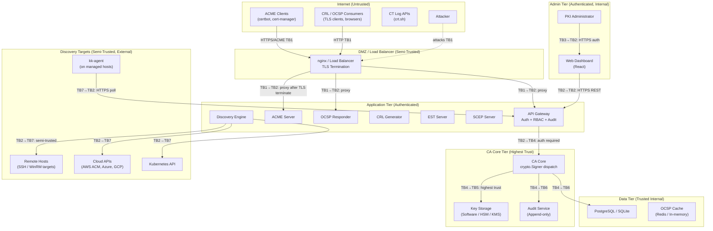
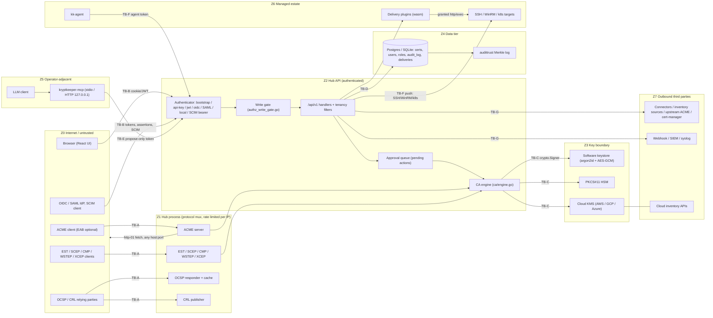

# Kryptkeeper — Threat Model

**Version:** 1.1 (1.0 2026-04-05; 2026-10-09 deep-audit addendum in §8)
**Date:** 2026-04-05
**Phase:** 3 — Design
**Framework:** STRIDE (Spoofing, Tampering, Repudiation, Information Disclosure,
Denial of Service, Elevation of Privilege)

This document identifies threats to Kryptkeeper across all trust boundaries and components,
rates each threat by severity, and maps each to a concrete mitigation. The threat model
is scoped to V1 architecture. V2 (ADCS/AD integration) introduces additional threats
documented in a separate addendum.

> **Read §1-§7 as the 1.0 design intent, not as the state of the code.** The
> 2026-10-09 audit found several mitigations and residual-risk ratings below to be
> false as built. §1 carries the corrected classification controls inline; every other
> corrected claim is in §8.10 with its code evidence and fix group (FG-n).

---

## Table of Contents

1. [Data Classification](#1-data-classification)
2. [Trust Boundary Diagram](#2-trust-boundary-diagram)
3. [Trust Boundary Definitions](#3-trust-boundary-definitions)
4. [STRIDE Threat Analysis by Component](#4-stride-threat-analysis-by-component)
   - [4.1 CA Core](#41-ca-core)
   - [4.2 API Gateway](#42-api-gateway)
   - [4.3 ACME Server](#43-acme-server)
   - [4.4 OCSP Responder](#44-ocsp-responder)
   - [4.5 Discovery Engine](#45-discovery-engine)
   - [4.6 kk-agent](#46-kk-agent)
   - [4.7 Web Dashboard](#47-web-dashboard)
   - [4.8 Database](#48-database)
5. [Security Controls Summary Table](#5-security-controls-summary-table)
6. [Threat-to-Control Traceability Matrix](#6-threat-to-control-traceability-matrix)
7. [Residual Risks](#7-residual-risks)
8. [2026-10-09 Deep-Audit Addendum](#8-2026-10-09-deep-audit-addendum)

---

## 1. Data Classification

The following classification defines how sensitive each data type is and what protections
are required.

| Classification | Label | Examples | Required Controls |
|----------------|-------|---------|------------------|
| **CRITICAL** | Private key material | CA root key, issuing CA key, OCSP signing key | Never leaves HSM or encrypted storage; memory zeroed after use; access audited. **As built:** `POST /api/v1/keys/{id}/export`, `/keys/escrow` and `/admin/backup` return key material only after a second approver under key dual control, on by default since FG-2 (D-122); `KRYPTKEEPER_KEY_DUAL_CONTROL=false` opts out with a startup warning (A2A7-001) |
| **CRITICAL** | Key derivation secrets | Argon2id passphrase, Vault master key reference, KMS key ARN | Same controls as private keys; never logged |
| **RESTRICTED** | Audit log | All `audit_log` table data | Append-only; tamper-evident; 7-year retention. **As built:** `GET /api/v1/audit` and `/api/v1/audit/transparency/*` need the `audit.read` permission (`requireReadPermission`, `internal/bootstrap/authz_grant.go`; called from `handlers_audit.go` and `handlers_audit_trust.go`). `pki-admin`, `auditor`, `pki-auditor` and custom roles granted it can read; `mcp-agent`, `service-account`, `viewer` and `operator` get 403 and a `denied` audit event. The MCP `audit_query` tool was removed. Fixed in FG-3 and FG-10 (LLM-001, A01-004). Under multi-tenancy the log is still not tenant-filtered (FG-6b, v0.10) |
| **RESTRICTED** | Notification channel configs | Webhook URLs, API tokens, PagerDuty routing keys | **As built: not met.** Delivery targets (webhook URLs, often bearer secrets) are stored and listed in plaintext in `notification_deliveries` (`internal/bootstrap/notification_db_provider.go:271-302`; TM-43, no fix group yet). AES-256-GCM sealing exists only for outbound credentials (`internal/bootstrap/outbound_credential_store.go`) |
| **RESTRICTED** | User credentials | Password hashes, OIDC tokens, API key hashes | **As built:** API keys are HMAC-SHA256 with a pepper (`internal/bootstrap/auth_identity.go:70`); the local login password (`APP_AUTH_LOGIN_PASSWORD_HASH`) is an Argon2id PHC string, 19 MiB, t=2, p=1 (`internal/bootstrap/auth_password.go`; FG-7, A2A7-002). Old HMAC-SHA256 values still verify and are upgraded in memory on the first successful login; `kryptkeeper --hash-password` emits the persistent value. Bcrypt is used only for EST users (`internal/est/auth.go`). Never stored in plaintext; never logged |
| **INTERNAL** | Certificate metadata | Fingerprints, subject DNs, validity dates, risk scores | Requires authentication; accessible to authorized roles; no public endpoint |
| **INTERNAL** | CA hierarchy | CA names, certificate fingerprints, status | Same as certificate metadata |
| **PUBLIC** | Issued certificates | Signed X.509 certificates | By design (certificates are public); CRL and OCSP responses are public |
| **PUBLIC** | CRL distribution points | CRL files at CDP URLs | By design; unauthenticated access required for CRL clients |
| **PUBLIC** | OCSP responses | Pre-signed OCSP responses | By design; unauthenticated access required for OCSP clients |

---

## 2. Trust Boundary Diagram

**Trust Boundary Key:**

| Boundary | ID | Description |
|----------|-----|-------------|
| Internet → DMZ | TB1 | Untrusted network. TLS required. Rate-limited. |
| DMZ → Application | TB2 | After TLS termination. Requests are authenticated or challenge-validated (ACME/OCSP). |
| Admin network → Application | TB3 | Dashboard access. Requires OIDC or local auth. |
| Application → CA Core | TB4 | Internal service call. Authenticated by service identity (no network hop in single binary). |
| CA Core → Key Storage | TB5 | Highest trust. Key material flows here only. |
| Application → Data | TB6 | Service account credentials. Encrypted in transit (TLS to PostgreSQL). |
| Application → Discovery Targets | TB7 | Semi-trusted. Credentials scoped to read-only. |

---

## 3. Trust Boundary Definitions

### TB1 — Internet to DMZ

**Who crosses it:** ACME clients, CRL/OCSP consumers, public attackers.
**What is allowed:** ACME protocol (port 8444), OCSP requests (port 8445), CRL downloads.
**Protections:** TLS 1.2+ required; nginx rate limiting; no authentication required for
OCSP/CRL (by design — revocation checking must be unauthenticated); ACME account required
for enrollment.

### TB2 — Application Tier (Internal)

**Who crosses it:** Dashboard (authenticated users), API clients (API key or JWT),
protocol servers routing to CA core.
**What is allowed:** All API operations — gated by RBAC.
**Protections:** JWT/API key authentication on all non-public endpoints; RBAC enforced at
middleware; audit log on all state changes.

### TB5 — CA Core to Key Storage

**Who crosses it:** CA core's Signer Manager when a signing operation is requested.
**What is allowed:** `crypto.Signer.Sign()` calls only. No key export.
**Protections:** This boundary is an in-process function call for software keys and a
PKCS#11 C_Sign call for HSM keys. Key material never crosses this boundary as bytes in
the software path after initialization. Memory zeroed after use.

### TB7 — Application to Discovery Targets

**Who crosses it:** Discovery connectors (SSH, WinRM, cloud APIs, K8s).
**What is allowed:** Read-only discovery operations. No certificate issuance, no file writes.
**Protections:** Credentials scoped to minimum privilege (read-only IAM roles, read-only
SSH keys, WinRM with constrained PowerShell). Target IP ranges require operator authorization
before scanning.

---

## 4. STRIDE Threat Analysis by Component

### 4.1 CA Core

The CA Core is the highest-value target. Compromise here undermines every certificate
ever issued.

---

#### T-CA-01: Private Key Theft via Memory Dump

| Field | Value |
|-------|-------|
| **STRIDE Category** | Information Disclosure |
| **Severity** | CRITICAL |
| **Component** | CA Core / Key Storage — Software Backend |
| **Description** | An attacker with OS-level access (root/SYSTEM) or a memory inspection capability (e.g., exploit) reads the Go heap and extracts the CA private key bytes that were decrypted for a signing operation. |
| **Attack Vectors** | OS-level exploit, container escape, compromised underlying host, heap dump via debug endpoint left open, core dump enabled on crash |
| **Mitigation** | (1) `crypto.Signer` abstraction ensures key bytes are touched only in the signing backend, not scattered through business logic. (2) Key bytes are zeroed immediately after the `Sign()` call completes. (3) No debug endpoints in production builds (remove `/debug/pprof` behind a build flag). (4) `RLIMIT_CORE=0` in Docker/Kubernetes to disable core dumps. (5) HSM backend (PKCS#11) eliminates in-memory key exposure entirely — recommend for production. (6) Container user is non-root; no privilege escalation path. |
| **Residual Risk** | Medium (software backend) / Low (HSM backend) |

---

#### T-CA-02: Unauthorized Certificate Signing

| Field | Value |
|-------|-------|
| **STRIDE Category** | Elevation of Privilege |
| **Severity** | CRITICAL |
| **Component** | CA Core / API Gateway |
| **Description** | An unauthenticated or insufficiently authorized caller submits a CSR and receives a signed certificate for an arbitrary domain or identity. |
| **Attack Vectors** | API authentication bypass, RBAC logic error, direct database write to `certificates` table bypassing CA, race condition in authorization check |
| **Mitigation** | (1) All CSR submission endpoints require authentication (`issuer` role minimum). (2) RBAC check happens at middleware before the request reaches the CA core — CA core performs a second authorization check (defense in depth). (3) Database user for the CA service has INSERT-only access to `certificates`, no UPDATE/DELETE. (4) Template policy engine validates every CSR attribute before signing — no path to bypass policy. (5) Audit log entry written for every signing operation before the response is returned. |
| **Residual Risk** | Low |

---

#### T-CA-03: CA Key Extraction via API

| Field | Value |
|-------|-------|
| **STRIDE Category** | Information Disclosure |
| **Severity** | CRITICAL |
| **Component** | REST API |
| **Description** | An attacker discovers or constructs an API endpoint that returns private key material. |
| **Attack Vectors** | Undocumented API endpoint, debug export endpoint, PKCS#12 export feature misuse, serialization bug that includes key in JSON response |
| **Mitigation** | (1) Constraint C-Sec03 is a hard architectural rule: no API endpoint returns private key material. (2) PKCS#12 export (for legacy systems) is disabled by default, requires `super-admin` role, and writes an audit log entry. (3) All API response types are reviewed in code review for accidental key field inclusion. (4) Automated test asserts that CA creation, certificate issuance, and CA detail endpoints do not contain PEM private key patterns in responses. |
| **Residual Risk** | Low |

---

#### T-CA-04: Certificate Issuance Policy Bypass

| Field | Value |
|-------|-------|
| **STRIDE Category** | Elevation of Privilege |
| **Severity** | HIGH |
| **Component** | Policy Engine / CA Core |
| **Description** | An attacker submits a crafted CSR that passes policy evaluation but produces a certificate with attributes exceeding the template's intended scope (e.g., a certificate with CA:TRUE constraint, or with a SAN covering a domain the requester does not own). |
| **Attack Vectors** | Malformed ASN.1 in CSR extensions, extra extensions not evaluated by policy, SAN injection via CN field, certificate request with BasicConstraints CA:TRUE |
| **Mitigation** | (1) Certificate builder explicitly constructs all extensions from template parameters — it does NOT copy extensions from the CSR (CSR extensions are advisory only, not trusted). (2) The `crypto/x509` stdlib is used for all certificate building; no custom ASN.1. (3) `BasicConstraints.IsCA` is always set to `false` for end-entity templates. (4) SAN validation policy evaluator runs as a mandatory step for all ACME and template-based issuances. (5) Integration tests for CSR injection attempts are part of the CA test suite. |
| **Residual Risk** | Low |

---

#### T-CA-05: Revocation Evasion

| Field | Value |
|-------|-------|
| **STRIDE Category** | Tampering |
| **Severity** | HIGH |
| **Component** | CA Core / OCSP / CRL |
| **Description** | A revoked certificate remains usable because the OCSP responder or CRL is not updated promptly after revocation, or because the OCSP response cache serves a stale "good" response. |
| **Attack Vectors** | Cache not invalidated on revocation, CRL publication delay, OCSP cache TTL too long, race condition between revocation write and cache invalidation |
| **Mitigation** | (1) Revocation writes to the database atomically with cache invalidation (within the same transaction). (2) OCSP pre-signed response cache is invalidated immediately on revocation — the cache key is the certificate serial + CA ID. (3) OCSP `nextUpdate` is set to 1 hour for pre-signed responses; clients that cache OCSP responses will see the revocation within 1 hour maximum. (4) CRL is generated immediately on revocation in addition to the scheduled cadence. (5) Acceptance criteria for FR-012 requires OCSP to return `revoked` within 60 seconds of revocation. |
| **Residual Risk** | Low |

---

### 4.2 API Gateway

#### T-API-01: Authentication Bypass

| Field | Value |
|-------|-------|
| **STRIDE Category** | Spoofing |
| **Severity** | CRITICAL |
| **Component** | API Gateway — Auth Middleware |
| **Description** | An attacker accesses protected API endpoints without a valid JWT or API key by exploiting weak token validation, algorithm confusion (e.g., RS256 to HS256 JWT attack), or missing authentication on certain routes. |
| **Attack Vectors** | JWT `alg:none` attack, RS256-to-HS256 confusion, missing auth middleware on new routes, regex bypass in route matching |
| **Mitigation** | (1) JWT validation uses `golang-jwt/jwt` with an explicit algorithm allow-list (no `alg:none`, no `RS256→HS256`). (2) Default-deny route configuration: all routes require authentication unless explicitly marked public (OCSP, CRL, ACME challenge). (3) Integration test asserts that unauthenticated requests to all non-public endpoints return HTTP 401. (4) `gosec` linter rule `G401` flags use of weak crypto in auth code. |
| **Residual Risk** | Low |

---

#### T-API-02: RBAC Privilege Escalation

| Field | Value |
|-------|-------|
| **STRIDE Category** | Elevation of Privilege |
| **Severity** | HIGH |
| **Component** | API Gateway — RBAC Middleware |
| **Description** | A user with `viewer` or `issuer` role performs operations only `pki-admin` or `super-admin` should be allowed to perform (e.g., revoking a certificate, modifying a template, creating a CA). |
| **Attack Vectors** | RBAC logic error (wrong role checked), parameter injection to claim a different role, endpoint without RBAC middleware attached |
| **Mitigation** | (1) RBAC check is applied as a middleware wrapping every handler — not inside handlers where it can be forgotten. (2) Roles are stored server-side (in JWT claims and verified against the database on sensitive operations) — clients cannot self-escalate. (3) Role table is explicitly checked: `if !roles.Contains(requiredRole) { return 403 }` with no implicit fallthrough. (4) Test suite includes a full matrix of role × operation × expected HTTP status. |
| **Residual Risk** | Low |

---

#### T-API-03: SQL Injection

| Field | Value |
|-------|-------|
| **STRIDE Category** | Tampering / Information Disclosure |
| **Severity** | HIGH |
| **Component** | API Gateway / Database Layer |
| **Description** | An attacker injects SQL through API parameters (certificate search, filter queries, template name) to read unauthorized data or modify database content. |
| **Attack Vectors** | Unsanitized string interpolation in SQL, ORM bypass via raw query escapes, JSONB operator injection |
| **Mitigation** | (1) All database queries use parameterized queries via `pgx` — no string interpolation into SQL. (2) No ORM that allows raw query passthrough. (3) `gosec` linter rule `G201`/`G202` flags string-concatenated SQL. (4) Integration tests include SQL injection payloads in all filter and search parameters. |
| **Residual Risk** | Low |

---

#### T-API-04: Rate Limiting Bypass / API Abuse

| Field | Value |
|-------|-------|
| **STRIDE Category** | Denial of Service |
| **Severity** | MEDIUM |
| **Component** | API Gateway |
| **Description** | An attacker submits high-volume requests to certificate issuance or ACME endpoints, exhausting CPU (signing operations are expensive) or flooding the database with spurious certificates. |
| **Attack Vectors** | Botnet enumeration of ACME endpoints, API key flooding, certificate issuance spam |
| **Mitigation** | (1) Per-IP rate limiting at nginx (e.g., 10 req/s for ACME, 100 req/s for read endpoints). (2) Per-API-key rate limiting in API middleware (configurable per key). (3) ACME rate limits per account: 10 orders/hour, 5 pending authorizations. (4) Certificate issuance is idempotent on duplicate CSR — same CSR returns existing cert, not a new signing operation. |
| **Residual Risk** | Low |

---

### 4.3 ACME Server

#### T-ACME-01: Domain Validation Bypass

| Field | Value |
|-------|-------|
| **STRIDE Category** | Spoofing |
| **Severity** | CRITICAL |
| **Component** | ACME Server — Challenge Handler |
| **Description** | An attacker obtains a certificate for a domain they do not control by manipulating HTTP-01 challenge verification (e.g., DNS rebinding, SSRF to internal validation endpoint, server-side request forgery to reach a host the attacker controls). |
| **Attack Vectors** | DNS rebinding during HTTP-01 verification, SSRF to a host the attacker controls, cached positive validation result, request smuggling to challenge server |
| **Mitigation** | (1) HTTP-01 validation connects to the domain's external IP only — no private IP ranges (RFC 1918, loopback, link-local) in challenge target addresses. (2) Challenge tokens are cryptographically random (32 bytes, base64url). (3) Challenge validation is performed server-side with a fresh DNS lookup at validation time — no caching of validation results between the challenge setup and verification. (4) DNS-01 challenge for internal CAs is preferred for internal domain names where HTTP-01 creates network topology complications. (5) Provisioner scoping: ACME provisioners can be configured with domain restrictions (only issue for `*.example.com`). |
| **Residual Risk** | Low |

---

#### T-ACME-02: ACME Account Key Compromise / Replay

| Field | Value |
|-------|-------|
| **STRIDE Category** | Spoofing / Tampering |
| **Severity** | HIGH |
| **Component** | ACME Server |
| **Description** | An attacker steals or reuses an ACME account key to issue certificates on behalf of another account, or replays a captured ACME order request. |
| **Attack Vectors** | ACME account key theft from client filesystem, replay of captured signed ACME request, nonce reuse |
| **Mitigation** | (1) Nonce is included in every ACME request and validated server-side — nonces are single-use. (2) Replay protection: each ACME request is signed with a per-request nonce from the `new-nonce` endpoint. (3) Account revocation is supported via the ACME `deactivateAuthorization` workflow. (4) ACME account keys are validated with JWS verification on every request — no unsigned operations after account creation. |
| **Residual Risk** | Low |

---

### 4.4 OCSP Responder

#### T-OCSP-01: Response Forgery

| Field | Value |
|-------|-------|
| **STRIDE Category** | Tampering |
| **Severity** | HIGH |
| **Component** | OCSP Responder |
| **Description** | An attacker generates a forged OCSP response claiming a revoked certificate is "good," allowing a revoked certificate to pass revocation checks. |
| **Attack Vectors** | OCSP signing key compromise, response cache poisoning, man-in-the-middle injection of forged response |
| **Mitigation** | (1) OCSP responses are signed with a dedicated OCSP signing certificate (separate from the CA signing key) with the `OCSPSigning` EKU. (2) The OCSP signing key uses the same `crypto.Signer` abstraction — HSM-backed in production. (3) OCSP responses include `nonce` extension when requested (RFC 8954), preventing response replay for nonce-aware clients. (4) Transport: OCSP endpoint served over HTTPS where possible (HTTP for legacy clients that require it). (5) Cache poisoning mitigated by generating responses server-side only — no external inputs to the response construction. |
| **Residual Risk** | Low |

---

#### T-OCSP-02: OCSP Responder Denial of Service

| Field | Value |
|-------|-------|
| **STRIDE Category** | Denial of Service |
| **Severity** | HIGH |
| **Component** | OCSP Responder |
| **Description** | An attacker floods the OCSP responder with requests, causing it to become unavailable. Because OCSP checking is on the critical path for TLS handshakes, OCSP downtime can block legitimate traffic. |
| **Attack Vectors** | Volumetric flood of OCSP GET requests, slow HTTP attack, large batch queries |
| **Mitigation** | (1) Pre-signed OCSP response cache (Redis or in-memory) serves the vast majority of requests without database access. (2) nginx rate limiting per IP on the OCSP endpoint. (3) OCSP responder can be scaled horizontally (stateless — reads only from shared cache/DB). (4) Graceful degradation: operators can configure clients to use CRL as fallback (OCSP soft-fail). (5) Health check endpoint allows load balancer to route around a downed OCSP replica. |
| **Residual Risk** | Low |

---

### 4.5 Discovery Engine

#### T-DISC-01: Credential Exposure — SSH Keys

| Field | Value |
|-------|-------|
| **STRIDE Category** | Information Disclosure |
| **Severity** | HIGH |
| **Component** | Discovery Engine — SSH Connector |
| **Description** | SSH private keys used for agentless discovery are stored or transmitted insecurely, allowing an attacker to use them to access all systems where the discovery user has access. |
| **Attack Vectors** | SSH key stored in plaintext in config file, key logged in debug output, key transmitted over unencrypted connection, key stored in database without encryption |
| **Mitigation** | (1) SSH keys for discovery are stored encrypted in the `notification_channels`-style config store (AES-256-GCM, application-layer encryption, key from `KRYPTKEEPER_SECRET_KEY`). (2) Keys are never logged at any log level. (3) SSH connections use key-based auth only — no password auth in discovery connectors. (4) Discovery user is a dedicated read-only account — `sudo` access is not required for certificate discovery. (5) Consider HashiCorp Vault dynamic SSH secrets as an alternative for enterprise deployments. |
| **Residual Risk** | Medium — depends on operator following the documented security guidance for key storage |

---

#### T-DISC-02: Unauthorized Network Scanning

| Field | Value |
|-------|-------|
| **STRIDE Category** | Elevation of Privilege |
| **Severity** | HIGH |
| **Component** | Discovery Engine — Network Connector |
| **Description** | A malicious actor uses the platform's network scanning capability to scan targets outside the organization's authorized IP ranges, effectively weaponizing Kryptkeeper as a port scanner. |
| **Attack Vectors** | API caller submits a scan scope pointing to external IPs or cloud metadata endpoints, SSRF-style scan to reach 169.254.x.x (cloud metadata), scan scope includes private AWS subnets of another account |
| **Mitigation** | (1) Scan scope requires operator authorization: target IP ranges must be pre-approved in a scan permission registry before any scan is initiated (FR-039). (2) Blocklist of prohibited scan targets: `127.0.0.0/8` (loopback), `169.254.0.0/16` (link-local, cloud metadata), `0.0.0.0/8`. (3) Scan authorization is recorded in audit log with actor identity. (4) API rate limiting prevents bulk scan job creation. (5) `pki-admin` role or above is required to create network scan jobs. |
| **Residual Risk** | Low |

---

#### T-DISC-03: WinRM Credential Exposure

| Field | Value |
|-------|-------|
| **STRIDE Category** | Information Disclosure |
| **Severity** | HIGH |
| **Component** | Discovery Engine — WinRM Connector |
| **Description** | WinRM credentials (username/password for Windows host discovery) are stored or transmitted insecurely. |
| **Attack Vectors** | Credentials in plaintext config, credentials in scan job `scope` JSONB, credentials logged, WinRM connection over HTTP (not HTTPS) |
| **Mitigation** | (1) WinRM credentials stored encrypted (same scheme as SSH keys above). (2) WinRM connections use HTTPS (port 5986) only — HTTP WinRM connections are rejected. (3) WinRM discovery uses a dedicated service account with read-only access (`Certificate Enrollment Agent` permission minimum). (4) Credentials never included in scan job `scope` column — stored by reference to the encrypted credential store. |
| **Residual Risk** | Medium — same dependency on operator following security guidance |

---

### 4.6 kk-agent

#### T-AGENT-01: Agent Impersonation

| Field | Value |
|-------|-------|
| **STRIDE Category** | Spoofing |
| **Severity** | HIGH |
| **Component** | kk-agent |
| **Description** | An attacker runs a rogue process that impersonates a legitimate `kk-agent`, submitting false certificate inventory data to the server (e.g., to hide a compromised certificate, or to inject false inventory entries). |
| **Attack Vectors** | Stolen agent API key, man-in-the-middle on the agent's HTTPS connection, forged agent registration |
| **Mitigation** | (1) Each agent instance is registered with a unique API key (scoped to `write:inventory` only). (2) Agent→API communication is HTTPS with server certificate verification — TLS pinning optional for high-security deployments. (3) Agent-submitted inventory is correlated against network scanner results — significant discrepancies generate alerts for operator review. (4) Agent API key is stored encrypted on the managed host — not in a world-readable config file. |
| **Residual Risk** | Low |

---

#### T-AGENT-02: Tampered Agent Binary

| Field | Value |
|-------|-------|
| **STRIDE Category** | Tampering |
| **Severity** | HIGH |
| **Component** | kk-agent — Auto-Update |
| **Description** | An attacker replaces the `kk-agent` binary with a malicious version that exfiltrates certificates, performs unauthorized actions on the host, or sends false inventory data. |
| **Attack Vectors** | Supply chain attack on the distribution channel, MITM on binary download, insecure auto-update mechanism |
| **Mitigation** | (1) Agent binary updates are signed: the server publishes a manifest with SHA-256 hash + Ed25519 signature. The agent verifies the signature before replacing itself. (2) The Ed25519 public key is embedded in the binary at build time — not downloaded. (3) Binary is distributed via HTTPS from the platform's own API endpoint — no third-party CDN dependency for updates. (4) Auto-update is optional — operators can disable it and manage binary distribution via their standard software deployment tooling. |
| **Residual Risk** | Low |

---

#### T-AGENT-03: Agent Credential Leakage

| Field | Value |
|-------|-------|
| **STRIDE Category** | Information Disclosure |
| **Severity** | MEDIUM |
| **Component** | kk-agent |
| **Description** | The agent's API key is exposed via process listing, environment variables, log output, or insecure storage on the managed host. |
| **Attack Vectors** | API key in environment variable visible via `/proc/environ`, key in agent config file with world-readable permissions, key logged at startup |
| **Mitigation** | (1) Agent config file is created with mode `0600` (owner read-only). (2) API key is never logged at any log level. (3) Agent does not pass the API key via command-line arguments (visible in `ps` output) — read from config file only. (4) API key has minimal scopes (`write:inventory` only) — compromised key cannot issue or revoke certificates. |
| **Residual Risk** | Low |

---

### 4.7 Web Dashboard

#### T-DASH-01: Cross-Site Scripting (XSS)

| Field | Value |
|-------|-------|
| **STRIDE Category** | Tampering / Information Disclosure |
| **Severity** | HIGH |
| **Component** | Web Dashboard |
| **Description** | An attacker injects malicious script through certificate metadata (e.g., a common name or SAN containing `<script>` tags) that executes in other users' browsers, stealing session tokens or performing actions on their behalf. |
| **Attack Vectors** | Reflected XSS through search parameters, stored XSS via certificate common name or SAN rendered without encoding, DOM-based XSS in React component |
| **Mitigation** | (1) React's JSX auto-escaping prevents injection in all `{variable}` expressions — explicitly use `dangerouslySetInnerHTML` is forbidden except in a small set of audited components. (2) Content Security Policy (CSP) header set by nginx: `default-src 'self'; script-src 'self'; style-src 'self' 'unsafe-inline'; img-src 'self' data:`. (3) All certificate metadata is treated as untrusted text — no HTML rendering of user-controlled values. (4) `eslint-plugin-react` rules flag `dangerouslySetInnerHTML` usage in CI. |
| **Residual Risk** | Low |

---

#### T-DASH-02: Cross-Site Request Forgery (CSRF)

| Field | Value |
|-------|-------|
| **STRIDE Category** | Tampering |
| **Severity** | MEDIUM |
| **Component** | Web Dashboard — Session Management |
| **Description** | An attacker tricks a logged-in user into performing a state-changing action (e.g., revoking a certificate) via a malicious third-party website. |
| **Attack Vectors** | Forged form submission from attacker's site, image or script tag triggering a state-changing GET (if any exist) |
| **Mitigation** | (1) All state-changing operations use `POST`/`PUT`/`DELETE` HTTP methods — no state changes on `GET`. (2) CSRF token included in session cookies (SameSite=Strict) and required as a request header for all non-`GET` requests. (3) API authentication uses `Authorization: Bearer` header — not cookies that are automatically sent cross-site. (4) `SameSite=Strict` on session cookies prevents cross-origin cookie submission. |
| **Residual Risk** | Low |

---

#### T-DASH-03: Session Hijacking

| Field | Value |
|-------|-------|
| **STRIDE Category** | Spoofing |
| **Severity** | MEDIUM |
| **Component** | Web Dashboard — Session Management |
| **Description** | An attacker steals a user's session token and uses it to impersonate them in the dashboard. |
| **Attack Vectors** | Session token in URL (referer leakage), XSS token theft (see T-DASH-01), insecure cookie (no HttpOnly or Secure flag), network interception of unencrypted session token |
| **Mitigation** | (1) Session tokens are stored in `HttpOnly; Secure; SameSite=Strict` cookies — not accessible via JavaScript. (2) All dashboard traffic is HTTPS-only; nginx redirects HTTP to HTTPS. (3) Session token is invalidated on logout (server-side). (4) JWT access tokens have a short expiry (15 minutes); refresh tokens are rotated on use. (5) Session tokens are never in query strings or URL fragments. |
| **Residual Risk** | Low |

---

### 4.8 Database

#### T-DB-01: Audit Log Tampering

| Field | Value |
|-------|-------|
| **STRIDE Category** | Tampering / Repudiation |
| **Severity** | CRITICAL |
| **Component** | Database — audit_log |
| **Description** | An attacker who gains database access (via SQL injection, compromised credentials, or direct DB access) deletes or modifies audit log entries to cover their tracks. |
| **Attack Vectors** | SQL injection leading to DELETE/UPDATE on audit_log, compromised database service account with write access, database superuser access |
| **Mitigation** | (1) Constraint C-Sec02: audit log is append-only. PostgreSQL row-level security policy allows INSERT only — no UPDATE or DELETE for any application-level database user. (2) The application database user for the audit service has INSERT privilege only on `audit_log`, not UPDATE or DELETE. (3) For high-assurance environments: a separate append-only audit database with a dedicated connection string that has no delete privileges. (4) Audit log entries can be exported to an immutable external store (S3 with Object Lock, Azure Immutable Blob Storage) for air-gap compliance. |
| **Residual Risk** | Low |

---

#### T-DB-02: Database Connection Credential Exposure

| Field | Value |
|-------|-------|
| **STRIDE Category** | Information Disclosure |
| **Severity** | HIGH |
| **Component** | Database |
| **Description** | Database connection credentials (PostgreSQL password or connection string) are exposed via environment variable leakage, log output, or insecure configuration storage. |
| **Attack Vectors** | Connection string in Docker environment variable visible via `docker inspect`, password logged at startup, connection string in application config file with insecure permissions |
| **Mitigation** | (1) Database password provided via environment variable (`KRYPTKEEPER_DB_PASSWORD`) or Kubernetes Secret — never in source code or committed config files. (2) Connection string never logged at any log level. (3) PostgreSQL TLS connection required in production (`sslmode=verify-full`). (4) Database user has minimum necessary privileges: no `pg_dump`, no superuser, no access to system tables. (5) Connection string masked in all error messages. |
| **Residual Risk** | Low |

---

## 5. Security Controls Summary Table

| Control ID | Control | Threats Addressed | Implementation |
|-----------|---------|------------------|---------------|
| SC-001 | `crypto.Signer` abstraction for all signing | T-CA-01, T-CA-02, T-CA-03 | ADR-003; `internal/keystore` |
| SC-002 | Key memory zeroing after use | T-CA-01 | Software backend implementation |
| SC-003 | No private key material in API responses | T-CA-03 | Constraint C-Sec03; automated test |
| SC-004 | PKCS#11 HSM backend | T-CA-01, T-OCSP-01 | `ThalesGroup/crypto11`; recommended for production |
| SC-005 | Template-enforced certificate building (no CSR extension copy) | T-CA-04 | `internal/ca` cert builder |
| SC-006 | Revocation → cache invalidation atomicity | T-CA-05 | Transactional revocation in `internal/ca` |
| SC-007 | Default-deny route authentication | T-API-01 | chi middleware chain |
| SC-008 | Explicit JWT algorithm allow-list | T-API-01 | `golang-jwt/jwt` configuration |
| SC-009 | RBAC as middleware, not in handlers | T-API-02 | chi middleware group |
| SC-010 | Parameterized SQL only | T-API-03 | pgx parameterized queries; `gosec` G201 |
| SC-011 | Rate limiting (nginx + application) | T-API-04, T-OCSP-02 | nginx `limit_req`; application middleware |
| SC-012 | ACME private IP blocklist for HTTP-01 | T-ACME-01 | ACME challenge validator |
| SC-013 | Single-use ACME nonces | T-ACME-02 | ACME server nonce store |
| SC-014 | Pre-signed OCSP response cache | T-OCSP-02 | `internal/protocols/ocsp` |
| SC-015 | OCSP nonce extension support | T-OCSP-01 | RFC 8954 implementation |
| SC-016 | Encrypted discovery credentials | T-DISC-01, T-DISC-03, T-AGENT-03 | AES-256-GCM credential store |
| SC-017 | Scan target authorization (permission registry) | T-DISC-02 | Scan API pre-flight check |
| SC-018 | Agent binary signature verification | T-AGENT-02 | Ed25519 manifest signing |
| SC-019 | Agent API key minimal scopes | T-AGENT-01, T-AGENT-03 | API key scope: `write:inventory` only |
| SC-020 | React JSX auto-escaping + CSP header | T-DASH-01 | nginx CSP header; JSX encoding |
| SC-021 | SameSite=Strict cookies + CSRF token | T-DASH-02 | Session middleware |
| SC-022 | HttpOnly + Secure session cookies | T-DASH-03 | Session middleware |
| SC-023 | Audit log append-only (RLS + app-layer) | T-DB-01 | PostgreSQL RLS; C-Sec02 |
| SC-024 | Encrypted database credentials (env vars, K8s Secrets) | T-DB-02 | Deployment configuration |
| SC-025 | PostgreSQL TLS connection (`sslmode=verify-full`) | T-DB-02 | `pgx` connection configuration |
| SC-026 | No core dumps in production containers | T-CA-01 | `RLIMIT_CORE=0`; Kubernetes securityContext |
| SC-027 | Non-root container user | T-CA-01 | Dockerfile `USER nonroot` |
| SC-028 | Dependency vulnerability scanning (govulncheck, trivy) | All | CI pipeline |
| SC-029 | License compliance scanning (go-licenses) | Supply chain | CI pipeline |
| SC-030 | Automated regression tests for security invariants | T-CA-02, T-CA-03, T-API-01, T-API-02 | Test suite |

---

## 6. Threat-to-Control Traceability Matrix

| Threat ID | Severity | Primary Controls | Secondary Controls |
|-----------|---------|-----------------|-------------------|
| T-CA-01 | CRITICAL | SC-001, SC-002, SC-004 | SC-026, SC-027 |
| T-CA-02 | CRITICAL | SC-007, SC-009, SC-005 | SC-023, SC-030 |
| T-CA-03 | CRITICAL | SC-003, SC-001 | SC-030 |
| T-CA-04 | HIGH | SC-005 | SC-030 |
| T-CA-05 | HIGH | SC-006 | SC-014 |
| T-API-01 | CRITICAL | SC-007, SC-008 | SC-030 |
| T-API-02 | HIGH | SC-009 | SC-030 |
| T-API-03 | HIGH | SC-010 | SC-028 |
| T-API-04 | MEDIUM | SC-011 | |
| T-ACME-01 | CRITICAL | SC-012, SC-013 | |
| T-ACME-02 | HIGH | SC-013 | |
| T-OCSP-01 | HIGH | SC-004, SC-015 | |
| T-OCSP-02 | HIGH | SC-014, SC-011 | |
| T-DISC-01 | HIGH | SC-016 | |
| T-DISC-02 | HIGH | SC-017 | SC-009 |
| T-DISC-03 | HIGH | SC-016 | |
| T-AGENT-01 | HIGH | SC-019, SC-018 | |
| T-AGENT-02 | HIGH | SC-018 | |
| T-AGENT-03 | MEDIUM | SC-016, SC-019 | |
| T-DASH-01 | HIGH | SC-020 | |
| T-DASH-02 | MEDIUM | SC-021 | |
| T-DASH-03 | MEDIUM | SC-022 | SC-020 |
| T-DB-01 | CRITICAL | SC-023 | |
| T-DB-02 | HIGH | SC-024, SC-025 | |

---

## 7. Residual Risks

The following risks remain after all mitigations are applied. These are accepted risks —
documented here so they are not forgotten.

| Risk | Residual Level | Reason | Owner |
|------|---------------|--------|-------|
| Software CA key theft by OS-level attacker | Medium | Software keys in memory during signing; HSM eliminates this | Operator (use HSM in production) |
| Discovery credential exposure | Medium | Depends on operator following security guidance for key file permissions | Operator (hardened deployment guide) |
| PKCS#11 HSM vendor compatibility edge cases | Medium | Exotic HSM firmware may have undocumented behaviors (R-T06) | Community + operator testing |
| MS-XCEP/WSTEP behavioral edge cases (V2) | Medium | Microsoft documentation errors documented in R-T01 | V2 behavioral testing plan |
| Zero-day in Go stdlib crypto | Low | Go team has a strong security track record; `govulncheck` provides early warning | Monitor; patch rapidly |
| Supply chain attack on Cloudflare CIRCL (PQC) | Low | CIRCL is maintained by Cloudflare Security team; limited to V2 PQC path | Monitor; switch to Go stdlib when available |

**Threats NOT in scope for V1:**
- Physical access to HSM hardware — operator's physical security policy
- Side-channel attacks on software AES/ECDSA implementations — Go stdlib uses constant-time implementations
- Quantum computing attacks on current RSA/ECDSA keys — addressed in V2/V3 PQC roadmap
- AD-specific threats (Kerberoasting, Golden Ticket) — V2 addendum

---

## 8. 2026-10-09 Deep-Audit Addendum

**Version:** 1.1 · **Date:** 2026-10-09 · **Source:** `--deep` security audit. Sections 1-7 above are the
1.0 design-time model (2026-04-05), kept as history. This section models the system **as built** at
the audit date and maps every threat to the confirmed findings in `docs/security/*_2026-10-09.md`.
Finding-schema output for this phase: `docs/security/THREAT_MODEL_FINDINGS_2026-10-09.md`.

**Update (after FG-1..14 merged):** §8.2, §8.3, the Status column of §8.5, §8.7, §8.8 and §8.10 describe the
current code. §8.1 and the §8.4 matrix keep the audit-time cell contents.

Legend: **GAP** = no control and no finding. **UNASSESSED** = nobody looked (listed in §8.9, not
counted). "MT on" = only exploitable with `MULTI_TENANCY` enabled (default off).

### 8.1 Data Flow Diagram (as built)

### 8.2 Trust boundaries

| ID | Boundary | Crossing | Authentication at the crossing | Key findings |
|---|---|---|---|---|
| TB-A | Internet → protocol mux | ACME, EST, SCEP, CMP, WSTEP, XCEP, OCSP, CRL | ACME: JWS account key, EAB **optional** by default; EST/WSTEP/XCEP: TLS client / Kerberos; SCEP: one-time name-bound challenge; CMP: PBM/signature; OCSP/CRL: none (public) | OWASP-A04-001, A10-001, SEMGREP-012 |
| TB-A′ | Hub → Internet (ACME http-01 egress) | validation fetch | none; follows redirects | OWASP-A10-001 |
| TB-B | Browser / IdP → API | session JWT, API key, OIDC/SAML login, SCIM | per mode (§8.3) | A02-3, A02-4, A2A7-002..008 |
| TB-B′ | Principal → tenant | `resolvePrincipalTenancy` (auth.go:240-270) | identity tenant; header must match or 403; bootstrap is SuperAdmin and may steer by `X-Tenant` | A01-001..007, A01S-1..6 |
| TB-C | CA engine → key store | `crypto.Signer` | in-process; KMS by cloud IAM | A2A7-001, A01S-3, CLOUD-002/003/007 |
| TB-D | Hub → Postgres | SQL | DSN credentials; TLS not enforced in app | TM-44 (GAP) |
| TB-E | MCP server → hub | propose-only API key | `mcp-agent` role; hub refuses it as approver; MCP HTTP transport needs `KRYPTKEEPER_MCP_HTTP_TOKEN` (32+ chars), Host/Origin allowlists and a 1 MiB body cap (`internal/mcpserver/transport_http.go`, FG-10) | LLM-001..006, A07-4 (fixed) |
| TB-F | Hub ↔ managed estate | agent poll; SSH/WinRM/k8s push; wasm plugins | agent token (hashed); SSH `HostKeyCallback` required; WinRM Basic never over http; plugin sha256 + grants | SEMGREP-004, OWASP-A08-001, A03-001, SEMGREP-003 |
| TB-G | Hub → third-party outbound | connectors, inventory, webhooks, SIEM, cloud APIs | credentials from sealed outbound credential store; `internal/egress` guard on webhooks, inventory sources and the ACME connector (FG-8); **no egress guard** on SIEM sinks, the evidence mailer or OIDC/JWKS/SAML-metadata fetches | SEMGREP-007, CLOUD-006/007 (open); SEMGREP-001/002, A10-002, CLOUD-001/005 (fixed) |

### 8.3 Auth modes (as built)

| Mode | Resulting principal | Notable |
|---|---|---|
| bootstrap | `pki-admin`, `SuperAdmin=true` under MT, AuthType `bootstrap` (auth_bootstrap.go:46) | constant-time compare, warned under 32 chars, `KRYPTKEEPER_DISABLE_BOOTSTRAP_TOKEN` switch (`auth_bootstrap.go`, `auth_config.go`; FG-5); still permanent unless the operator disables it (A07-6, A2A7-009) |
| api-key | stored role + scopes + tenant (auth_identity.go:63) | HMAC+pepper, constant time; free-text `principal_id` (A07-4) |
| jwt (HS256) | `viewer` unless `APP_AUTH_ROLE_CLAIM` + ordered `APP_AUTH_ROLE_MAP_JSON` map a role (FG-5, D-125) | secrets under 32 bytes are a startup error (A02-3); `nbf` checked |
| oidc (RS256/JWKS) | `viewer` unless the claim map grants a role (FG-5) | issuer and audience required, empty is a startup error and requests fail closed (A02-4); unknown-`kid` JWKS refetch at most once per 30 s (`auth_oidc.go:60`) |
| local login / OIDC login / SAML → session | user record role, embedded as signed `role` claim | refresh re-reads role and status from the user store; logout revokes the login session's refresh tokens (A2A7-003, FG-7). The access JWT keeps its minted role and stays valid until expiry (default 900 s). SAML: InResponseTo binding and assertion replay cache, both per process (`auth_saml_guard.go`, A2A7-008) |
| SCIM bearer | sets `kryptkeeperRole` on invite/patch (scim.go:173,233) | can assign `pki-admin` by design (TM-19) |

### 8.4 STRIDE matrix (component × category)

Cells hold threat IDs (§8.5), `ctrl` (control read in code, no finding), or `—` (no credible threat
at this boundary). All six categories were applied to every component.

| Component | S | T | R | I | D | E |
|---|---|---|---|---|---|---|
| Browser / UI | TM-16, TM-17 | ctrl SameSite=Strict | — | TM-39 | — | TM-39 |
| Hub API + write gate | TM-11, TM-12 | TM-24 | TM-23 | TM-21 | TM-18 | TM-08, TM-24 |
| Auth modes (bootstrap/jwt/oidc/SAML/SCIM/local) | TM-09, TM-11, TM-13, TM-15, TM-17 | TM-14 | TM-23 | TM-13 | TM-18 | TM-09, TM-19 |
| ACME | TM-01 | TM-26 | ctrl JWS + audit | TM-02 | TM-27 | TM-01, TM-28 |
| EST / SCEP / WSTEP / XCEP | ctrl CallerNamesOnly, atomic SCEP challenge, Kerberos | ctrl | ctrl audit | — | ctrl rate limit | UNASSESSED (XCEP no-authenticator) |
| CMP | ctrl PBM before processing | ctrl | ctrl | — | TM-27 | TM-28 |
| OCSP | TM-25 | TM-25 | — | — | TM-25 | — |
| CRL | UNASSESSED | UNASSESSED | — | — | ctrl rate limit | — |
| Keystores (software / PKCS#11 / KMS) | TM-37 | ctrl AES-GCM AAD | ctrl audited export | TM-04, TM-20, TM-37, TM-42 | TM-37 | TM-20 |
| CA engine | TM-01 | ctrl extensions never copied from CSR | ctrl | — | — | TM-10, TM-28 |
| Approval queue + MCP server | TM-07, TM-29 | TM-06, TM-30 | TM-07 | TM-21 | TM-31 | TM-05, TM-07 |
| Agents | ctrl hashed token | — | — | TM-32 | — | ctrl open registration off by default |
| Agentless installers (SSH / WinRM / k8s) | ctrl host key required | TM-33 | — | TM-34 | — | TM-33, TM-35 |
| Delivery plugins (wasm) | ctrl sha256-pinned approval, ECDSA tiers | ctrl | ctrl | ctrl https-only `http.do` | ctrl memory limit + timeout | TM-35 |
| Connectors / inventory (outbound) | — | TM-36 | — | TM-36, TM-37 | TM-37 | — |
| Notifications | — | TM-36 | — | TM-43 | — | — |
| Postgres / audit store | — | TM-44, ctrl append-only migration 000004 + Merkle | TM-23 | TM-44 | — | — |
| Multi-tenancy | TM-03 | TM-05, TM-22 | TM-23 | TM-04, TM-21 | — | TM-03, TM-22 |
| Supply chain | — | TM-40 | — | TM-41 | — | TM-40 |

### 8.5 Threat register

| ID | STRIDE | Component | Rating | Attack scenario | Findings | Status |
|---|---|---|---|---|---|---|
| TM-01 | S/E | ACME + CA engine | CRITICAL | Order an `ip` identifier pointing at an attacker host, pass http-01 there, finalize any CSR; `CallerNamesOnly` unset so CSR DNS/IP/URI SANs and Subject pass through. Unauthenticated when EAB is off (default). | OWASP-A04-001 | fixed, FG-1 (merged) |
| TM-02 | I/T | ACME http-01 | HIGH | Identifier host:port 302s to 169.254.169.254 or loopback; hub fetches it, logs 512 B of body. | OWASP-A10-001 | fixed, FG-1 (merged) |
| TM-03 | E | Multi-tenancy / API keys | CRITICAL (MT on) | Tenant-a admin `POST /api-keys {"tenant":""}` → default-tenant pki-admin key. | A01-001, A01S-1 | finding; FG-6a (v0.10, MT experimental) |
| TM-04 | I | Keystore × tenancy | HIGH (MT on) | Tenant admin exports another tenant's CA key or the global `ssh-ca` key with its own passphrase. | A01S-3, A01-006 | finding; FG-6a (v0.10, MT experimental) |
| TM-05 | E | Approval queue × tenancy | HIGH (MT on) | Propose revoke/issue against another tenant's cert/CA; same-tenant approver executes it. | A01-002, A01S-2 | finding; FG-6a (v0.10, MT experimental) |
| TM-06 | T | Approval queue | MEDIUM | Concurrent approves run the executor N times before the CAS. | A01-003 | fixed, FG-2 (merged) |
| TM-07 | S/R | Approval queue + MCP | MEDIUM | Admin mints a key with a fresh `principal_id` and approves own proposal; operator approves what their own agent proposed under the shared MCP id. | A07-4, LLM-006 | fixed, FG-2 (merged) |
| TM-08 | E | Write gate / roles / users | HIGH | Custom role with `user.manage` grants itself all permissions or PATCHes own user to `pki-admin`. | none | fixed, FG-3 (merged) |
| TM-09 | S/E | Auth (oidc) | HIGH (chain) | Empty `APP_OIDC_AUDIENCE`/`ISSUER`: any token the IdP signs → `service-account` → certificate.issue → root SSH certs (TM-10). | A02-4, A2A7-009 | fixed, FG-5 (merged) |
| TM-10 | E | CA engine (SSH) | HIGH | Any `certificate.issue` holder gets SSH certs for `root`; one global SSH CA across tenants. | A01S-4 | fixed, FG-4 (merged); one SSH CA still shared across tenants (MT) |
| TM-11 | S | Auth (HS256 sessions) | MEDIUM | Offline brute-force of a short signing secret from any session JWT, then mint `role: pki-admin`. | A02-3, A2A7-009 | fixed, FG-5 (merged) |
| TM-12 | S | Bootstrap | LOW | Timing/brute force on the permanent bootstrap token. | A07-6, A2A7-009 | mitigated, FG-5 (merged); token permanent unless disabled |
| TM-13 | S/I | Local login | MEDIUM | Stolen user DB → fast offline cracking (HMAC, no work factor). | A2A7-002 | fixed, FG-7 (merged) |
| TM-14 | S/T | Sessions | MEDIUM | Stolen refresh token survives logout and keeps a demoted user's old role. | A2A7-003, A07-5 | fixed, FG-7 (merged); access JWT valid until expiry |
| TM-15 | S | OIDC login | MEDIUM | IdP account with unverified matching email takes over a hub user, permanently linked. | A2A7-006, A07-3 | fixed, FG-7 (merged) |
| TM-16 | S | OIDC login | LOW | Login CSRF (state not browser-bound, no nonce). | A2A7-007 | fixed, FG-7 (merged) |
| TM-17 | S | SAML | MEDIUM | Replay a captured assertion; `/\host` RelayState open redirect. | A2A7-008, A2A7-005, A07-1, A07-2 | fixed, FG-7 (merged); replay cache per process |
| TM-18 | D | Auth (JWKS) | MEDIUM | Unknown `kid` per request forces unthrottled JWKS refetch. | A2A7-004 | mitigated, FG-7 (merged); one forced refetch per 30 s |
| TM-19 | E | SCIM | MEDIUM | SCIM bearer holder provisions a `pki-admin`. | none | ctrl (by design: constant-time bearer, fails closed unset) |
| TM-20 | I/E | Keystore dual control | HIGH | One admin escrows with both custodian passphrases or takes a full backup; dual control off by default. | A2A7-001, A02-5 | fixed, FG-2 (merged); opt-out remains |
| TM-21 | I | Tenancy reads + MCP tools | HIGH (MT on, chain via MCP) | `GET /audit`, `/search`, `/cbom`, `/ssh/certificates`, MCP `audit_query`/`search` return all tenants. | A01-004, A01-005, A01-007, A01S-5, LLM-001, LLM-002 | partly fixed: `audit.read` and MCP `audit_query` removal (FG-3, FG-10, merged); tenant filtering open, FG-6b (v0.10) |
| TM-22 | E/T | Tenancy admin scope | MEDIUM (MT on) | Tenant admin edits global config, credentials, plugins; deletes other tenants' users. | A01-006, A01S-6 | finding; FG-6a (v0.10, MT experimental) |
| TM-23 | R | Audit | LOW | Forged XFF / X-Tenant in audit rows; tenant stamped `default`. | OWASP-001, OWASP-002, A01-004 | finding; no fix group (XFF audit IP); tenant part MT |
| TM-24 | T/E | Write gate | LOW | `%2e%2e` / `%2F` path matches a broader subtree than the mux routes. | A01S-7, SEMGREP-009 | finding |
| TM-25 | S/T/D | OCSP | MEDIUM | Unknown issuer hash → signed `Good` from default CA; serial-only cache poisoning; flush at 10k. | SEMGREP-012, SEMGREP-013 | fixed, FG-9 (merged) |
| TM-26 | T | ACME revoke | LOW | DB error during revoke records it against the default CA; real issuer never lists it. | SEMGREP-014 | fixed, FG-9 (merged) |
| TM-27 | D | ACME / CMP / discovery | LOW | Nonce-map flush, 1M PBM iterations, `/0` CIDR expansion. | OWASP-A04-003/004/005 | partly fixed: nonce FIFO (FG-1), CIDR cap (FG-8); PBM iteration cap still 1,000,000 |
| TM-28 | E | CA engine | MEDIUM | RSA-1024 accepted on ACME/CMP when no policy rows exist. | OWASP-A04-002 | fixed, FG-1 (merged) |
| TM-29 | S/E | MCP HTTP transport | MEDIUM | DNS rebinding from a browser reaches the unauthenticated localhost transport. | LLM-004, A01S-8 | fixed, FG-10 (merged) |
| TM-30 | T | MCP | MEDIUM | Attacker-controlled cert fields injected into tool results steer the LLM's proposals. | LLM-003 | mitigated, FG-10 (merged); untrusted-data envelope, not a guarantee |
| TM-31 | D | MCP / approval queue | MEDIUM | Unbounded proposal bodies stored verbatim. | LLM-005 | fixed, FG-3 and FG-10 (merged); 64 KiB cap |
| TM-32 | I/S | Agents | LOW | Agent bearer token in process log; non-CT compare in memory store. | SEMGREP-004, A07-7 | partly fixed: token log removed, FG-13 (merged); A07-7 compare not re-checked |
| TM-33 | T/E | WinRM installer | LOW | cmd metacharacters in IIS fields reach `netsh`/`certutil`. | OWASP-A03-001 | finding (UNVERIFIED runtime) |
| TM-34 | I/S | k8s / cert-manager connector | MEDIUM | `SkipVerify` sends bearer token to a MITM. | SEMGREP-003 | fixed, FG-11 (merged) |
| TM-35 | E | Delivery plugins | MEDIUM | `["sh","-c","sudo …"]` passes the argv[0] basename check → root. | OWASP-A08-001 | fixed, FG-10 (merged); denylist, not a sandbox |
| TM-36 | I/T | Connectors / notifications | MEDIUM | Authenticated SSRF via webhook, inventory base URL, ACME connector probe, SIEM. | SEMGREP-001, SEMGREP-002, OWASP-A10-002, SEMGREP-007 | partly fixed, FG-8 (merged); SIEM sinks not covered |
| TM-37 | I/S/D | Cloud KMS + inventory | MEDIUM | Unauthorized inventory leaks ARNs; account-wide IAM; software-protected GCP/Azure keys; Azure token to unpinned host; no deadlines. | CLOUD-001..009 | partly fixed, FG-11 (merged); CLOUD-004/006/007/009 open |
| TM-38 | I | SPIFFE issuance | MEDIUM | Server-generated `key_pem` in API response. | SEMGREP-010 | finding (UNVERIFIED); no-store, rate limit and generic error added (FG-7); `key_pem` still returned |
| TM-39 | I/E | Browser | LOW | No CSP/frame headers; Secure cookie trusts X-Forwarded-Proto. | OWASP-003, OWASP-004 | fixed, FG-7 (merged) |
| TM-40 | T/E | Supply chain | MEDIUM | Reachable gRPC authz bypass in terraform-provider; toolchain floor pulls vulnerable stdlib. | DEP-001, DEP-002, DEP-003 | fixed, FG-13 (merged) |
| TM-41 | I | Repo hygiene | LOW | Lab topology / token IDs / dev password published at visibility flip. | SEC-01..04 | finding |
| TM-42 | I | Software keystore | LOW | Host compromise reads keys in memory. | none | ctrl (argon2id + AES-GCM; HSM/KMS option; 1.0 accepted residual) |
| TM-43 | I | Notifications | MEDIUM | Webhook URLs (bearer secrets) stored and listed in plaintext in `notification_deliveries`. | none | **GAP** (UNVERIFIED that targets carry secrets) |
| TM-44 | T/I | Postgres | LOW | App accepts `sslmode=disable`; only the Terraform template sets `require`. | none | **GAP** |

Totals as audited: CRITICAL 2, HIGH 8, MEDIUM 22, LOW 12 (44). Ratings and attack scenarios above are the
audit-time text; only Status is updated. Open GAPs after FG-1..14: TM-43, TM-44 (TM-08 closed by FG-3).

### 8.6 Mitigations (CRITICAL / HIGH first)

These are the audit's proposed controls; the Status column of §8.5 says which are on `main`. Not implemented:
TM-03/04/05/22 and the tenant part of TM-21 (FG-6, v0.10), TM-23, TM-24, TM-33, TM-41, TM-43, TM-44.

| Threat | Proposed control |
|---|---|
| TM-01 | Accept only `dns` identifiers validated as hostnames; set `CallerNamesOnly: true` and Subject from identifiers; reject a CSR whose SAN set differs from the order (RFC 8555 §7.4); make EAB default-on. |
| TM-03 | API-key `tenant` must equal the caller's tenant unless SuperAdmin; tenant-filter GET/DELETE `/api-keys`. |
| TM-02 | Port 80 only; dialer guard refusing private/loopback/link-local, re-checked per redirect; no body logging. |
| TM-04 | Map keys to CAs and apply `caVisibleToTenant`; unmapped/global keys (`ssh-ca`) SuperAdmin-only. |
| TM-05 | Executor verifies the target's tenant equals the action's tenant before acting. |
| TM-08 | Grantor must hold every permission it grants; only `pki-admin` assigns `pki-admin`; validate role names (refuse `bootstrap`); forbid self-modification; route role changes through dual control. |
| TM-09 | Fatal startup error in `oidc` mode without issuer and audience; check `nbf`; do not map IdP tokens to an issuing role by default. |
| TM-10 | Per-template allowed principals and host patterns enforced in the SSH handler; per-tenant SSH CA. |
| TM-20 | Route escrow and backup through `KeyDualControl`; custodian passphrases from two distinct principals; default dual control on for new installs. |
| TM-21 | Apply tenant filters to audit, search, CBOM, SSH certs and totals; MCP tools inherit the caller's tenant and require `report.read`/auditor for `audit_query`. |
| TM-06 | CAS `pending → executing` before running the executor. |
| TM-07 | Bind API keys to existing user records; compare canonical human identity; forbid approval by keys the proposer minted. |
| TM-11 / TM-12 | Refuse secrets under 32 bytes; constant-time bootstrap compare; allow disabling bootstrap after setup; fatal config errors. |
| TM-13 / TM-14 | argon2id for local passwords; server-side refresh revocation on logout; re-read role at refresh. |
| TM-15 / TM-16 / TM-17 | Require `email_verified`; bind state to a browser cookie and send `nonce`; SAML InResponseTo + replay cache; reject `/\` redirects. |
| TM-18 | Rate-limit JWKS refetch per issuer. |
| TM-22 | Split "tenant admin" from global admin; global config/credentials/plugins SuperAdmin-only; tenant on user records. |
| TM-23 | Use `APP_TRUSTED_PROXY_CIDRS` for client IP; record the resolved principal tenant, not the header. |
| TM-24 | Reject `.`/`..`/encoded `/` under `/api/v1`, or match the gate on the cleaned escaped path. |
| TM-25 | Answer `unauthorized` for unknown issuers; cache keyed by (issuer, serial); fail closed on CA list error. |
| TM-26 | Fail the revoke when the issuing CA cannot be resolved. |
| TM-27 | Oldest-first nonce eviction; cap PBM iterations ~10k; cap CIDR size at the API. |
| TM-28 | Engine-level key floor (RSA ≥ 2048, approved curves) independent of policy rows. |
| TM-29 / TM-30 / TM-31 | Token auth + Origin/Host check + body cap on MCP HTTP; wrap tool results as untrusted data; cap proposal size. |
| TM-32 | Never log tokens; reuse `agentTokenMatches`. |
| TM-33 | Validate `IPPort` as ip:port and `AppID` as GUID. |
| TM-34 | Remove `SkipVerify` or pin a CA bundle. |
| TM-35 | Non-elevated exec under an account without sudo, or argv allowlist. |
| TM-36 | Shared egress guard for every outbound URL; generic error details. |
| TM-37 | Tag KMS keys and scope IAM; HSM protection level on GCP/Azure; workload identity; pin Azure vault host; context deadlines. |
| TM-38 | Return SVID keys only to the attested workload, `Cache-Control: no-store`, audited. |
| TM-39 | CSP, `frame-ancestors`, nosniff; Secure cookie from server TLS config. |
| TM-40 | Bump gRPC/x/net in terraform-provider; pin toolchain to a patched release. |
| TM-41 | Pre-flip history scrub per SECRETS_FINDINGS recommendations. |
| TM-43 | Store channel secrets in the sealed credential store; redact targets in logs/API. |
| TM-44 | Refuse non-`verify-full` Postgres DSNs outside dev. |

### 8.7 Standing threat archetypes

**bootstrap-authority — PRESENT, partially mitigated (no GAP).** The bootstrap token resolves to role
`pki-admin` with AuthType `bootstrap` (auth_bootstrap.go:46); under MT it is the only `SuperAdmin`
and may steer to any tenant with `X-Tenant` (auth.go:247-258). Since FG-5 it is compared in constant
time, warned about under 32 characters and can be switched off with `KRYPTKEEPER_DISABLE_BOOTSTRAP_TOKEN`, but it is
permanent unless the operator does so (A07-6, A2A7-009, TM-12). The SCIM
bearer is a second bootstrap-class authority: it can provision `pki-admin` (TM-19, by design).
Mitigation: §8.6 TM-11/TM-12 (implemented in FG-5).

**self-referential-permission-gate — FIXED in FG-3 (merged); was GAP TM-08, HIGH.** `/api/v1/roles/**` and
`/api/v1/users/**` are still gated on `user.manage` alone (authz_write_gate.go) and `roleMayManageRoles`
(authz_custom_roles_handlers.go:58) still admits `pki-admin` or any role holding `user.manage`. What changed is the
grant check (`checkRoleGrant`, `checkPermissionGrant`, `internal/bootstrap/authz_grant.go`): users invite/PATCH, role
create/update and API-key create require the caller to hold every permission of the role it hands out; only an admin
(`pki-admin` or the bootstrap token) grants `pki-admin` or `bootstrap`; unknown role strings are 400 on every path. A user
PATCH/DELETE requires the caller could grant the target's current role, and a custom role PUT/DELETE requires the caller to
hold the existing role's permissions, so a delegate cannot demote or disable a `pki-admin`. Refusals are 403 plus an audit
event. Residual: a `user.manage` delegate can still hand out any role whose permissions it holds itself; role changes do not
go through dual control.

**rbac-highest-role-wins — N/A as stated; additive-union variant assessed.** Principals hold exactly
one role. Effective permissions (`principalPermissions`, authz_write_gate.go:175-206) =
fixed-role permissions (+ `operatorExtras` for pki-operator) **or** legacy-role permissions **or** the
custom role's permissions, **unioned with** API-key scope permissions (`scopePermissions`, limited to
discovery/notification/dashboard/protocol `.manage`). `admin` is true only for `pki-admin`/`bootstrap`.
Unknown roles hold nothing (fail closed); `mcp-agent` short-circuits to empty regardless of scopes.
There is no precedence ordering to exploit. Live variants: (a) scopes widen any role, but only admins
mint keys (permAdmin on `/api-keys/**`); (b) the role is frozen into the signed session `role` claim for the access token's lifetime (default 900 s); refresh now re-reads the role and status from the user store, and secrets under 32 bytes are refused at startup (A2A7-003, TM-14, A02-3, TM-11; FG-5, FG-7).
Note (not a threat, fails closed): handler checks duplicate the gate with role-string allowlists that
disagree with it — fixed role `approver` holds `action.approve` in the gate but `canApproveActions`
(handlers_pending_actions.go:22-31) admits only `pki-admin`/`pki-operator`, so `approver` cannot approve.

### 8.8 Stale documentation

| Document | Stale claim | As built (evidence) |
|---|---|---|
| `docs/design/TENANCY_POSTURE.md` (2026-07-16) | **Corrected in FG-14.** Was: "`X-Tenant` is a client-supplied header, not a verified claim"; "every write path and every single-resource GET is tenant-blind"; "audit records carry no tenant field" | Non-bootstrap principals are pinned to their identity tenant and a mismatching header returns `errTenantMismatch` (auth.go:261-270); CA/cert/template/approval reads and writes return 403 cross-tenant (A01 supplement); `audit_tenant` migration 000021 exists. Remaining holes are the A01/A01S findings (TM-03/04/05/21/22, v0.10), not the posture the doc describes. |
| This file, §1 Data Classification | **Corrected in FG-14** (see §1 and §8.10). Was: notification channel configs "encrypted at rest (AES-256-GCM)"; user credentials "Bcrypt/HMAC hashed" | Notification targets plaintext (TM-43); local password is a single HMAC-SHA256 (A2A7-002). |
| This file, §2-§6 | No MCP server, approval queue, multi-tenancy, SCIM/SAML, EST/SCEP/CMP/WSTEP/XCEP, delivery plugins, cloud KMS, or SSH CA in the STRIDE analysis | Covered in §8.4-§8.5. |
| `docs/sdlc/phase-3-design/ARCHITECTURE.md` | **Corrected in FG-14** (built-reality note and Security Controls table). Was: 2026-04 component set (no MCP/approval queue/tenancy/delivery plugins/SSH CA) | `internal/` now has `mcpserver`, `plugins`, `wstep`, `xcep`, `cmp`, `sshkeys`, `audittrust`, `cloudinventory`; this addendum's DFD (§8.1) is the current map. |
| `docs/security/OWASP_TRACKER.md` | **Corrected in FG-14.** Was: A01/A02/A03/A04/A07/A08/A10 "NEEDS_REVIEW" | Category findings files of 2026-10-09 are complete; tracker rows rewritten per category and updated again after FG-1..14 merged. |

### 8.9 Unassessed (not counted)

CRL generation integrity and DoS; dns-01 resolver trust; XCEP with no authenticator configured
(`internal/xcep/server.go:63-64`) and XCEP template policy; CT monitor; bulk reissue and
imported-certificate trust; commercial CA adapters; OIDC JWKS / SAML metadata fetch origin; per-id
tenant probes on credentials, connectors, notifications, targets, inventory sources, SCEP challenges;
leaf-escrow and BYOK export under dual control; jwt/oidc live tests; IaC (`IaC_FINDINGS_2026-10-09.md`
absent at read time); govulncheck on `sdk/` and `plugins/`.

### 8.10 Claims in §1-§7 corrected by FG-14

"Merged" means the fix is on `main`. Fix state after the 2026-10-09 merges: FG-1 through FG-5 and FG-7
through FG-14 merged, plus the W20-26/27 write gate and the multi-tenancy experimental gate (D-123);
FG-6a/6b deferred to v0.10.

| Claim (section) | As built | Evidence | Fix |
|---|---|---|---|
| T-CA-02 (4): policy validates every CSR attribute, "no path to bypass"; residual Low | ACME finalize now sets `CallerNamesOnly` (A04-001). Templates carry an optional `name_policy` (DNS suffixes or exact names, IP and URI SAN allowance, URI prefixes, CN-must-be-SAN) enforced in the CA engine on the names about to be signed, so API, bulk reissue and WSTEP issuance are bounded (SUP-A04-3). API issuance without a template is allowed and audited as `name_policy: none`; renewal enforces only the predecessor template's name policy (the full policy broke PQC migration waves) and fails closed on a template lookup error. CMP checks `senderKID`, rejects a reused transactionID+senderNonce (per-process cache) and, with `KRYPTKEEPER_CMP_ALLOWED_DNS_SUFFIXES`, issues only matching names; it still has one shared secret and reference per server, and without the suffix list a holder can obtain any name (SUP-A04-2) | `internal/acme/server.go:687`; `internal/ca` `NamePolicy`; `handlers_certificates.go:193`; `internal/cmp/server.go`; SUP rows in `OWASP_A03_A08_A10_SUPPLEMENT_2026-10-09.md` | ACME: FG-1 merged. Template and CMP names: FG-9 merged (residual as described) |
| T-CA-02 (1): "`issuer` role minimum" | No `issuer` role exists. Fixed roles are pki-admin, pki-operator, viewer, auditor, approver, service-account, mcp-agent, bootstrap; operator and service-account hold `certificate.issue` | `internal/bootstrap/authz_custom_roles.go:43-50,299-318` | none needed |
| T-CA-03 (1)(2), SC-003: no API endpoint returns private key material; PKCS#12 export needs `super-admin` | Key material leaves via `/keys/{id}/export`, `/keys/escrow`, `/admin/backup` to any pki-admin; before FG-2, escrow and backup skipped dual control (now covered, on by default); no `super-admin` role exists (the name is a tenancy flag in code) | `handlers_keys.go:297-316`, `handlers_key_escrow.go:42-80`, `handlers_backup.go:36-85`; `key_dual_control.go` (D-122 default on) | fixed in FG-2, merged |
| T-API-01 (1): JWT via `golang-jwt/jwt` | No JWT library in `go.mod`; HS256 and JWKS verification are hand-written. In `oidc` mode an empty issuer or audience is a startup error and requests fail closed; `nbf` is checked with 60 s skew; HS256 secrets under 32 bytes are a startup error; a bearer token is `viewer` unless the claim map grants a role (A02-3, A02-4) | `go.mod`; `internal/bootstrap/auth_hs256.go`, `auth_jwks.go`, `auth_config.go` | FG-5 merged |
| T-API-01 (2), SC-007: default-deny authentication, "chi middleware chain" | Router is `net/http` `ServeMux` (no chi); each handler authenticates itself. The only global middleware is the write gate, which fails closed for writes. Reads are authenticated and checked per handler: `/api/v1/audit`, `/audit/transparency/*` need `audit.read` (`requireReadPermission`, `authz_grant.go`) and the cloud key inventory needs `key.manage` or `report.read` (`handlers_key_inventory.go:118`); other reads have no permission check beyond authentication | `internal/bootstrap/server.go:92`; `authz_write_gate.go:245-257`; `authz_grant.go:154` | audit and key inventory: FG-3, FG-11 merged; remaining reads unchanged |
| T-API-02 (1), SC-009: RBAC as middleware, not in handlers | Middleware covers writes only (W20-26/27); read access control lives in handlers. A custom role holding `user.manage` can no longer make itself pki-admin: grants are bounded by the grantor's own permissions (TM-08) | `authz_write_gate.go:245`; `authz_grant.go:64-95`; `handlers_users.go` | write gate and TM-08: merged (FG-3) |
| T-API-02 (2): role verified against the database on sensitive operations | Refresh re-reads role and status from the user store (a user-store error fails open); the access JWT carries its minted role until expiry (default 900 s) and logout does not invalidate it (A2A7-003) | `auth_identity.go` `resolveRefreshIdentity`, `Refresh`; `handlers_auth.go` logout | FG-7 merged; access-token window remains |
| T-ACME-01 (1): no RFC 1918 targets in http-01 | Loopback, link-local, multicast and unspecified are refused after DNS resolution and per redirect hop; RFC 1918/ULA stay reachable on purpose (internal CA). Before FG-1 nothing was refused | `internal/acme/http01.go:20-60` | FG-1 merged |
| T-ACME-01 (5): provisioner domain restrictions | No domain-restriction setting found in `internal/acme` | grep of `internal/acme` | not verified further; FG-1 validates identifiers instead |
| T-AGENT-02, SC-018: Ed25519-signed agent binary updates | No agent self-update or manifest-verification code found in `cmd/` or `internal/` | grep for self-update/auto-update | not built; keep as design intent only |
| SC-011: nginx and application rate limiting | Per-IP limits on protocol endpoints (30/min ACME, EST, SCEP, CMP, WSTEP, XCEP, CRL; 200/min OCSP) and per-principal limits on selected API routes | `cmd/kryptkeeper/main.go:512-519`; `internal/bootstrap/auth_rate_limit.go:26` | none needed |
| §1 audit log: access requires `pki-admin` | `/api/v1/audit` needs `audit.read`: admin, `auditor`, `pki-auditor` or a custom role granted it | `internal/bootstrap/handlers_audit.go:29`, `authz_grant.go:154` | FG-3 merged |
| §1 notification configs encrypted; user credentials Bcrypt/HMAC | See §1 inline corrections | TM-43; A2A7-002 (Argon2id, `auth_password.go`) | TM-43: no fix group; A2A7-002: FG-7 merged |
