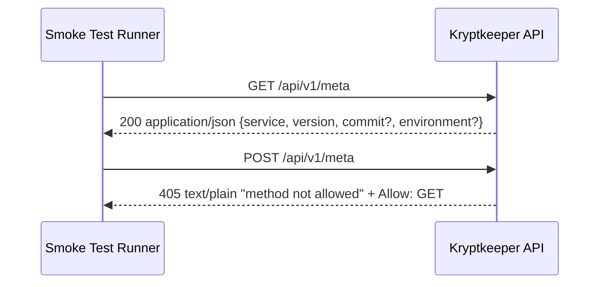

# API v1 Minimal Contract (Phase 4 Bootstrap)

## Summary

This document defines the **first minimal `/api/v1` contract** for implementation and smoke/contract testing.
It introduces one endpoint, `GET /api/v1/meta`, while preserving existing bootstrap endpoint behavior defined in `BOOTSTRAP_CONTRACT_MATRIX.md`.

## Scope

- In scope: `GET /api/v1/meta` behavior and baseline method-rejection behavior on the same path.
- Out of scope: auth, pagination, and domain resources under `/api/v1/*` (to be introduced in later workstreams).

## Cross-reference

- Existing bootstrap contracts remain authoritative in: `docs/sdlc/phase-4-implementation/BOOTSTRAP_CONTRACT_MATRIX.md`

## Endpoint Contract

### `GET /api/v1/meta`

**Purpose**

Provide lightweight service metadata for early runtime validation and deployment smoke checks.

**Authentication**

- None (bootstrap/public metadata endpoint).

**Request**

- Method: `GET`
- Path: `/api/v1/meta`
- Request body: none

**Success Response**

- Status: `200 OK`
- `Content-Type`: `application/json`
- Body schema:

```json
{
  "service": "string",
  "version": "string",
  "commit": "string (optional)",
  "environment": "string (optional)"
}
```

**Field requirements**

- `service` (**required**): stable service identifier (for example `"kryptkeeper"`).
- `version` (**required**): running app version string (semantic version or build version).
- `commit` (**optional**): source revision identifier for trace/debug builds.
- `environment` (**optional**): deployment environment label (for example `"dev"`, `"staging"`, `"prod"`).

**200 Example**

```json
{
  "service": "kryptkeeper",
  "version": "0.1.0",
  "commit": "a1b2c3d",
  "environment": "dev"
}
```

### Method Rejection Baseline (non-`GET /api/v1/meta`)

For any non-`GET` request method on `/api/v1/meta` (for example `POST`):

- Status: `405 Method Not Allowed`
- Required header: `Allow: GET`
- `Content-Type`: `text/plain; charset=utf-8`
- Body baseline: `method not allowed`

```text
method not allowed
```

Notes:
- This endpoint follows the canonical bootstrap method-rejection behavior used by existing GET-only routes.

## Forward Compatibility Notes (v1)

The `/api/v1/meta` response is designed for additive evolution:

1. Existing response fields (`service`, `version`) remain stable in name/type within v1.
2. New **optional** response fields may be added without version bump.
3. Clients must ignore unknown response fields to stay forward compatible.
4. Optional fields (`commit`, `environment`) may be omitted when not available.
5. Removing/renaming required fields or changing their type is a breaking change and requires `/api/v2`.

## Smoke Flow (Implementation + Test)



## Test Assertions (Minimal)

1. `GET /api/v1/meta` returns `200`.
2. Response `Content-Type` is `application/json`.
3. JSON body contains `service` and `version` as non-empty strings.
4. If present, `commit` and `environment` are strings.
5. Representative non-GET (e.g., `POST`) returns `405` with `Allow: GET`.
6. Non-GET response is `text/plain; charset=utf-8` and body contains `method not allowed`.
