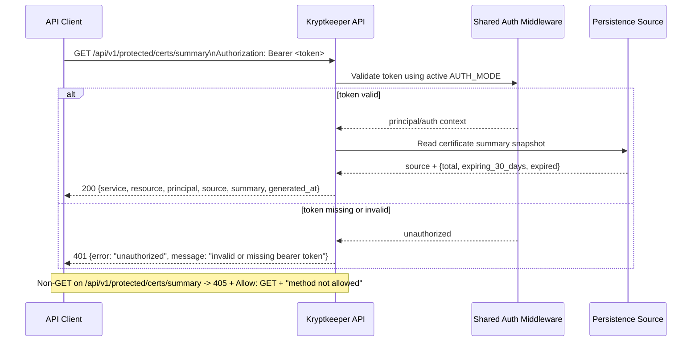

# API v1 Protected Certs Summary Contract (Phase 4)

## Summary

This document defines the first **persistence-backed** auth-protected resource contract: `GET /api/v1/protected/certs/summary`.
The endpoint reuses the existing shared auth middleware behavior from current protected endpoints and returns aggregate certificate counts from a storage-backed source using a stable v1 response shape.

## Scope

- In scope: request/response contract for `GET /api/v1/protected/certs/summary`, auth-mode compatibility, unchanged `401`/`405` behavior, and additive forward-compatibility rules for summary fields.
- Provider selection, file/database adapters, and summary-loading internals are implementation details only; they MUST NOT alter this contract’s response schema or status codes.
- Out of scope: certificate list/details payloads, pagination/filtering, authorization role/scope policy changes, and auth middleware implementation changes.
- Provider-specific observability logs (file-read fallback reasons, stub mode notices) are internal-only and MUST NOT affect response fields, statuses, or source semantics.
- Implementation note: provider abstraction is an internal seam only; it may change how the summary is sourced, but it MUST NOT change the response schema, required fields, or successful `200` status contract for this endpoint.
- Implementation note: the `db` mode currently fails closed with `503 Service Unavailable` when the placeholder store cannot serve data; it does not synthesize a successful fake summary. The `200` schema stays unchanged.
- Implementation note: provider-specific observability logs are internal-only diagnostics and do not change the API contract or response payload.

## Cross-reference

- Protected auth baseline endpoint: `docs/sdlc/phase-4-implementation/AUTH_V1_MINIMAL_CONTRACT.md`
- Protected ping contract: `docs/sdlc/phase-4-implementation/API_V1_PROTECTED_RESOURCE_CONTRACT.md`
- Protected whoami contract: `docs/sdlc/phase-4-implementation/API_V1_PROTECTED_WHOAMI_CONTRACT.md`
- Protected config contract: `docs/sdlc/phase-4-implementation/API_V1_PROTECTED_CONFIG_CONTRACT.md`
- JWT transition auth baseline: `docs/sdlc/phase-4-implementation/AUTH_JWT_TRANSITION_CONTRACT.md`
- OIDC/JWKS auth baseline: `docs/sdlc/phase-4-implementation/AUTH_OIDC_JWKS_CONTRACT.md`
- OIDC discovery/JWKS refresh behavior: `docs/sdlc/phase-4-implementation/AUTH_OIDC_DISCOVERY_CONTRACT.md`

## Endpoint Contract

### `GET /api/v1/protected/certs/summary`

**Purpose**

Provide a protected, persistence-backed summary view for certificate state counters (total, expiring soon, expired) without returning per-certificate details.

**Authentication**

- Required header: `Authorization: Bearer <token>`
- Auth middleware behavior MUST be identical to `/api/v1/authz-check` and existing `/api/v1/protected/*` endpoints for the active `AUTH_MODE`.

**DB mode behavior**

- `APP_CERTS_SUMMARY_PROVIDER=db` enables the DB-backed summary adapter.
- DB engine selection follows `KRYPTKEEPER_DB_MODE` (`sqlite` for single-node/dev, `postgres` for primary production mode).
- When the DB store cannot serve data (open/query failure), the request fails closed with `503 Service Unavailable` rather than returning a fake summary.

**Request**

- Method: `GET`
- Path: `/api/v1/protected/certs/summary`
- Request body: none

**Success Response**

- Status: `200 OK`
- `Content-Type`: `application/json`
- Body schema:

```json
{
  "service": "string",
  "resource": "protected-certs-summary",
  "principal": "string",
  "source": "string",
  "summary": {
    "total": 0,
    "expiring_30_days": 0,
    "expired": 0
  },
  "generated_at": "RFC3339 datetime string"
}
```

**Field requirements**

- `service` (**required**): stable service identifier (`"kryptkeeper"`).
- `resource` (**required**): constant string `"protected-certs-summary"`.
- `principal` (**required**): resolved caller identity from the same auth decision path used by current protected endpoints.
- `source` (**required**): provider-derived summary backing source identifier emitted by the active persistence adapter.
  - Current additive values include `"file-store"`, `"file-store-default"`, `"db-store-sqlite"`, and `"db-store-postgres"`.
  - DB source strings identify the selected DB adapter path and are additive in v1.
  - Future real provider values are allowed in v1 without changing endpoint shape/status behavior.
  - Clients MUST treat `source` as informational and SHOULD NOT hardcode a closed enum.
- If the active provider cannot serve data, the endpoint returns `503 Service Unavailable` instead of a summary payload; successful `200` responses remain unchanged.
- `summary` (**required**): aggregate counters object.
  - `summary.total` (**required**): integer `>= 0`; total certificates represented by this source snapshot.
  - `summary.expiring_30_days` (**required**): integer `>= 0`; certificates expiring within 30 days from generation time.
  - `summary.expired` (**required**): integer `>= 0`; certificates already expired at generation time.
- `generated_at` (**required**): server generation timestamp as RFC3339 string (UTC `Z` suffix recommended), for example `2026-04-06T16:10:00Z`.

**200 Example**

```json
{
  "service": "kryptkeeper",
  "resource": "protected-certs-summary",
  "principal": "bootstrap",
  "source": "file-store",
  "summary": {
    "total": 128,
    "expiring_30_days": 17,
    "expired": 3
  },
  "generated_at": "2026-04-06T16:10:00Z"
}
```

## `401 Unauthorized` (unchanged envelope)

For missing or invalid Bearer token, response shape remains unchanged from existing protected/auth contracts:

```json
{
  "error": "unauthorized",
  "message": "invalid or missing bearer token"
}
```

## `405 Method Not Allowed` (unchanged baseline)

For non-`GET` methods on `/api/v1/protected/certs/summary`:

- Status: `405 Method Not Allowed`
- Required header: `Allow: GET`
- Baseline body: `method not allowed` (text/plain)

## Auth-Mode Compatibility Table

`GET /api/v1/protected/certs/summary` MUST remain contract-compatible across all currently supported auth modes.

| AUTH_MODE | Bearer token acceptance baseline | `principal` source in `200` | Contract behavior |
|---|---|---|---|
| `bootstrap` | Header equals `Bearer <APP_BOOTSTRAP_TOKEN>` (with local default in bootstrap mode) | Constant `"bootstrap"` | Returns protected cert summary payload; `401` and `405` unchanged |
| `jwt` | HS256 JWT validation and required claims per auth transition contract | JWT `sub` | Returns protected cert summary payload; `401` and `405` unchanged |
| `oidc` | RS256 JWT + JWKS (`kid`) validation per OIDC auth contracts | JWT `sub` | Returns protected cert summary payload; `401` and `405` unchanged |

## Sequence Diagram



## Forward-Compatibility Notes (v1)

1. Existing required top-level fields (`service`, `resource`, `principal`, `source`, `summary`, `generated_at`) remain stable in name/type within v1.
2. Existing required summary fields (`total`, `expiring_30_days`, `expired`) remain stable in name/type within v1.
3. New optional fields MAY be added inside `summary` without a version bump.
4. New optional top-level fields MAY be added without a version bump.
5. Clients MUST ignore unknown fields (both top-level and inside `summary`) to remain forward compatible.
6. `source` values are additive/provider-derived in v1 (including future persistence providers) and do not require a version bump when endpoint fields/statuses are unchanged.
7. Renaming/removing required fields, changing required field types, changing the meaning of required counters, or altering the `401` envelope is breaking and requires `/api/v2`.

## Minimal Verification Assertions

1. `GET /api/v1/protected/certs/summary` with valid Bearer token returns `200` and required fields (`service`, `resource`, `principal`, `source`, `summary`, `generated_at`).
2. `resource` value is exactly `"protected-certs-summary"`.
3. `summary` includes required non-negative integer keys: `total`, `expiring_30_days`, `expired`.
4. `generated_at` is a valid RFC3339 datetime string.
5. Missing or invalid Bearer token returns unchanged `401` envelope.
6. Representative non-`GET` method returns unchanged `405` behavior with `Allow: GET` and plain-text `method not allowed`.
