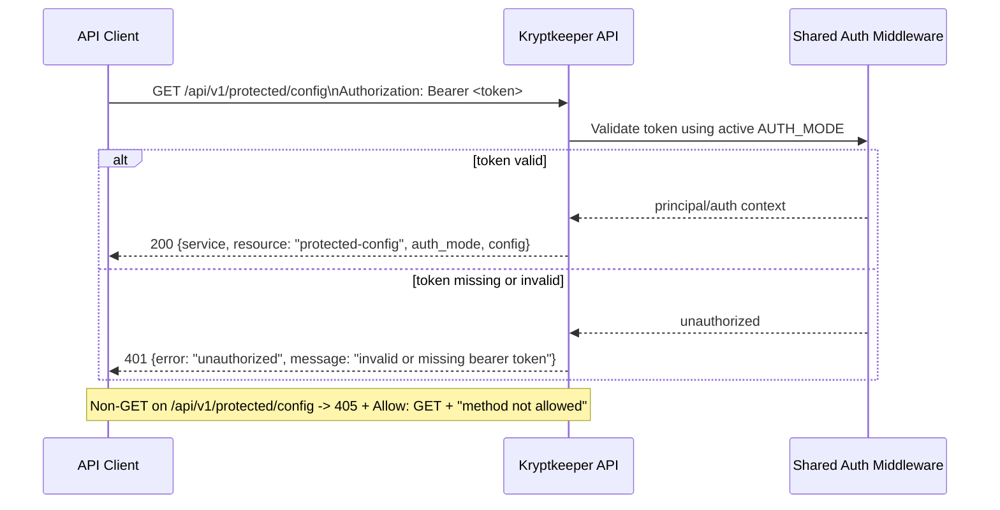

# API v1 Protected Config Contract (Phase 4)

## Summary

This document defines the next auth-protected resource endpoint contract: `GET /api/v1/protected/config`.
The endpoint reuses the same auth middleware behavior as existing protected endpoints and returns lightweight service configuration introspection data with a stable v1 shape.

## Scope

- In scope: request/response contract for `GET /api/v1/protected/config`, auth-mode compatibility, unchanged `401`/`405` behavior, and forward-compatible config field evolution.
- Out of scope: authorization policy changes (roles/scopes), auth middleware implementation changes, and any non-additive v1 schema changes.

## Cross-reference

- Protected ping baseline: `docs/sdlc/phase-4-implementation/API_V1_PROTECTED_RESOURCE_CONTRACT.md`
- Protected whoami baseline: `docs/sdlc/phase-4-implementation/API_V1_PROTECTED_WHOAMI_CONTRACT.md`
- Bootstrap auth baseline: `docs/sdlc/phase-4-implementation/AUTH_V1_MINIMAL_CONTRACT.md`
- JWT transition auth baseline: `docs/sdlc/phase-4-implementation/AUTH_JWT_TRANSITION_CONTRACT.md`
- OIDC/JWKS auth baseline: `docs/sdlc/phase-4-implementation/AUTH_OIDC_JWKS_CONTRACT.md`

## Endpoint Contract

### `GET /api/v1/protected/config`

**Purpose**

Return a minimal protected configuration-introspection payload so clients and operators can verify effective auth-related service flags without exposing secrets.

**Authentication**

- Required header: `Authorization: Bearer <token>`
- Auth middleware behavior MUST be identical to `/api/v1/authz-check`, `/api/v1/protected/ping`, and `/api/v1/protected/whoami` for the active `AUTH_MODE`.

**Request**

- Method: `GET`
- Path: `/api/v1/protected/config`
- Request body: none

**Success Response**

- Status: `200 OK`
- `Content-Type`: `application/json`
- Body schema:

```json
{
  "service": "string",
  "resource": "protected-config",
  "auth_mode": "bootstrap|jwt|oidc",
  "config": {
    "oidc_enabled": true,
    "discovery_enabled": true,
    "jwt_mode_enabled": true
  }
}
```

**Field requirements**

- `service` (**required**): stable service identifier (`"kryptkeeper"`).
- `resource` (**required**): constant string `"protected-config"`.
- `auth_mode` (**required**): active auth mode string, one of `bootstrap`, `jwt`, `oidc`.
- `config` (**required**): object containing non-secret runtime feature flags.
  - `config.oidc_enabled` (**required**): boolean.
  - `config.discovery_enabled` (**required**): boolean. `true` only when managed OIDC discovery and JWKS refresh are active; environment-variable presence alone does not make this `true`.
  - `config.jwt_mode_enabled` (**required**): boolean.

**200 Example**

```json
{
  "service": "kryptkeeper",
  "resource": "protected-config",
  "auth_mode": "oidc",
  "config": {
    "oidc_enabled": true,
    "discovery_enabled": true,
    "jwt_mode_enabled": false
  }
}
```

## `401 Unauthorized` (unchanged envelope)

For missing or invalid Bearer token, response shape remains unchanged from existing protected/auth contracts:

```json
{
  "error": "unauthorized",
  "message": "invalid or missing bearer token"
}
```

## `405 Method Not Allowed` (unchanged)

For non-`GET` methods on `/api/v1/protected/config`:

- Status: `405 Method Not Allowed`
- Required header: `Allow: GET`
- Baseline body: `method not allowed` (text/plain)

## Auth-Mode Compatibility Matrix

`GET /api/v1/protected/config` MUST remain contract-compatible across all currently supported auth modes.

`config.discovery_enabled` reflects managed discovery/JWKS refresh state, not mere configuration presence.

| AUTH_MODE | Bearer token acceptance baseline | `auth_mode` value in `200` | `config` contract behavior |
|---|---|---|---|
| `bootstrap` | Header equals `Bearer <APP_BOOTSTRAP_TOKEN>` (with local default in bootstrap mode) | `"bootstrap"` | Returns required `config` object with all required boolean keys |
| `jwt` | HS256 JWT validation and required claims per auth transition contract | `"jwt"` | Returns required `config` object with all required boolean keys |
| `oidc` | RS256 JWT + JWKS (`kid`) validation per OIDC auth contracts | `"oidc"` | Returns required `config` object with all required boolean keys |

## Sequence Diagram



## Forward-Compatibility Notes (v1)

1. Existing required top-level fields (`service`, `resource`, `auth_mode`, `config`) remain stable in name/type within v1.
2. Existing required `config` fields (`oidc_enabled`, `discovery_enabled`, `jwt_mode_enabled`) remain stable in name/type within v1.
3. New optional fields MAY be added inside `config` without a version bump.
4. Clients MUST ignore unknown `config` fields to stay forward compatible.
5. Renaming/removing required fields, changing required field types, or altering the `401` envelope is breaking and requires `/api/v2`.

## Minimal Verification Assertions

1. `GET /api/v1/protected/config` with valid Bearer token returns `200` and required fields (`service`, `resource`, `auth_mode`, `config`).
2. `resource` value is exactly `"protected-config"`.
3. `auth_mode` value matches active mode (`bootstrap|jwt|oidc`).
4. `config` includes exactly the required keys with boolean values: `oidc_enabled`, `discovery_enabled`, `jwt_mode_enabled`.
5. Missing or invalid Bearer token returns unchanged `401` envelope.
6. Representative non-`GET` method returns unchanged `405` behavior with `Allow: GET` and plain-text `method not allowed`.
