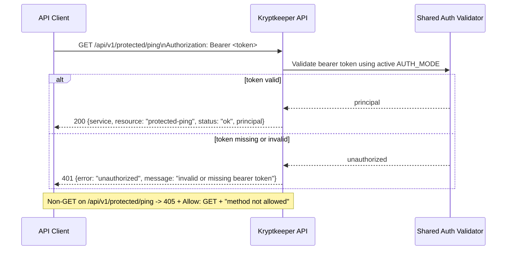

# API v1 Protected Resource Contract (Phase 4)

## Summary

This document defines the first auth-protected resource endpoint contract beyond `GET /api/v1/authz-check`: `GET /api/v1/protected/ping`.
The endpoint intentionally reuses the same auth middleware behavior as `/api/v1/authz-check` across `AUTH_MODE=bootstrap|jwt|oidc`, while introducing a minimal resource-specific `200` payload.

## Scope

- In scope: request/response contract for `GET /api/v1/protected/ping`, auth-mode compatibility, and unchanged `401`/`405` behavior.
- Out of scope: new authorization policy (roles/scopes), additional protected resources, pagination/filtering, and auth-mode implementation changes.

## Cross-reference

- Bootstrap auth baseline: `docs/sdlc/phase-4-implementation/AUTH_V1_MINIMAL_CONTRACT.md`
- JWT transition auth baseline: `docs/sdlc/phase-4-implementation/AUTH_JWT_TRANSITION_CONTRACT.md`
- OIDC/JWKS auth baseline: `docs/sdlc/phase-4-implementation/AUTH_OIDC_JWKS_CONTRACT.md`
- Managed OIDC discovery/JWKS refresh behavior: `docs/sdlc/phase-4-implementation/AUTH_OIDC_DISCOVERY_CONTRACT.md`

## Endpoint Contract

### `GET /api/v1/protected/ping`

**Purpose**

Provide a minimal protected resource endpoint that proves the shared auth gate is reusable beyond `/api/v1/authz-check`.

**Authentication**

- Required header: `Authorization: Bearer <token>`
- Auth behavior MUST be identical to `/api/v1/authz-check` for the active `AUTH_MODE`.

**Request**

- Method: `GET`
- Path: `/api/v1/protected/ping`
- Request body: none

**Success Response**

- Status: `200 OK`
- `Content-Type`: `application/json`
- Body schema:

```json
{
  "service": "string",
  "resource": "protected-ping",
  "status": "ok",
  "principal": "string"
}
```

**Field requirements**

- `service` (**required**): stable service identifier (`"kryptkeeper"`).
- `resource` (**required**): constant string `"protected-ping"`.
- `status` (**required**): constant string `"ok"`.
- `principal` (**required**): resolved caller identity from the same auth decision path used by `/api/v1/authz-check`.

**200 Example**

```json
{
  "service": "kryptkeeper",
  "resource": "protected-ping",
  "status": "ok",
  "principal": "bootstrap"
}
```

## `401 Unauthorized` (unchanged envelope)

For missing or invalid Bearer token, response shape remains unchanged from existing auth contracts:

```json
{
  "error": "unauthorized",
  "message": "invalid or missing bearer token"
}
```

## `405 Method Not Allowed` (unchanged)

For non-`GET` methods on `/api/v1/protected/ping`:

- Status: `405 Method Not Allowed`
- Required header: `Allow: GET`
- Baseline body: `method not allowed` (text/plain)

## Auth-Mode Compatibility Matrix

`GET /api/v1/protected/ping` MUST remain contract-compatible across all currently supported auth modes.

| AUTH_MODE | Bearer token acceptance baseline | `principal` source in `200` | Contract behavior |
|---|---|---|---|
| `bootstrap` | Header equals `Bearer <APP_BOOTSTRAP_TOKEN>` (with local default in bootstrap mode) | Constant `"bootstrap"` | `200` protected-ping payload; `401` and `405` unchanged |
| `jwt` | HS256 JWT validation and required claims per auth transition contract | JWT `sub` | `200` protected-ping payload; `401` and `405` unchanged |
| `oidc` | RS256 JWT + JWKS (`kid`) validation per OIDC auth contracts | JWT `sub` | `200` protected-ping payload; `401` and `405` unchanged |

## Sequence Diagram



## Minimal Verification Assertions

1. `GET /api/v1/protected/ping` with valid Bearer token returns `200` and all required fields (`service`, `resource`, `status`, `principal`).
2. `resource` value is exactly `"protected-ping"`.
3. `status` value is exactly `"ok"`.
4. Missing or invalid Bearer token returns unchanged `401` envelope.
5. Representative non-`GET` method returns unchanged `405` behavior with `Allow: GET` and plain-text `method not allowed`.

## Versioning Notes

Within `/api/v1`, additive optional fields may be introduced later. Renaming/removing `service`, `resource`, `status`, or `principal`, changing types, or altering the `401` envelope is breaking and requires `/api/v2`.
