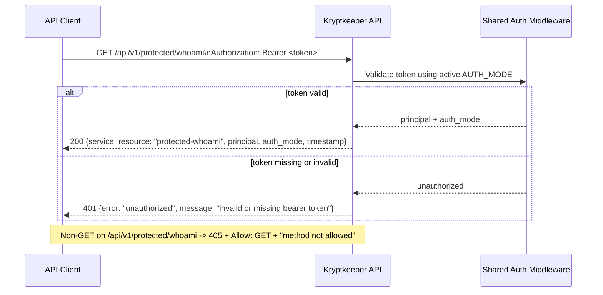

# API v1 Protected WhoAmI Contract (Phase 4)

## Summary

This document defines the second auth-protected resource endpoint contract: `GET /api/v1/protected/whoami`.
The endpoint reuses the same auth middleware behavior already established for `GET /api/v1/authz-check` and `GET /api/v1/protected/ping`, while introducing a minimal `200` payload that includes caller identity, auth mode, and an RFC3339 timestamp.

## Scope

- In scope: request/response contract for `GET /api/v1/protected/whoami`, auth-mode compatibility, and unchanged `401`/`405` behavior.
- Out of scope: new authorization policy (roles/scopes), additional auth modes, and auth middleware implementation changes.

## Cross-reference

- First protected resource baseline: `docs/sdlc/phase-4-implementation/API_V1_PROTECTED_RESOURCE_CONTRACT.md`
- Bootstrap auth baseline: `docs/sdlc/phase-4-implementation/AUTH_V1_MINIMAL_CONTRACT.md`
- JWT transition auth baseline: `docs/sdlc/phase-4-implementation/AUTH_JWT_TRANSITION_CONTRACT.md`
- OIDC/JWKS auth baseline: `docs/sdlc/phase-4-implementation/AUTH_OIDC_JWKS_CONTRACT.md`
- Managed OIDC discovery/JWKS refresh behavior: `docs/sdlc/phase-4-implementation/AUTH_OIDC_DISCOVERY_CONTRACT.md`

## Endpoint Contract

### `GET /api/v1/protected/whoami`

**Purpose**

Return a caller-focused protected identity payload using the same shared auth gate as existing protected endpoints.

**Authentication**

- Required header: `Authorization: Bearer <token>`
- Auth middleware behavior MUST be identical to existing protected endpoints (`/api/v1/authz-check` and `/api/v1/protected/ping`) for the active `AUTH_MODE`.

**Request**

- Method: `GET`
- Path: `/api/v1/protected/whoami`
- Request body: none

**Success Response**

- Status: `200 OK`
- `Content-Type`: `application/json`
- Body schema:

```json
{
  "service": "string",
  "resource": "protected-whoami",
  "principal": "string",
  "auth_mode": "bootstrap|jwt|oidc",
  "timestamp": "RFC3339 datetime string"
}
```

**Field requirements**

- `service` (**required**): stable service identifier (`"kryptkeeper"`).
- `resource` (**required**): constant string `"protected-whoami"`.
- `principal` (**required**): resolved caller identity from the same auth decision path used by `/api/v1/authz-check` and `/api/v1/protected/ping`.
- `auth_mode` (**required**): active auth mode string, one of `bootstrap`, `jwt`, `oidc`.
- `timestamp` (**required**): server generation time in RFC3339 format (UTC `Z` suffix recommended), for example `2026-04-06T14:30:00Z`.

**200 Example**

```json
{
  "service": "kryptkeeper",
  "resource": "protected-whoami",
  "principal": "bootstrap",
  "auth_mode": "bootstrap",
  "timestamp": "2026-04-06T14:30:00Z"
}
```

## `401 Unauthorized` (unchanged envelope)

For missing or invalid Bearer token, response shape remains unchanged from existing protected/auth contracts:

```json
{
  "error": "unauthorized",
  "message": "invalid or missing bearer token"
}
```

## `405 Method Not Allowed` (unchanged)

For non-`GET` methods on `/api/v1/protected/whoami`:

- Status: `405 Method Not Allowed`
- Required header: `Allow: GET`
- Baseline body: `method not allowed` (text/plain)

## Auth-Mode Compatibility Notes

`GET /api/v1/protected/whoami` MUST remain contract-compatible across all currently supported auth modes.

| AUTH_MODE | Bearer token acceptance baseline | `principal` source in `200` | `auth_mode` value | `timestamp` format |
|---|---|---|---|---|
| `bootstrap` | Header equals `Bearer <APP_BOOTSTRAP_TOKEN>` (with local default in bootstrap mode) | Constant `"bootstrap"` | `"bootstrap"` | RFC3339 string |
| `jwt` | HS256 JWT validation and required claims per auth transition contract | JWT `sub` | `"jwt"` | RFC3339 string |
| `oidc` | RS256 JWT + JWKS (`kid`) validation per OIDC auth contracts | JWT `sub` | `"oidc"` | RFC3339 string |

## Sequence Diagram



## Minimal Verification Assertions

1. `GET /api/v1/protected/whoami` with valid Bearer token returns `200` and all required fields (`service`, `resource`, `principal`, `auth_mode`, `timestamp`).
2. `resource` value is exactly `"protected-whoami"`.
3. `auth_mode` value matches active mode (`bootstrap|jwt|oidc`).
4. `timestamp` is a valid RFC3339 datetime string.
5. Missing or invalid Bearer token returns unchanged `401` envelope.
6. Representative non-`GET` method returns unchanged `405` behavior with `Allow: GET` and plain-text `method not allowed`.

## Versioning Notes

Within `/api/v1`, additive optional fields may be introduced later. Renaming/removing `service`, `resource`, `principal`, `auth_mode`, or `timestamp`, changing field types, or altering the `401` envelope is breaking and requires `/api/v2`.
