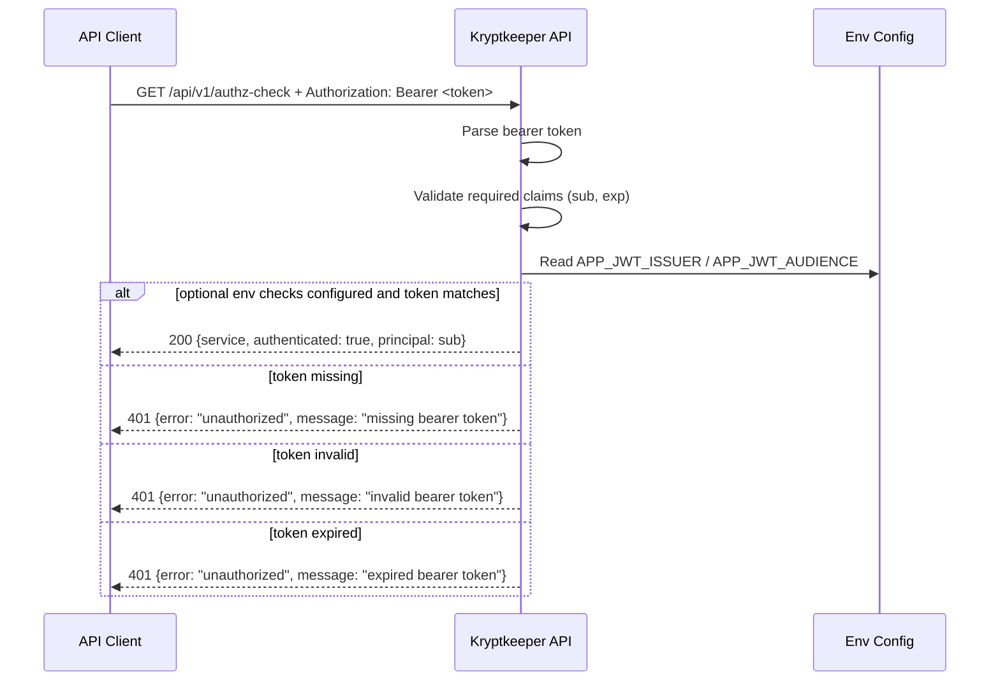

# Auth JWT Transition Contract (Phase 4)

## Summary

This contract defines the Phase-4 transition of `GET /api/v1/authz-check` from shared bootstrap-token validation to JWT-style Bearer-token validation.
The success (`200`) response shape remains unchanged from `AUTH_V1_MINIMAL_CONTRACT.md`, while `401` behavior is formalized for missing, invalid, and expired tokens.

## Scope

- In scope: auth behavior for `GET /api/v1/authz-check`, JWT-like claim baseline, optional issuer/audience policy via environment, and migration guidance from bootstrap token mode.
- Out of scope: external IdP discovery, JWKS fetch/rotation details, role/scope authorization, and non-`/api/v1/authz-check` endpoint changes.

## Cross-reference

- Prior bootstrap contract: `docs/sdlc/phase-4-implementation/AUTH_V1_MINIMAL_CONTRACT.md`
- Base API v1 route/error baseline: `docs/sdlc/phase-4-implementation/API_V1_MINIMAL_CONTRACT.md`

## Endpoint Contract

### `GET /api/v1/authz-check`

**Authentication**

- Required header: `Authorization: Bearer <token>`
- Token is validated using JWT-style rules in this document.

**Request**

- Method: `GET`
- Path: `/api/v1/authz-check`
- Request body: none

**Success Response (unchanged)**

- Status: `200 OK`
- `Content-Type`: `application/json`
- Body schema:

```json
{
  "service": "string",
  "authenticated": true,
  "principal": "string"
}
```

`200` field contract is unchanged from `AUTH_V1_MINIMAL_CONTRACT.md`:

- `service` (required string)
- `authenticated` (required boolean, `true`)
- `principal` (required string)

## JWT-Style Validation Policy (Transition Baseline)

### Required claim baseline

For a Bearer token to be accepted, it MUST include:

1. `sub` (subject): non-empty string; mapped to response `principal`.
2. `exp` (expiration): valid numeric JWT expiration time; request time MUST be before `exp`.

### Optional issuer/audience checks (env-configured)

Issuer and audience checks are optional in bootstrap mode and become active only when configured:

- `APP_JWT_ISSUER` (optional)
  - If set, token `iss` MUST exactly match this value.
  - If unset, `iss` is not enforced.
- `APP_JWT_AUDIENCE` (optional)
  - If set, token `aud` MUST contain this value.
  - If unset, `aud` is not enforced.

This allows bootstrap deployments to start with minimal claim checks (`sub`, `exp`) while enabling stricter validation in staged/prod environments without changing the endpoint contract.

## `401 Unauthorized` Error Envelope

For missing, invalid, or expired Bearer tokens:

- Status: `401 Unauthorized`
- `Content-Type`: `application/json`
- Envelope:

```json
{
  "error": "unauthorized",
  "message": "string"
}
```

Message values by failure class:

- Missing token/header: `"missing bearer token"`
- Invalid token/claims/signature/format: `"invalid bearer token"`
- Expired token (`exp` in past): `"expired bearer token"`

## Method Rejection Baseline (unchanged)

For non-`GET` methods on `/api/v1/authz-check`:

- Status: `405 Method Not Allowed`
- Header: `Allow: GET`
- `Content-Type`: `text/plain; charset=utf-8`
- Body baseline: `method not allowed`

## Migration Notes: `APP_BOOTSTRAP_TOKEN` → JWT Validation Mode

### Current bootstrap mode

- Auth is currently a shared static token from `APP_BOOTSTRAP_TOKEN` (with local default), compared as full header equality.

### Transition mode (this contract)

1. Keep request shape the same: `Authorization: Bearer <token>`.
2. Replace static token equality checks with JWT-style validation of required claims (`sub`, `exp`).
3. Preserve success response shape (`service`, `authenticated`, `principal`) to avoid client breakage.
4. Preserve `401` envelope shape (`error`, `message`) while refining message semantics for missing/invalid/expired classes.
5. Add optional strictness via `APP_JWT_ISSUER` and `APP_JWT_AUDIENCE` when set.

### Implementation compatibility guidance

- During rollout, support a controlled migration window where environments can move from `APP_BOOTSTRAP_TOKEN` to JWT validation without changing client call structure.
- Once JWT mode is validated in the target environment, remove bootstrap token dependency from deployment configuration.

## Sequence Diagram



## Minimal Test Assertions

1. Valid token with `sub` and unexpired `exp` returns `200` and unchanged response schema.
2. Missing `Authorization` header returns `401` with `error` + missing-token message.
3. Malformed/invalid token returns `401` with `error` + invalid-token message.
4. Expired token returns `401` with `error` + expired-token message.
5. When `APP_JWT_ISSUER` is set, mismatched `iss` returns `401` invalid-token message.
6. When `APP_JWT_AUDIENCE` is set, non-matching `aud` returns `401` invalid-token message.
7. Representative non-`GET` method returns `405` with `Allow: GET` and plain-text `method not allowed`.
