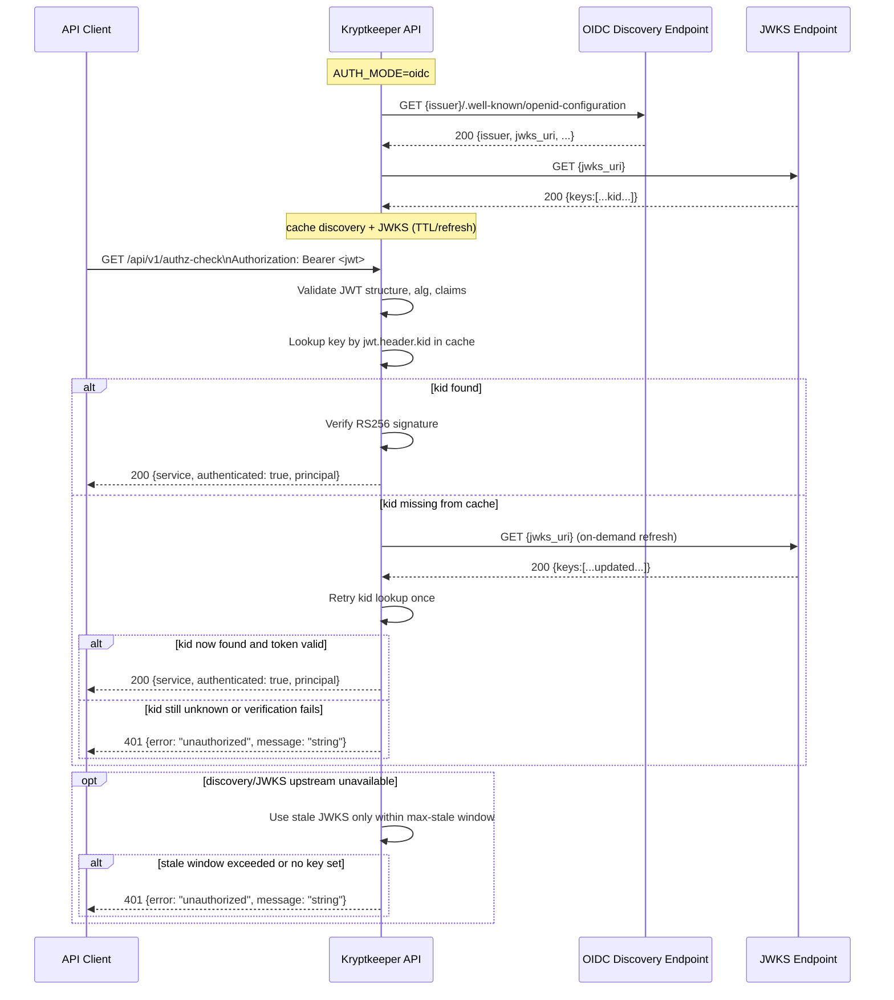

# Auth OIDC Discovery + JWKS Rotation Contract (Phase 4 Next)

## Summary

This contract defines **managed OIDC discovery and JWKS rotation behavior** for `GET /api/v1/authz-check` when `AUTH_MODE=oidc`.
The endpoint surface is unchanged (`200`/`401`/`405` envelopes stay the same), while signing-key trust is managed through OIDC discovery (`issuer/.well-known/openid-configuration`) and periodic JWKS refresh with fail-closed verification semantics.

## Scope

- In scope: discovery metadata URL derivation, `jwks_uri` retrieval, JWKS cache/refresh/retry behavior, `kid` lookup semantics, and key-rotation handling.
- Out of scope: changing route paths, response body schemas, introducing new authz claims/policy, or changing existing `/api/v1` error envelope shape.

## Cross-reference

- Base OIDC/JWKS auth-mode contract: `docs/sdlc/phase-4-implementation/AUTH_OIDC_JWKS_CONTRACT.md`
- HS256 transition predecessor: `docs/sdlc/phase-4-implementation/AUTH_JWT_TRANSITION_CONTRACT.md`
- Bootstrap auth baseline: `docs/sdlc/phase-4-implementation/AUTH_V1_MINIMAL_CONTRACT.md`

## Managed Behavior (`AUTH_MODE=oidc`)

### 1) OIDC issuer discovery metadata URL

When `AUTH_MODE=oidc`, the verifier MUST derive metadata from configured issuer:

1. `APP_OIDC_ISSUER` is required and MUST be an HTTPS URL.
2. Discovery URL MUST be computed as:
   - `discovery_url = trim_trailing_slash(APP_OIDC_ISSUER) + "/.well-known/openid-configuration"`
3. Metadata fetch MUST succeed and return JSON containing `issuer` and `jwks_uri`.
4. Metadata `issuer` MUST exactly match `APP_OIDC_ISSUER` (after equivalent trailing-slash normalization); mismatch is treated as discovery failure.

### 2) `jwks_uri` retrieval and key-set refresh

After successful discovery metadata load:

1. Verifier MUST fetch JWKS from `jwks_uri` (HTTPS only).
2. JWKS cache MUST include all signing keys indexed by `kid`.
3. Refresh policy MUST include both:
   - **scheduled refresh**: periodic background fetch
   - **on-demand refresh**: immediate single refresh when token `kid` is unknown
4. Successful refresh atomically replaces the active key set.

### 3) Cache TTL, retries, and fail-closed policy

1. Discovery metadata and JWKS responses are cacheable using configured TTLs.
2. Network failures/timeouts trigger bounded retries with backoff.
3. Verification behavior is **fail-closed**:
   - If no usable key set is available (cold start failure or stale window exceeded), token validation returns `401`.
   - If a previously good key set exists and is within `max stale`, verification MAY continue using stale keys.
   - If stale age exceeds `max stale`, verification MUST fail closed (`401`) until refresh succeeds.

### 4) `kid` verification semantics and rotation

For every Bearer JWT:

1. JWT header MUST include `kid`; missing `kid` is invalid token (`401`).
2. Verifier attempts lookup in active JWKS cache by exact `kid` match.
3. If `kid` is not found:
   - trigger one on-demand JWKS refresh;
   - retry `kid` lookup once using refreshed set;
   - if still not found, reject token as invalid (`401`).
4. Rotation expectation:
   - During overlap windows, old and new keys may coexist in JWKS.
   - Newly issued tokens signed by new `kid` succeed after scheduled or on-demand refresh.
   - Tokens signed by removed keys fail once those keys are absent from current/stale-allowed sets.

## Endpoint Contract Compatibility (unchanged)

`AUTH_MODE=oidc` managed discovery/rotation MUST NOT change existing endpoint envelopes:

### `200 OK` (unchanged)

```json
{
  "service": "string",
  "authenticated": true,
  "principal": "string"
}
```

### `401 Unauthorized` envelope (unchanged)

```json
{
  "error": "unauthorized",
  "message": "string"
}
```

### `405 Method Not Allowed` behavior (unchanged)

- Non-`GET` methods on `/api/v1/authz-check` return `405`.
- `Allow: GET` header remains required.
- `Content-Type` remains `text/plain; charset=utf-8`.
- Body baseline remains plain text: `method not allowed`.

## Operational Environment Configuration

All values below apply only when `AUTH_MODE=oidc`.

| Variable | Required | Default | Notes |
| --- | --- | --- | --- |
| `APP_OIDC_ISSUER` | Yes | none | HTTPS issuer base URL used to derive discovery metadata URL. |
| `APP_OIDC_DISCOVERY_TIMEOUT_MS` | No | `3000` | Per-request timeout for OIDC discovery metadata fetch. |
| `APP_OIDC_JWKS_TIMEOUT_MS` | No | `3000` | Per-request timeout for JWKS fetch operations. |
| `APP_OIDC_DISCOVERY_CACHE_TTL_MS` | No | `300000` (5m) | How long discovery metadata is considered fresh before scheduled refresh. |
| `APP_OIDC_JWKS_REFRESH_INTERVAL_MS` | No | `300000` (5m) | Background JWKS refresh cadence. |
| `APP_OIDC_JWKS_MAX_STALE_MS` | No | `900000` (15m) | Max age of stale JWKS allowed for verification during upstream outage; after this, fail closed. |
| `APP_OIDC_HTTP_RETRY_COUNT` | No | `2` | Retry attempts after initial failed discovery/JWKS request. |
| `APP_OIDC_HTTP_RETRY_BACKOFF_MS` | No | `250` | Base backoff; implementation may apply exponential backoff with jitter. |

### Configuration guardrails

1. `APP_OIDC_JWKS_MAX_STALE_MS` MUST be `>= APP_OIDC_JWKS_REFRESH_INTERVAL_MS`.
2. Timeouts and intervals MUST be positive integers.
3. Invalid OIDC config at startup SHOULD produce explicit startup error logs and SHOULD keep verifier in fail-closed mode.

## Discovery + Verification Flow



## Minimal Verification Assertions

1. Discovery URL is derived from issuer + `/.well-known/openid-configuration` and metadata must include `jwks_uri`.
2. Cold-start discovery/JWKS fetch failure returns `401` (fail closed).
3. Cached key verifies valid token with unchanged `200` envelope.
4. Unknown `kid` triggers one on-demand refresh; unresolved `kid` returns `401` with unchanged envelope.
5. During transient JWKS endpoint outage, stale cache is allowed only up to `APP_OIDC_JWKS_MAX_STALE_MS`.
6. Non-`GET` `/api/v1/authz-check` behavior remains `405` with `Allow: GET` and plain-text `method not allowed`.
