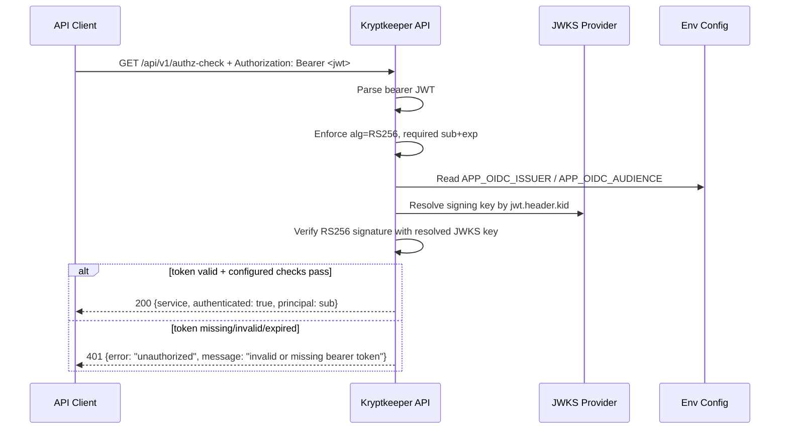

# Auth OIDC/JWKS Contract (Phase 4 Next)

## Summary

This contract defines the next auth mode for `GET /api/v1/authz-check`: `AUTH_MODE=oidc`.
In this mode, the endpoint requires a Bearer JWT signed with `RS256`, validates required claims (`sub`, `exp`), performs optional issuer/audience enforcement when configured, and resolves signing keys via JWKS using `kid`. The `200` success schema, `401` envelope, and non-`GET` `405` behavior remain unchanged from prior contracts.

## Scope

- In scope: auth behavior for `GET /api/v1/authz-check` when `AUTH_MODE=oidc`, JWT/JWKS validation requirements, and migration from HS256 transition mode.
- Out of scope: role/scope authorization policy, introducing new response fields, and changing non-`/api/v1/authz-check` endpoints.

## Cross-reference

- HS256 transition contract: `docs/sdlc/phase-4-implementation/AUTH_JWT_TRANSITION_CONTRACT.md`
- Bootstrap auth baseline: `docs/sdlc/phase-4-implementation/AUTH_V1_MINIMAL_CONTRACT.md`
- Base API baseline: `docs/sdlc/phase-4-implementation/API_V1_MINIMAL_CONTRACT.md`

## Endpoint Contract

### `GET /api/v1/authz-check` (with `AUTH_MODE=oidc`)

**Authentication**

- Required header: `Authorization: Bearer <jwt>`
- Missing bearer token returns existing `401` envelope (unchanged).

**Request**

- Method: `GET`
- Path: `/api/v1/authz-check`
- Request body: none

**Success Response (unchanged)**

- Status: `200 OK`
- `Content-Type`: `application/json`
- Body schema (unchanged):

```json
{
  "service": "string",
  "authenticated": true,
  "principal": "string"
}
```

Field mapping remains unchanged:

- `principal` = validated JWT `sub`

## OIDC/JWKS Validation Policy

For `AUTH_MODE=oidc`, a Bearer JWT MUST satisfy all of the following:

1. **Algorithm**: token header `alg` MUST be `RS256`.
2. **Required claims**:
   - `sub`: non-empty string
   - `exp`: valid numeric JWT expiration time; current time MUST be before `exp`
3. **Issuer check (when configured)**:
   - If `APP_OIDC_ISSUER` is set, token `iss` MUST exactly match.
   - If unset, `iss` is not enforced.
4. **Audience check (when configured)**:
   - If `APP_OIDC_AUDIENCE` is set, token `aud` MUST contain that value.
   - If unset, `aud` is not enforced.
5. **JWKS key resolution (kid-based)**:
   - JWT header MUST include `kid`.
   - Verifier resolves the public key from configured JWKS by matching `kid`.
   - Signature verification MUST use the resolved key and `RS256`.
   - If `kid` is missing, unknown, or no valid key is resolvable, validation fails as invalid token.

## Error and Method Behavior (unchanged)

### `401 Unauthorized` envelope (unchanged)

For missing, invalid, or expired Bearer tokens, response envelope remains:

```json
{
  "error": "unauthorized",
  "message": "string"
}
```

Bootstrap implementation currently uses a single message value:

- Missing or invalid token: `"invalid or missing bearer token"`

Future auth hardening may split message classes without changing the envelope keys.

### Non-`GET` method behavior (unchanged)

For non-`GET` methods on `/api/v1/authz-check`:

- Status: `405 Method Not Allowed`
- Header: `Allow: GET`
- `Content-Type`: `text/plain; charset=utf-8`
- Body baseline: `method not allowed`

## Migration Path: HS256 Transition Mode → OIDC/JWKS Mode

This section defines a no-contract-break migration from `AUTH_MODE=jwt` (HS256 transition mode in `AUTH_JWT_TRANSITION_CONTRACT.md`) to `AUTH_MODE=oidc`.

1. **Keep endpoint and response contract stable**
   - Continue using `GET /api/v1/authz-check` with the same `200` and `401` shapes.
2. **Switch verifier mode by environment**
   - Move from `AUTH_MODE=jwt` to `AUTH_MODE=oidc`.
3. **Move signing trust from shared secret to JWKS**
   - HS256 shared-secret verification is replaced by RS256 verification using JWKS key lookup by `kid`.
4. **Retain required claim baseline**
   - `sub` and `exp` remain required, minimizing client-token contract drift.
5. **Keep issuer/audience checks policy-compatible**
   - `APP_OIDC_ISSUER` / `APP_OIDC_AUDIENCE` control strict `iss`/`aud` enforcement when set.
6. **Cutover recommendation**
   - Validate OIDC mode in pre-prod with real JWKS rotation scenarios, then enable `AUTH_MODE=oidc` in prod.
   - After cutover, deprecate HS256 transition mode configuration.

## Sequence Diagram (OIDC/JWKS)



## Minimal Test Assertions

1. Valid RS256 JWT with resolvable `kid`, `sub`, and unexpired `exp` returns unchanged `200` schema.
2. Missing `Authorization` header returns unchanged `401` envelope with missing-token message.
3. Token with non-`RS256` algorithm returns unchanged `401` envelope with invalid-token message.
4. Token with unknown/missing `kid` or unresolved JWKS key returns unchanged `401` envelope with invalid-token message.
5. Expired token currently returns unchanged `401` envelope with bootstrap message value.
6. When `APP_OIDC_ISSUER` is set, mismatched `iss` returns `401`.
7. When `APP_OIDC_AUDIENCE` is set, non-matching `aud` returns `401`.
8. Representative non-`GET` on `/api/v1/authz-check` still returns `405` with `Allow: GET` and plain-text `method not allowed`.
