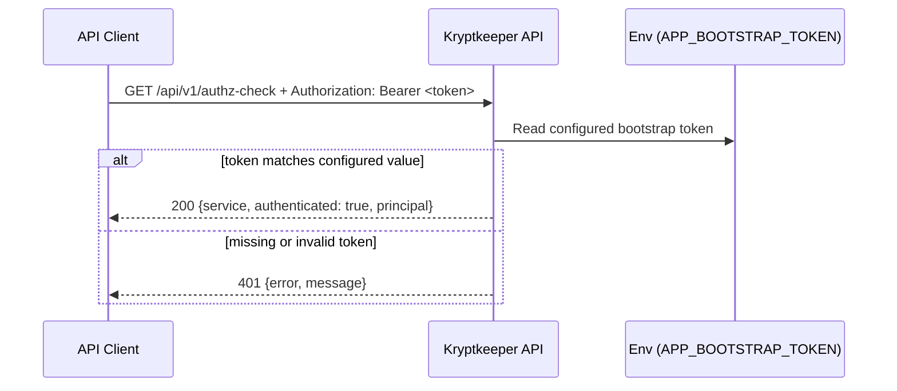

# Auth v1 Minimal Contract (Phase 4 Bootstrap)

## Summary

This document defines the first **auth-protected** `/api/v1` contract for bootstrap implementation: `GET /api/v1/authz-check`.
It adds a minimal Bearer-token gate and establishes baseline `200`, `401`, and `405` behavior while remaining compatible with the existing v1 bootstrap contract.

## Scope

- In scope: `GET /api/v1/authz-check` request/response contract, bootstrap token policy, and method rejection behavior.
- Out of scope: JWT validation, external IdP integration, scopes/roles, and multi-tenant authorization rules.

## Cross-reference

- Base v1 route contract and error baseline: `docs/sdlc/phase-4-implementation/API_V1_MINIMAL_CONTRACT.md`

## Endpoint Contract

### `GET /api/v1/authz-check`

**Purpose**

Provide a minimal authenticated endpoint to verify that API v1 auth protection is wired correctly during bootstrap.

**Authentication**

- Required header: `Authorization: Bearer <token>`
- Token must match the bootstrap token policy defined below.

**Request**

- Method: `GET`
- Path: `/api/v1/authz-check`
- Request body: none

**Success Response**

- Status: `200 OK`
- `Content-Type`: `application/json`
- Body schema:

```json
{
  "service": "string",
  "authenticated": true,
  "principal": "string"
}
```

**Field requirements**

- `service` (**required**): stable service identifier (for example `"kryptkeeper"`).
- `authenticated` (**required**): boolean, must be `true` for a successful auth check.
- `principal` (**required**): caller identity string resolved by bootstrap token validation.

**200 Example**

```json
{
  "service": "kryptkeeper",
  "authenticated": true,
  "principal": "bootstrap-local"
}
```

### Unauthorized Response (missing or invalid token)

For requests without a valid Bearer token:

- Status: `401 Unauthorized`
- `Content-Type`: `application/json`
- Error envelope (bootstrap baseline):

```json
{
  "error": "unauthorized",
  "message": "invalid or missing bearer token"
}
```

### Method Rejection Baseline (non-`GET /api/v1/authz-check`)

For any non-`GET` method on this path (for example `POST`):

- Status: `405 Method Not Allowed`
- Required header: `Allow: GET`
- `Content-Type`: `text/plain; charset=utf-8`
- Body baseline: `method not allowed`

```text
method not allowed
```

## Bootstrap Token Policy (Phase 4)

This phase uses a single shared bootstrap token suitable for local testing only.

1. Validation source: environment variable `APP_BOOTSTRAP_TOKEN`.
2. Local-safe default (only when env var is not set): `bootstrap-dev-token`.
3. Default principal mapping for a valid token: `bootstrap`.
4. Token must never be hardcoded in clients; pass via `Authorization: Bearer <token>`.
5. For non-local environments, set `APP_BOOTSTRAP_TOKEN` explicitly via deployment secrets.

Implementation note: this is intentionally temporary for bootstrap execution; production auth will replace this policy in a future workstream.

## Forward-Compatibility Notes (v1)

1. Existing `200` fields (`service`, `authenticated`, `principal`) remain stable in name/type within v1.
2. New optional response fields may be added without version bump.
3. Clients must ignore unknown response fields to remain forward compatible.
4. Replacing static bootstrap token validation with standards-based auth (JWT/OIDC) is expected in v1 as a backward-compatible internal change if the external contract remains unchanged.
5. Removing/renaming response fields, changing field types, or changing error envelope shape is a breaking change and requires `/api/v2`.

## Request Flow (Bootstrap)



## Minimal Test Assertions

1. `GET /api/v1/authz-check` with valid bearer token returns `200` and JSON body with `service`, `authenticated: true`, `principal`.
2. `GET /api/v1/authz-check` with missing `Authorization` header returns `401` JSON with `error` and `message`.
3. `GET /api/v1/authz-check` with invalid bearer token returns `401` JSON with `error` and `message`.
4. Representative non-GET (e.g., `POST`) returns `405` with `Allow: GET` and plain-text `method not allowed`.
