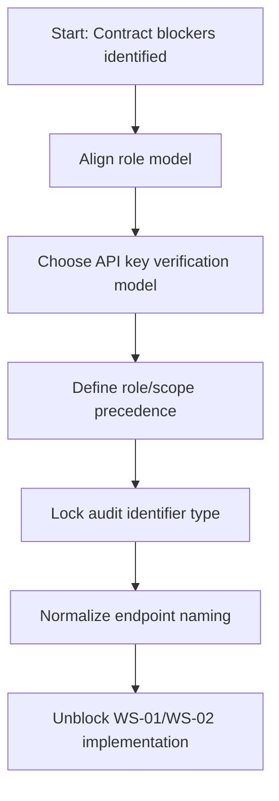

# Kryptkeeper — Phase 4 Blocking Decisions Record

**Date:** 2026-04-06  
**Status:** APPROVED (2026-04-06)  
**Scope:** Unblocks WS-01 (Contract Foundation) and WS-02 (Identity & Access)

---

## 1. Inputs and Delegation

This record synthesizes expert recommendations from:

- API design review (`/api-design --review`, task `ses_29bf5ec6effeIt6ggw3Tim0n3O`)
- Security review (`/security`, task `ses_29bf5ec5dffeUbYqIu0dmjnjvy`)
- Database review (`/dba`, task `ses_29bf5ec5affeqW7yCTjqGrURcK`)

---

## 2. Subtask Decomposition

1. **[D1] RBAC model alignment** (M) — DONE  
2. **[D2] Custom roles V1 decision** (M) — DONE  
3. **[D3] API key semantics and precedence policy** (L) — DONE  
4. **[D4] Audit log identifier canonicalization** (M) — DONE  
5. **[D5] Endpoint naming consistency** (M) — DONE

**Progress:** 5 / 5 complete

---

## 3. Decision Flow

---

## 4. Proposed Decisions

## DEC-001 — RBAC Canonical Role Set (V1)

**Decision:** Adopt the V1 canonical built-in roles:

- `pki-admin`
- `pki-operator`
- `pki-viewer`
- `pki-auditor`
- `discovery-operator`
- `service-account`

**Rationale:** Reconciles SRS FR-092, API contract, and threat model role usage.

**Risk if deferred:** HIGH (authorization drift and inconsistent enforcement).

---

## DEC-002 — Custom Roles in V1

**Decision:** Defer custom role CRUD to V2, but keep permission model extension-ready.

**Rationale:** Prevents V1 schedule risk while preserving future extensibility.

**Required updates:**
- SRS/API docs must explicitly mark custom roles as V2 scope.

**Risk if deferred without documentation:** HIGH (requirements/doc mismatch).

---

## DEC-003 — API Key Storage + Authorization Precedence

**Decision:**

1. Token format: `kk_<kid>_<secret>`
2. Store `kid` + secret verifier using **HMAC-SHA-256 with server-side pepper**
3. Keep secret non-recoverable; never store raw token
4. Authorization rule: **effective permissions = role permissions ∩ scopes**
   (scopes can restrict only, never elevate)

**Rationale:** Stronger DB-breach resistance and deterministic auth behavior.

**Note:** FR-091 wording should be aligned to this verifier model if currently SHA-256-only.

**Risk if unresolved:** HIGH (privilege escalation or inconsistent authz decisions).

---

## DEC-004 — Audit Log Identifier Type

**Decision:** Canonicalize `audit_log.id` as **BIGINT (int64)** for V1.

**Rationale:** Better append-heavy performance, smaller indexes, stable cursor ordering with
`(timestamp, id)`, and aligns with partitioned audit design.

**Required updates:**
- API conventions must state IDs are resource-specific (not universally UUID)
- OpenAPI schema for audit endpoints must type `id` as int64 (or numeric string for JS safety)

**Risk if unresolved:** MEDIUM-HIGH (schema/contract drift and migration churn).

---

## DEC-005 — Endpoint Naming Conventions

**Decision:** Use canonical kebab-case plural resources across V1:

- `/api/v1/api-keys` (canonical)
- `/api/v1/scans` and `/api/v1/scans/{id}/results`
- `/api/v1/scan-targets` (if persisted target resource is implemented)

**Rationale:** Predictable routing, lower SDK and security-rule drift, cleaner deprecation path.

**Risk if unresolved:** MEDIUM-HIGH (WAF/SIEM rule drift, client inconsistency).

---

## 5. Compatibility and Migration Notes

1. If alternate path aliases already exist, keep temporary compatibility aliases with `Sunset` headers.
2. If legacy API keys exist, support transitional verification window and force rotation.
3. If any docs currently imply universal UUID IDs, update wording before implementation begins.

---

## 6. Approval Checklist

- [x] DEC-001 approved
- [x] DEC-002 approved
- [x] DEC-003 approved
- [x] DEC-004 approved
- [x] DEC-005 approved

When all are checked, WS-01 and WS-02 move from PENDING to IN_PROGRESS.

**Approval note:** User approved all five decisions in-session.
