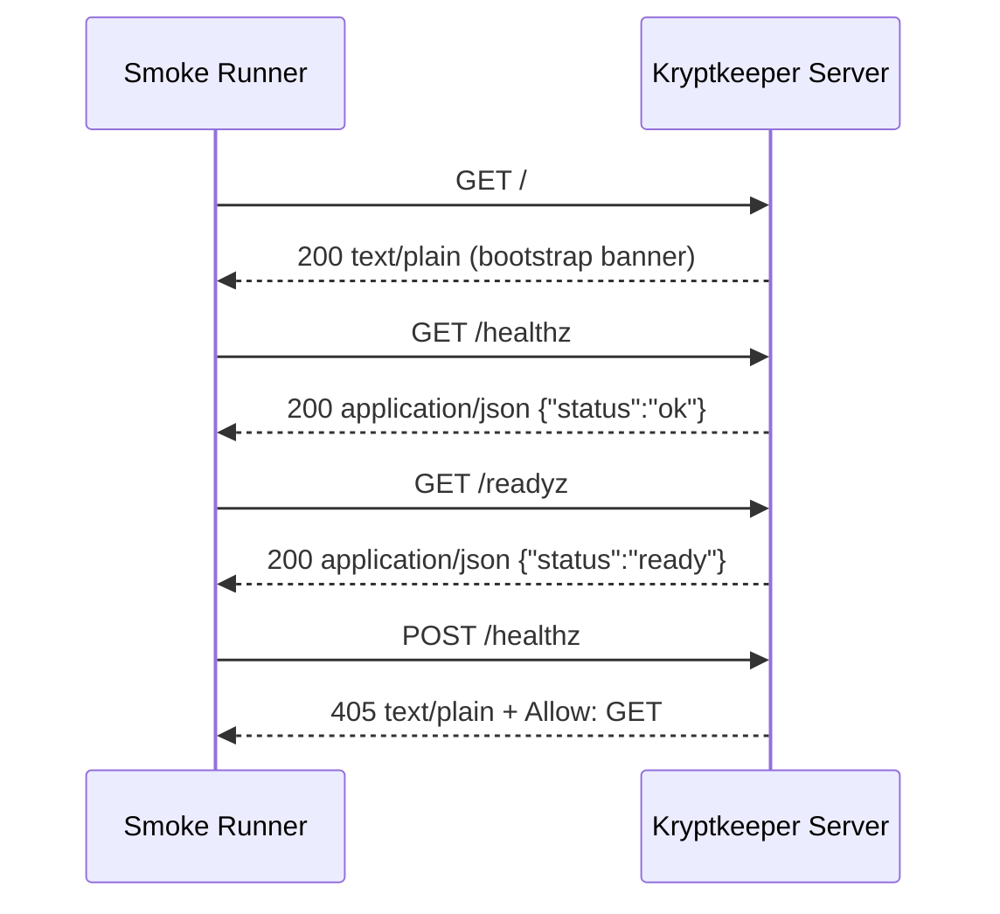

# Bootstrap Endpoint Contract Matrix (Phase 4 Baseline)

## Summary

This document defines the **minimal executable API contract baseline** for the current bootstrap server so smoke/contract checks can assert stable behavior while `/api/v1/*` is introduced.

Cross-reference: the first `/api/v1` route contract is documented in `API_V1_MINIMAL_CONTRACT.md`.

## Contract Test Matrix

| Endpoint | Request method | Expected status | Expected `Content-Type` | Expected body fields/content |
| --- | --- | --- | --- | --- |
| `/` | `GET` | `200 OK` | `text/plain; charset=utf-8` | Plain text contains `kryptkeeper bootstrap app` |
| `/healthz` | `GET` | `200 OK` | `application/json` | JSON object with `status` = `"ok"` |
| `/readyz` | `GET` | `200 OK` | `application/json` | JSON object with `status` = `"ready"` |
| `/healthz` | any non-`GET` (ex: `POST`) | `405 Method Not Allowed` | `text/plain; charset=utf-8` | Plain text contains `method not allowed`; `Allow: GET` response header present |

### Notes for test implementation

- For the non-`GET /healthz` case, one representative method (for example `POST`) is sufficient to prove current `getOnly` behavior.
- Body assertions should be resilient to trailing newlines for plaintext responses.

## Forward-Compatibility Rules for Future `/api/v1/*`

1. New product/resource APIs must be added under `/api/v1/*`; do not repurpose `/`, `/healthz`, or `/readyz`.
2. Keep bootstrap endpoint contracts above stable as deployment/smoke probes, even after `/api/v1/*` is added.
3. Prefer additive, backward-compatible changes within `v1` (new optional fields/endpoints/query params only).
4. Any breaking contract change under API paths (field removal/rename/type change, auth model change, error format change) requires a new major version path (for example `/api/v2/*`).

## Smoke Flow (Executable Sequence)

