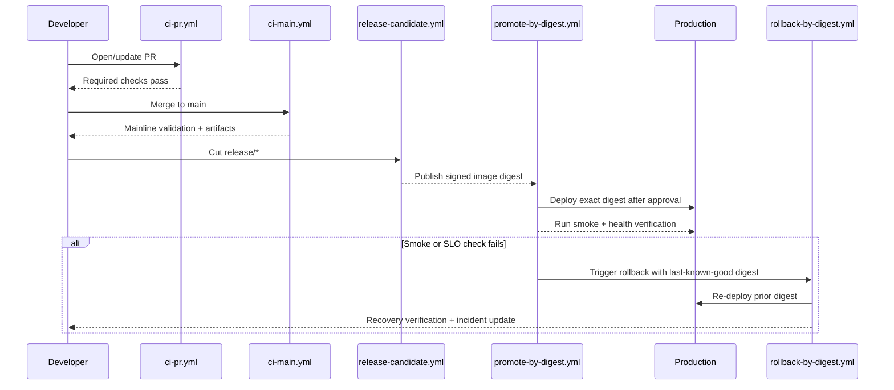

# Kryptkeeper — CI/CD Workflow Manifest (Phase 4)

## Summary

This document defines an implementation-ready GitHub Actions workflow set for Kryptkeeper Phase 4.
It translates Phase 3 architecture, the approved blocking decisions, and test strategy gates into
exact workflow files, branch protections, promotion-by-digest, and rollback operations designed for
low-surprise 3am incident response.

---

## Subtask Decomposition and Status

1. **[1] Extract constraints from architecture/test/blocking decisions** — DONE  
2. **[2] Define exact workflow file set under `.github/workflows/`** — DONE  
3. **[3] Define trigger/job/secrets/check gates per workflow** — DONE  
4. **[4] Define branch policy matrix (PR vs main vs release)** — DONE  
5. **[5] Define rollout waves and measurable success criteria** — DONE  
6. **[6] Define rollback workflow and artifact promotion by digest** — DONE

---

## 1) Proposed Workflow Files (Exact Names)

1. `.github/workflows/ci-pr.yml`  
   PR validation gate for all code changes.

2. `.github/workflows/ci-main.yml`  
   Post-merge validation on `main`, including stronger integration/security checks.

3. `.github/workflows/release-candidate.yml`  
   Release branch hard gate (`release/*`) producing immutable signed artifacts.

4. `.github/workflows/promote-by-digest.yml`  
   Manual promotion of prebuilt image digest across environments (staging → production).

5. `.github/workflows/rollback-by-digest.yml`  
   Emergency rollback to known-good digest with post-rollback verification.

6. `.github/workflows/nightly-scale-and-protocol.yml`  
   Nightly non-PR heavy tests (perf/scale/protocol/interoperability drift detection).

---

## 2) Workflow Definitions (Triggers, Jobs, Secrets, Checks, Gates)

### 2.1 `.github/workflows/ci-pr.yml`

**Triggers**
- `pull_request` on `main`, `release/*`
- `merge_group` (if GitHub merge queue enabled)

**Key jobs**
1. `changed-paths` (scope fast/slow jobs)
2. `lint-static` (golangci-lint, frontend lint, OpenAPI/spec validation)
3. `unit-backend` (`go test ./... -race` where scoped)
4. `unit-frontend` (`pnpm --dir web test`)
5. `integration-core` (Postgres + Redis services, API/service/DB/audit path)
6. `security-baseline` (dependency audit + static secret scan)
7. `e2e-smoke` (critical dashboard/API smoke only)

**Required secrets**
- None required for core PR checks (preferred)
- Optional: `CODECOV_TOKEN` (non-gating upload)

**Required status checks (branch protection names)**
- `ci-pr / lint-static`
- `ci-pr / unit-backend`
- `ci-pr / unit-frontend`
- `ci-pr / integration-core`
- `ci-pr / security-baseline`
- `ci-pr / e2e-smoke`

**Pass/fail gates**
- Fail immediately on any lint/test/security-baseline failure.
- Block merge on missing checks.
- Allow flaky-test quarantine only with linked issue + temporary allowlist expiry date.

---

### 2.2 `.github/workflows/ci-main.yml`

**Triggers**
- `push` to `main`
- `workflow_dispatch`

**Key jobs**
1. `build-binaries` (Go services + agent size check per C-Ops02)
2. `integration-full` (Postgres + Redis + protocol adapters where feasible)
3. `protocol-conformance` (ACME/OCSP/CRL/EST/SCEP scripted checks)
4. `security-policy` (SAST + dependency policy + license policy)
5. `publish-ci-artifacts` (test reports, coverage, SBOM)

**Required secrets**
- `GHCR_TOKEN` (if publishing internal CI images)
- `COSIGN_KEY` and `COSIGN_PASSWORD` (if signing enabled in main)

**Required status checks**
- Not required on PR branch protection; required internally before release cut.

**Pass/fail gates**
- Any failure opens/updates incident ticket tagged `ci-main-regression`.
- `protocol-conformance` failure blocks release branch creation until green.

---

### 2.3 `.github/workflows/release-candidate.yml`

**Triggers**
- `push` to `release/*`
- `workflow_dispatch` with `release_version`

**Key jobs**
1. `verify-from-main` (commit ancestry check)
2. `test-release-gates` (stages 0–6 from TEST_STRATEGY)
3. `build-image-once` (single immutable image build)
4. `generate-sbom` (SPDX/CycloneDX)
5. `sign-and-attest` (cosign signature + provenance)
6. `publish-digest` (emit `image@sha256:...` artifact + release notes payload)

**Required secrets**
- `GHCR_TOKEN`
- `COSIGN_KEY`
- `COSIGN_PASSWORD`
- `PROVENANCE_OIDC_AUDIENCE` (if required by signer setup)

**Required status checks**
- `release-candidate / verify-from-main`
- `release-candidate / test-release-gates`
- `release-candidate / sign-and-attest`
- `release-candidate / publish-digest`

**Pass/fail gates**
- No unsigned artifact can be promoted.
- Release fails if critical/high security scan findings are unresolved.
- Release fails if protocol conformance or revocation-path checks fail.

---

### 2.4 `.github/workflows/promote-by-digest.yml`

**Triggers**
- `workflow_dispatch` with inputs:
  - `source_env` (`staging`)
  - `target_env` (`production`)
  - `image_digest` (required, full `image@sha256`)
  - `change_ticket` (required)

**Key jobs**
1. `validate-digest-exists` (registry lookup)
2. `verify-signature` (cosign verify against trusted identity)
3. `deploy-target` (environment-specific deploy)
4. `post-deploy-smoke` (health + critical API path + OCSP endpoint check)
5. `record-promotion` (append deployment record with digest, actor, ticket)

**Required secrets**
- `DEPLOY_STAGING_CREDENTIALS`
- `DEPLOY_PRODUCTION_CREDENTIALS`
- `GHCR_TOKEN`

**Required status checks**
- `promote-by-digest / validate-digest-exists`
- `promote-by-digest / verify-signature`
- `promote-by-digest / post-deploy-smoke`

**Pass/fail gates**
- Promotion is blocked if digest is unsigned/untrusted.
- Promotion is blocked if smoke test fails.
- Promotion requires GitHub Environment approval for `production`.

---

### 2.5 `.github/workflows/rollback-by-digest.yml`

**Triggers**
- `workflow_dispatch` with inputs:
  - `target_env` (`staging|production`)
  - `rollback_digest` (required)
  - `incident_id` (required)

**Key jobs**
1. `precheck` (incident + approval + digest availability)
2. `deploy-rollback` (pin deploy to prior digest)
3. `verify-recovery` (error rate, p95/p99 latency, key health endpoints)
4. `announce` (incident channel + deployment log)

**Required secrets**
- `DEPLOY_STAGING_CREDENTIALS`
- `DEPLOY_PRODUCTION_CREDENTIALS`
- `INCIDENT_WEBHOOK_URL`

**Required status checks**
- Not a PR check; operational workflow with mandatory audit trail.

**Pass/fail gates**
- If `verify-recovery` fails, auto-open escalation task and keep incident at P0/P1.
- Rollback must include explicit verification output in workflow summary.

---

### 2.6 `.github/workflows/nightly-scale-and-protocol.yml`

**Triggers**
- `schedule` (nightly UTC)
- `workflow_dispatch`

**Key jobs**
1. `perf-baseline` (latency/throughput drift against stored baseline)
2. `interop-suite` (certbot/acme.sh/openssl compatibility)
3. `discovery-scale` (high-volume inventory/dedup/risk path)

**Required secrets**
- `PERF_RESULTS_TOKEN` (optional external sink)

**Required status checks**
- Non-blocking for PRs; blocking for release if last 24h run is red.

**Pass/fail gates**
- Open ticket for warning drift.
- Page on critical SLO regressions (per alert policy).

---

## 3) Branch Policy Matrix (PR vs main vs release)

| Policy Area | PR to `main` | `main` push | `release/*` |
|---|---|---|---|
| Required checks | `ci-pr` required checks only | none externally; `ci-main` must pass before release cut | `release-candidate` checks mandatory |
| Reviews | 1+ code owner | n/a | 2 approvals (eng + ops/security) |
| Merge strategy | squash or merge queue | protected direct push disabled | protected direct push disabled |
| Security gate | baseline scan blocking | full policy scan | full policy + no unresolved high/critical |
| Deploy action | none | auto-deploy to staging optional | promotion only by digest |
| Artifact rule | no release artifact | optional CI artifact | signed immutable artifact required |
| Rollback readiness | validate last-known-good digest reference | maintain LKG catalog | mandatory rollback digest documented |

---

## 4) Rollout Order and Success Criteria

### Wave 1 — PR Guardrails
- Implement: `ci-pr.yml`
- Success criteria:
  1. 100% of new PRs receive all required checks.
  2. Median PR CI runtime ≤ 15 min.
  3. No increase in false-positive pages from CI notifications.

### Wave 2 — Mainline Confidence
- Implement: `ci-main.yml`, `nightly-scale-and-protocol.yml`
- Success criteria:
  1. Mainline regression detection within 30 min of merge.
  2. Nightly drift reports generated 7/7 days.
  3. Protocol conformance failures create actionable tickets automatically.

### Wave 3 — Release Hardening
- Implement: `release-candidate.yml`
- Success criteria:
  1. Every release candidate publishes signed digest + SBOM.
  2. Zero unsigned artifact promotions.
  3. Release gate failures are reproducible from logs/artifacts.

### Wave 4 — Controlled Promotion + Rollback
- Implement: `promote-by-digest.yml`, `rollback-by-digest.yml`
- Success criteria:
  1. Mean time to promote staging→prod ≤ 10 min after approval.
  2. Rollback drill completes ≤ 15 min with verified recovery metrics.
  3. 100% promotions/rollbacks have incident/change ticket linkage.

---

## 5) Artifact Promotion by Digest (Design)

**Rule:** Build once on release workflow, then promote the exact immutable digest across environments.

1. `release-candidate.yml` builds image and records `image@sha256:<digest>`.
2. Signature/provenance attached to that digest.
3. `promote-by-digest.yml` deploys only by supplied digest (never by mutable tag).
4. Environment config changes must be separate from artifact identity.
5. `rollback-by-digest.yml` re-deploys prior known-good digest.

Benefits:
- Eliminates “works in staging, different image in prod” drift.
- Makes rollback deterministic and auditable.
- Preserves chain-of-custody for security/compliance.

---

## 6) Promotion and Rollback Control Flow

---

## 7) Operational Notes (Failure Modes First)

- Single point of failure in CI/CD is artifact trust: if signature verification is bypassed, promotion safety collapses.
- Retry behavior must be bounded: deploy jobs use capped retries with backoff; no infinite loops.
- Every paging alert from deployment workflows must include runbook link and incident context.
- Required check names above are contract-level; do not rename casually (branch protection break risk).

---

## Confidence Scores (Reasoning Loop)

| Subtask | Confidence (1-10) | Notes |
|---|---:|---|
| [1] Source constraint extraction | 9 | Directly mapped from architecture/test/blocking docs |
| [2] Workflow file manifest | 9 | Exact file names and purpose defined |
| [3] Triggers/jobs/secrets/checks/gates | 8 | Ready for YAML implementation, repo specifics may tune job internals |
| [4] Branch policy matrix | 8 | Actionable and aligns with protected branch operations |
| [5] Rollout order + success criteria | 8 | Quantitative criteria included |
| [6] Rollback + digest promotion design | 9 | Deterministic promotion and rollback path defined |

All subtasks are **>= 7** confidence.
