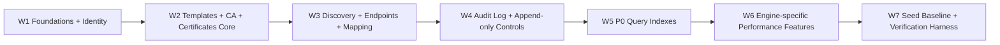
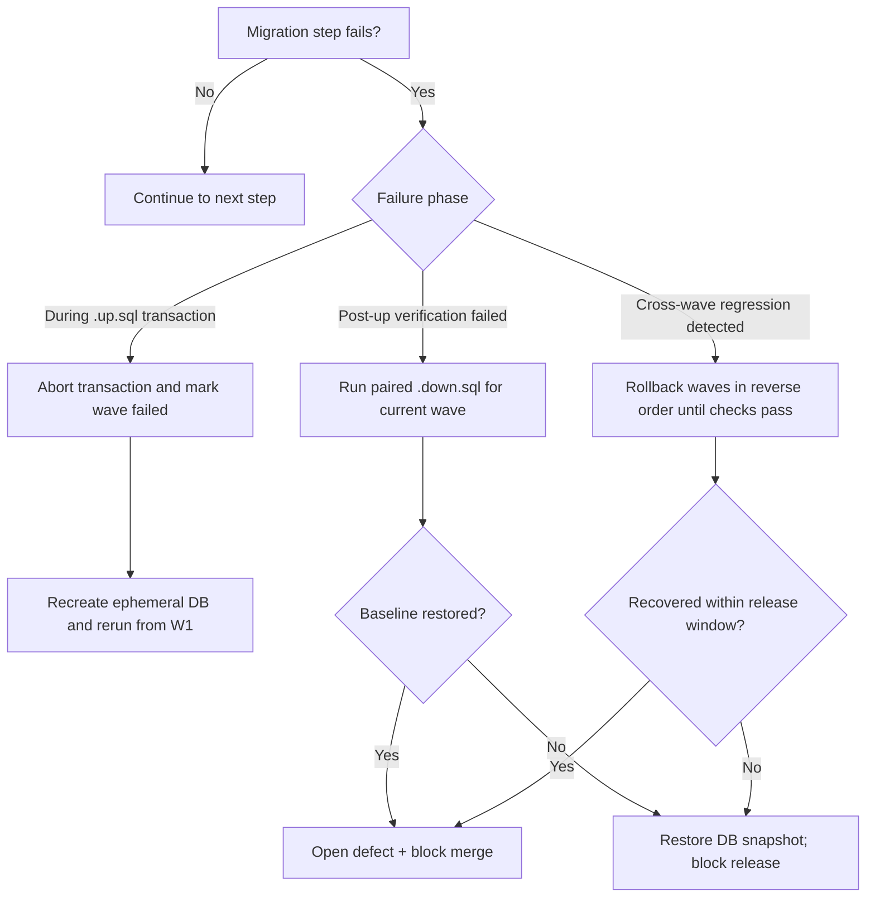

# Kryptkeeper — Phase 4 Migration Manifest (Implementation-Ready)

## Summary

This manifest defines the **authoritative migration file plan** for Phase 4, with dual tracks for PostgreSQL and SQLite, strict wave ordering (**W1..W7**), reversible up/down pairs, CI execution order, and rollback decisions. It is derived from:

- `docs/DATABASE.md`
- `docs/sdlc/phase-3-design/DATABASE.md`
- `docs/sdlc/phase-4-implementation/BLOCKING_DECISIONS.md`

This file is execution-focused: each migration has explicit filename, dependency, rollback pair, and verification checks.

---

## 1) Scope, Conventions, and Guardrails

- Migration roots:
  - `internal/db/migrations/postgres/`
  - `internal/db/migrations/sqlite/`
- Naming convention: `NNNNNN_<wave_name>.<direction>.sql`
- Direction values: `.up.sql` and `.down.sql`
- Execution order: lexical by filename (strictly increasing sequence)
- Rollback rule: each `.up.sql` must have an exact inverse `.down.sql`
- Cross-DB parity rule: logical schema behavior must match across PG + SQLite

---

## 2) Wave Dependency Map (W1..W7)

Hot-path rationale:
- W1-W3 establish write/read model for identity, PKI core, and discovery.
- W4 locks audit invariants from DEC-004 (`audit_log.id` BIGINT behavior).
- W5 ensures P0 query index coverage before scale tests.
- W6 handles DB-engine divergence without changing logical contracts.
- W7 provides deterministic CI validation and rollback confidence.

---

## 3) PostgreSQL Migration File Manifest

| Wave | Up File | Down File | Purpose | Depends On | Rollback Pair | Verification Checks |
|---|---|---|---|---|---|---|
| W1 | `internal/db/migrations/postgres/000001_foundations_identity.up.sql` | `internal/db/migrations/postgres/000001_foundations_identity.down.sql` | Create `users`, `notification_policies`, `teams`, `team_members`, `api_keys`; role/scopes-safe identity baseline | none | exact inverse drops in dependency order | tables exist, unique constraints on user email/team slug/api key hash, FK integrity for `user_id` + `notification_policy_id` |
| W2 | `internal/db/migrations/postgres/000002_templates_ca_certs_core.up.sql` | `internal/db/migrations/postgres/000002_templates_ca_certs_core.down.sql` | Create `certificate_templates`, `certificate_authorities`, `certificates`; stage circular FK add after both tables exist | W1 | remove staged FK first, then dependent objects | PK/unique: fingerprint + `(serial_number, ca_id)`; check constraints for risk bounds + enum-like statuses |
| W3 | `internal/db/migrations/postgres/000003_discovery_endpoints.up.sql` | `internal/db/migrations/postgres/000003_discovery_endpoints.down.sql` | Create `scan_jobs`, `endpoints`, `scan_results`, `certificate_endpoints`; add deferred FK for `endpoints.last_scan_job_id` | W2 | drop deferred FK then tables reverse order | FK join validity (`scan_results.scan_job_id`, cert-endpoint joins), no orphan rows |
| W4 | `internal/db/migrations/postgres/000004_audit_log_append_only.up.sql` | `internal/db/migrations/postgres/000004_audit_log_append_only.down.sql` | Create partitioned `audit_log` parent + initial monthly partitions + append-only trigger/policy controls | W1 | drop append-only controls, partitions, then parent | append succeeds, UPDATE/DELETE blocked, `audit_log.id` monotonic BIGINT behavior |
| W5 | `internal/db/migrations/postgres/000005_p0_indexes.up.sql` | `internal/db/migrations/postgres/000005_p0_indexes.down.sql` | Add P0 indexes for expiry, risk, status, endpoint mapping, scan operational views, audit drilldowns | W2,W3,W4 | index-only rollback (no schema drop) | `EXPLAIN ANALYZE` uses expected indexes on top 3 hot queries |
| W6 | `internal/db/migrations/postgres/000006_pg_perf_extensions.up.sql` | `internal/db/migrations/postgres/000006_pg_perf_extensions.down.sql` | Enable `pg_trgm`; add trigram/GIN and optional partial indexes for high-risk and inventory search | W5 | drop extension-dependent indexes then optional extension | no regressions in write latency threshold; search plan uses GIN/trgm |
| W7 | `internal/db/migrations/postgres/000007_seed_baseline_data.up.sql` | `internal/db/migrations/postgres/000007_seed_baseline_data.down.sql` | Insert deterministic CI seed graph (identity, CA, cert, endpoint, scan, audit) | W1..W6 | delete by deterministic IDs/prefix namespace only | seed idempotency, expected row counts, FR-critical smoke tests pass |

---

## 4) SQLite Migration File Manifest

| Wave | Up File | Down File | Purpose | Depends On | Rollback Pair | Verification Checks |
|---|---|---|---|---|---|---|
| W1 | `internal/db/migrations/sqlite/000001_foundations_identity.up.sql` | `internal/db/migrations/sqlite/000001_foundations_identity.down.sql` | SQLite-equivalent identity foundation using TEXT UUIDs and INTEGER booleans | none | exact inverse drops in dependency order | `PRAGMA foreign_keys=ON` enforced in tests; uniqueness and FK checks pass |
| W2 | `internal/db/migrations/sqlite/000002_templates_ca_certs_core.up.sql` | `internal/db/migrations/sqlite/000002_templates_ca_certs_core.down.sql` | Core PKI schema with JSON/TEXT substitutes for PG arrays/JSONB/interval types | W1 | remove circular-FK mitigation objects first | cert uniqueness + risk bounds + lifecycle constraints validated |
| W3 | `internal/db/migrations/sqlite/000003_discovery_endpoints.up.sql` | `internal/db/migrations/sqlite/000003_discovery_endpoints.down.sql` | Discovery and endpoint mapping with deferred relationship assembly | W2 | reverse-order drop after FK cleanup | no orphans in bridge tables; endpoint-scan linkage valid |
| W4 | `internal/db/migrations/sqlite/000004_audit_log_append_only.up.sql` | `internal/db/migrations/sqlite/000004_audit_log_append_only.down.sql` | Unpartitioned `audit_log` + trigger-based UPDATE/DELETE rejection | W1 | drop triggers then table | append-only behavior enforced; BIGINT-compatible id ordering preserved |
| W5 | `internal/db/migrations/sqlite/000005_p0_indexes.up.sql` | `internal/db/migrations/sqlite/000005_p0_indexes.down.sql` | P0 indexes adapted for SQLite planner characteristics | W2,W3,W4 | index-only rollback | `EXPLAIN QUERY PLAN` shows SEARCH vs SCAN on hot paths |
| W6 | `internal/db/migrations/sqlite/000006_sqlite_perf_features.up.sql` | `internal/db/migrations/sqlite/000006_sqlite_perf_features.down.sql` | Add FTS5/search helpers and JSON extraction indexes for parity with PG fuzzy/filter features | W5 | remove FTS artifacts + helper indexes | inventory search latency target met on scale-lite dataset |
| W7 | `internal/db/migrations/sqlite/000007_seed_baseline_data.up.sql` | `internal/db/migrations/sqlite/000007_seed_baseline_data.down.sql` | Deterministic seed set equivalent to PG track, CI-only usage | W1..W6 | delete by deterministic namespace keys only | row-count parity checks and functional smoke tests pass |

---

## 5) Per-Wave Verification Checklist (Run After Each `.up.sql`)

1. **Schema presence:** required tables/views/indexes for the wave exist.
2. **FK integrity:** orphan checks return zero.
3. **Constraint validity:** risk score ranges, enum-like checks, uniqueness constraints hold.
4. **Audit invariant (W4+):** INSERT allowed; UPDATE/DELETE denied.
5. **Plan quality (W5+):**
   - PostgreSQL: `EXPLAIN ANALYZE` confirms index scan on expiry/risk/audit drilldown.
   - SQLite: `EXPLAIN QUERY PLAN` avoids full scans on same hot paths.
6. **Rollback drill:** execute paired `.down.sql` in ephemeral DB once per CI pipeline, then re-apply `.up.sql`.

---

## 6) CI Migration Execution Order (Dual-Engine)

CI stages (must run in this order):

1. `lint-migrations` — filename sequence, pair completeness, duplicate sequence guard.
2. `pg-up` — apply PG W1→W7 `.up.sql`.
3. `pg-verify` — run structural/FK/query-plan checks.
4. `pg-down-drill` — rollback W7→W1 `.down.sql`, verify clean baseline.
5. `sqlite-up` — apply SQLite W1→W7 `.up.sql`.
6. `sqlite-verify` — run structural/FK/query-plan checks.
7. `sqlite-down-drill` — rollback W7→W1 `.down.sql`, verify clean baseline.
8. `cross-engine-parity` — compare expected logical row-shape and semantics from seed dataset.

Release gate condition:
- Any fail in steps 2-8 blocks merge/release.
- No migration may ship without successful down-drill in both engines.

---

## 7) Failure Rollback Decision Tree

Operational rule-of-thumb:
- **Single-wave verification failure:** rollback current wave only.
- **Unknown integrity drift:** rollback all waves for that deployment and restore snapshot.

---

## 8) Delivery Checklist for Implementation PRs

- [ ] All 28 files present (14 per engine: 7 up + 7 down).
- [ ] Each `.up.sql` has exact `.down.sql` pair and tested reversal.
- [ ] W1..W7 dependencies are not violated by filename sequence.
- [ ] Verification SQL checked into test harness and executed in CI.
- [ ] Blocking decisions reflected (DEC-003 API key semantics, DEC-004 audit id type).
- [ ] No production auto-seed; W7 marked CI/test-only execution path.

---

## 9) Notes on Backward Compatibility and Risk

- Avoid irreversible destructive DDL in this phase; defer drops/narrowing to dedicated deprecation waves.
- Keep audit append-only invariant non-negotiable across both engines.
- Run nightly scale-lite dataset checks to detect query-plan drift before production growth.
- If Phase 4 introduces API shape coupling, coordinate with API design review before migration merge.
