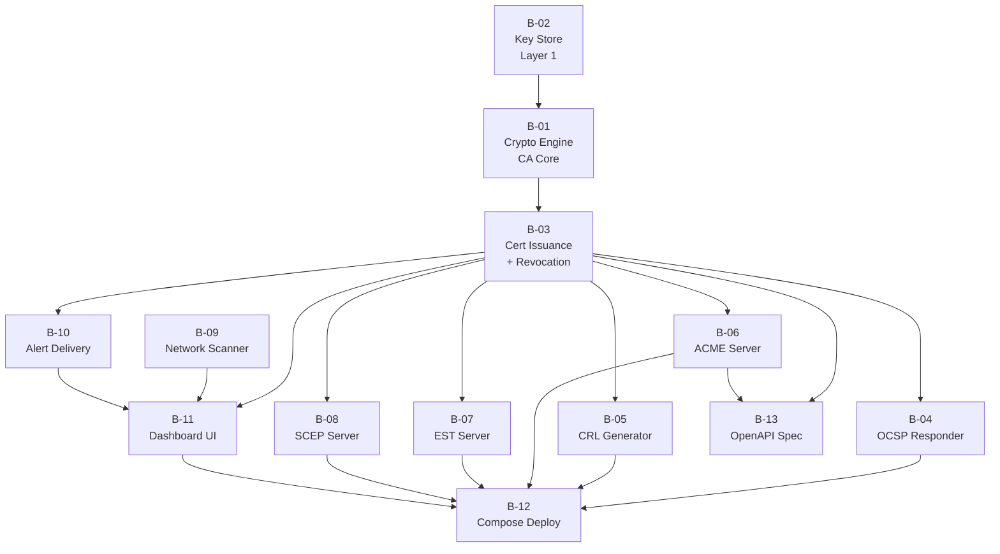

# Kryptkeeper — Phase 4b Implementation Plan

**Date:** 2026-04-07
**Status:** PLANNING
**Prerequisite:** Phase 4a approved — API handlers, auth stack, provider interfaces, migrations W1-W8, CI/CD baseline, container baseline all DONE.

---

## 1. Objective

Phase 4b turns the V1 scaffold into a shippable PKI platform. Every workstream in Phase 4a produced contracts, interfaces, and handler stubs. Phase 4b replaces those stubs with real behavior: a crypto engine that issues certificates, protocol servers that speak RFC-compliant wire formats, a scanner that actually finds TLS endpoints, a dashboard that a human can operate, and a deployment that starts with a single command.

V1 done criteria (from SCOPE.md §5) drives every priority decision here.

---

## 2. Subtask Decomposition

| # | Workstream | Complexity | Status |
|---|---|---|---|
| B-01 | Crypto Engine (CA Core) | L | PENDING |
| B-02 | Key Store — Layer 1 (software PKCS#8) | M | PENDING |
| B-03 | Certificate Issuance + Revocation | L | PENDING |
| B-04 | OCSP Responder | M | PENDING |
| B-05 | CRL Generator + Distribution | M | PENDING |
| B-06 | ACME Server (RFC 8555) | L | PENDING |
| B-07 | EST Server (RFC 7030) | M | PENDING |
| B-08 | SCEP Server | M | PENDING |
| B-09 | Network Discovery Scanner | L | PENDING |
| B-10 | Alert Delivery Engine | M | PENDING |
| B-11 | Dashboard UI | L | PENDING |
| B-12 | Docker Compose full deploy | M | PENDING |
| B-13 | OpenAPI spec | S | PENDING |

Progress: 0 / 13 complete

---

## 3. Dependency Graph

Critical path: **B-02 → B-01 → B-03 → {B-04, B-05, B-06} → B-12**

B-09 (scanner), B-10 (alerts), and B-11 (dashboard) can run in parallel once B-03 is done. B-07, B-08 are parallel once B-03 is done.

---

## 4. Build Order

### Wave 1 — Crypto Foundation (blocks everything)

**B-02: Key Store Layer 1 — Software PKCS#8**

Deliverables:
- `internal/keystore/software/` — KeyStore interface implementation
- Argon2id KDF for key encryption passphrase derivation (cost params: time=1, mem=64MB, threads=4)
- AES-256-GCM envelope: data key encrypted at rest, loaded into memory only during signing
- Key generation: RSA-2048/4096, ECDSA P-256/P-384, Ed25519
- `crypto.Signer` adapter wrapping each key type
- Key persistence: encrypted PKCS#8 PEM files in configurable directory
- Tests: key gen, round-trip encrypt/decrypt, signing correctness per algorithm

**B-01: Crypto Engine — CA Core**

Deliverables:
- `internal/ca/` — CA Service implementing the `ca.Service` interface from Phase 4a
- Root CA creation: self-signed cert, key ceremony log entry, offline mode flag
- Intermediate CA creation: CSR generation, signing by parent CA, chain assembly
- External CA import: parse PEM chain, validate chain integrity, store without private key
- Certificate Builder: apply SANs, key usage, EKU, AIA/CDP extension injection, serial number (RFC 5280 §4.1.2.2 — unique per CA, random 128-bit)
- Policy Engine: pluggable `PolicyEvaluator` registry, template policy wired in
- Signer Manager: resolves `crypto.Signer` by CA ID via KeyStore registry
- Tests: root CA create, intermediate CA create, chain validation, template policy enforcement

### Wave 2 — Issuance and Revocation (unblocks all protocols)

**B-03: Certificate Issuance + Revocation**

Deliverables:
- `internal/ca/issuance.go` — `IssueFromCSR()`: parse CSR, validate against template, sign, persist
- `internal/ca/revocation.go` — `RevokeCertificate()`: write revocation record, mark in DB, trigger CRL delta, OCSP cache invalidation
- Renewal: `RenewCertificate()` — re-issue with fresh validity, predecessor/successor chain tracking (links to existing cert row)
- Serial number uniqueness enforced at DB level (unique constraint on `certificates.serial_number` per CA)
- Audit log entries for every issuance, revocation, and renewal event
- Integration tests: issue → query → revoke → OCSP should-be-revoked

### Wave 3 — Protocol Servers (parallel after Wave 2)

**B-04: OCSP Responder**

Deliverables:
- `internal/ocsp/` — RFC 5019 GET and POST request handling
- Response signing: OCSP responses signed by designated responder cert (delegated or CA cert)
- Response cache: in-memory LRU + optional Redis; pre-signed on revocation event
- Response fields: thisUpdate, nextUpdate (configurable, default 24h), certStatus, revokedInfo
- Nonce handling: RFC 8954 nonce optional — honor if present, omit if not
- Tests: good status, revoked status (with reason + time), unknown serial, replay test with nonce

**B-05: CRL Generator + Distribution**

Deliverables:
- `internal/crl/` — Full CRL and delta CRL generation per CA
- Scheduled generation: configurable interval (default: full CRL every 24h, delta every 1h)
- On-demand trigger: fires when a certificate is revoked
- DER and PEM output; served at `/crl/{ca-id}.crl` (matches AIA CDP extension injected at issuance)
- Distribution point handler wired into API router (no auth required — public endpoint)
- Tests: CRL contains revoked serial, CRL does not contain active serial, delta CRL sequence numbers

**B-06: ACME Server (RFC 8555)**

Deliverables:
- `internal/acme/` — Directory, nonce, account, order, authorization, challenge, finalize, certificate endpoints
- Challenge validators: HTTP-01 (outbound HTTP GET to `.well-known/acme-challenge/`), DNS-01 (DNS TXT lookup), TLS-ALPN-01 (outbound TLS with ACME OID)
- Account key: JWS ES256 or RS256 verification
- Order state machine: pending → ready → processing → valid; invalid on challenge failure
- Rate limiting: max 5 pending orders per account (configurable)
- Auto-renewal hook: ACME-enrolled certificates flagged for background renewal at 2/3 of validity
- Integration test: certbot `--test-cert` against local ACME server obtains and renews a cert

**B-07: EST Server (RFC 7030)**

Deliverables:
- `internal/est/` — `/cacerts`, `/simpleenroll`, `/simplereenroll`, `/csrattrs` endpoints
- Client authentication: mTLS client certificate or HTTP Basic (configurable per enrollment policy)
- CSR forwarding to CA Core issuance path
- PKCS#7 and PKCS#10 wire format handling
- Tests: simpleenroll issues cert, simplereenroll renews, cacerts returns correct chain

**B-08: SCEP Server**

Deliverables:
- `internal/scep/` — PKIOperation: PKCSReq, CertRep, GetCertInitial, GetCACert, GetCACaps
- Challenge password enforcement (configurable per CA)
- RA mode: SCEP server acts as Registration Authority, forwards to CA Core
- RSA encryption/decryption of SCEP envelope (PKCS#7 EnvelopedData)
- Tests: PKCSReq issues cert, GetCACert returns CA cert, GetCACaps advertises SHA-256 + AES

### Wave 4 — Platform Completeness (parallel after Wave 2)

**B-09: Network Discovery Scanner**

Deliverables:
- `internal/discovery/scanner/` — Scanner implementing the `DiscoveryConnector` interface from Phase 4a
- Port detection: masscan wrapper (subprocess) or raw TCP connect fallback for environments without masscan
- TLS cert extraction: Go TLS handshake against each discovered open port; extract leaf + chain
- Scan job lifecycle: pending → running → completed/failed; progress events written to scan_jobs table
- Rate limiting: configurable concurrency (default 500 goroutines), timeout per host
- Output: endpoint rows created/updated in `endpoints` table with extracted cert metadata
- Risk score calculation: RFC 5280 validity window, algo weakness (RSA<2048, SHA-1), unowned flag
- Tests: scan against local TLS server, cert metadata extracted correctly, risk score computed

**B-10: Alert Delivery Engine**

Deliverables:
- `internal/notifications/delivery/` — Delivery worker consuming notification events
- Channels: SMTP email (Go `net/smtp`), Slack Incoming Webhook, PagerDuty Events API v2
- Channel interface: `NotificationChannel.Send(event NotificationEvent) error` — one implementation per channel
- Retry: exponential backoff, max 3 attempts; dead-letter status written to `notification_deliveries`
- Threshold evaluation: background job runs every 15 minutes, queries certificates expiring within configured windows, fires events
- Tests: mock SMTP server receives email, Slack webhook receives POST, retry on transient failure

**B-11: Dashboard UI**

Deliverables:
- `ui/` — React 18 + Vite + TypeScript + shadcn/ui + TanStack Query
- Views: Certificate Inventory (table, filter by CA/status/expiry, sort), CA Hierarchy (tree), Discovery Management (trigger scan, job status, endpoint list), Risk Dashboard (expiring soon, high-risk, unowned), Alert Configuration (CRUD thresholds + channels)
- Auth: OIDC login via redirect, JWT bearer token stored in memory (not localStorage)
- API client: generated from OpenAPI spec (B-13); typed, no hand-written fetch calls
- Accessibility: WCAG 2.1 AA (keyboard nav, screen reader labels on all interactive elements)
- Tests: Vitest unit tests for risk score display logic; Playwright e2e for certificate issue flow

### Wave 5 — Deployment and Documentation

**B-12: Docker Compose Full Deploy**

Deliverables:
- `docker-compose.yml` updated: adds dashboard nginx container, Postgres with persistent volume, optional Redis sidecar
- Environment variable documentation: `APP_*` vars with defaults in `.env.example`
- `scripts/bootstrap.sh` — first-run: generates root CA, creates admin user, prints API key
- Health check chain: all containers have `/healthz` checked before dependent containers start
- Single-command validation: `docker compose up && sleep 30 && scripts/smoke-full.sh` returns 0
- Documentation: ONBOARDING.md "Quick Start" updated to reflect real deploy

**B-13: OpenAPI Spec**

Deliverables:
- `docs/openapi.yaml` — OpenAPI 3.1 spec generated from handler annotations (`swaggo/swag` or hand-authored if annotation overhead is too high)
- All V1 endpoints: request/response schemas, auth requirements, error codes
- Served at `/api/v1/openapi.json` at runtime
- Validated: `swagger-cli validate` passes in CI

---

## 5. Risk Assessment

| Risk | Likelihood | Impact | Mitigation |
|---|---|---|---|
| ACME challenge validation requires outbound network in CI | High | High | Mock challenge validator interface; integration test uses DNS-01 with local resolver override |
| masscan requires root/CAP_NET_RAW in container | High | Medium | Raw TCP connect fallback path built in from day one; masscan optional |
| SCEP envelope crypto (RSA PKCS#7) has subtle interop bugs | Medium | High | Test against real device emulator (OpenSCEP or strongSwan SCEP) before calling done |
| React dashboard scope creeps past V1 needs | Medium | Medium | Locked to 5 views defined above; no new views without explicit scope change |
| OCSP response time SLA (50ms P99) requires cache warm | Medium | High | Pre-sign OCSP responses on revocation event; LRU cache populated at startup from DB |
| EST mTLS client cert auth requires careful middleware ordering | Medium | Medium | Isolate EST router on its own port with separate TLS config; do not share API TLS config |
| OpenAPI spec drift from handler reality | Medium | Medium | CI gate: `swagger-cli validate docs/openapi.yaml` must pass on every PR that touches handlers |
| Key store file permissions on shared volumes | Low | Critical | `internal/keystore/software/` enforces `0600` on key files at write time; startup check validates |

---

## 6. Expert Delegation Plan

| When | Expert | Scope |
|---|---|---|
| Before B-01 coding | `/security` | Review key ceremony design: Argon2id params, AES-256-GCM nonce reuse risk, key file permissions |
| Before B-06 coding | `/security` | ACME challenge validator isolation: SSRF risk on HTTP-01, DNS rebinding on DNS-01 |
| Before B-09 coding | `/security` | Scanner rate limiting and resource exhaustion; goroutine pool bounds |
| After B-03 is coded | `/test-expert --coverage` | Verify issuance, revocation, and renewal hit 80%+ branch coverage |
| After B-11 is coded | `/ux --audit` | WCAG 2.1 AA pass on dashboard; keyboard nav and screen reader |
| After B-12 is coded | `/containers --optimize` | Production image size, non-root runtime, secret injection pattern |
| Before phase gate | `/security` | Full OWASP audit of B-01 through B-10 (key handling, ACME, SCEP) |

---

## 7. Phase 4b Definition of Done

Phase 4b is complete when all 8 V1 done criteria from SCOPE.md §5 are verifiable by a human:

1. Root CA created, issuing CA created beneath it, cert issued from CSR — no Windows required
2. certbot can obtain and auto-renew a cert against the ACME server
3. `openssl ocsp` can verify revocation status of a revoked and an active cert
4. Network scan discovers all TLS endpoints in a /24 in under 30 minutes
5. Dashboard shows cert inventory with expiry dates, risk scores, and owners
6. Alert fires to Slack or email when a cert is within 30 days of expiry
7. `docker compose up` produces a working platform from cold start
8. `docs/openapi.yaml` validates and documents all V1 endpoints

Gate check runs against all 8 criteria before Phase 5 (review) begins.
