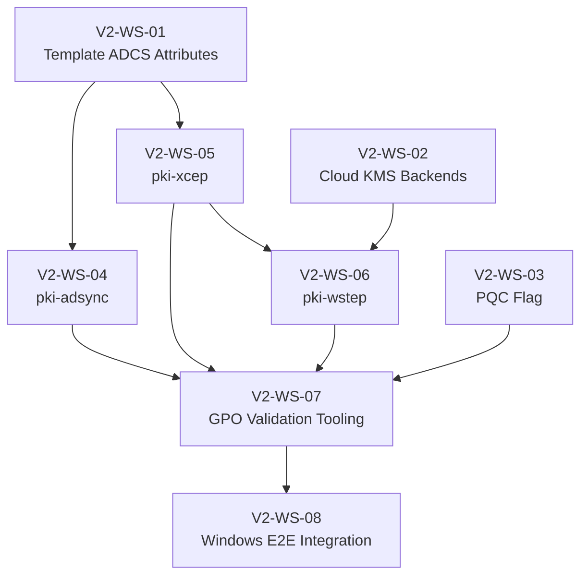

# Kryptkeeper V2 — ADCS Replacement Implementation Plan

**Date:** 2026-04-07
**Status:** PLANNING
**Prerequisite:** V1 MVP complete (all WS-01..WS-10 DONE)

---

## 1. Objective

Deliver Windows auto-enrollment via XCEP/WSTEP, Active Directory sync, Cloud KMS
signing backends, and a PQC readiness flag. V2 is done when a domain-joined Windows
10/11 machine auto-enrolls a certificate through GPO with kryptkeeper as the sole CA —
no ADCS server in the environment.

---

## 2. Workstream Decomposition

| ID | Workstream | Complexity | Depends On |
|----|-----------|------------|------------|
| V2-WS-01 | Template ADCS Attribute Extension | M | — |
| V2-WS-02 | Cloud KMS Signing Backends (Layer 4) | L | — |
| V2-WS-03 | PQC Vulnerability Flag | S | — |
| V2-WS-04 | pki-adsync Service | L | V2-WS-01 |
| V2-WS-05 | pki-xcep Service | L | V2-WS-01 |
| V2-WS-06 | pki-wstep Service | L | V2-WS-05, V2-WS-02 |
| V2-WS-07 | GPO Validation Tooling | M | V2-WS-04..06 |
| V2-WS-08 | Windows End-to-End Integration | L | V2-WS-07 |

---

## 3. Dependency Graph

Critical path: WS-01 → WS-05 → WS-06 → WS-07 → WS-08.
WS-02, WS-03, and WS-04 run in parallel with WS-05.

---

## 4. Workstream Scope

### V2-WS-01 — Template ADCS Attribute Extension

Extend the template schema in the database and `TemplateProvider` interface with
ADCS-specific fields required by XCEP and adsync.

New nullable fields on template: `msPKI-Cert-Template-OID` (unique OID string),
`msPKI-Enrollment-Flag` (bitmask), `msPKI-Private-Key-Flag` (bitmask),
`msPKI-Certificate-Name-Flag` (bitmask), `msPKI-Minimal-Key-Size` (int),
`msPKI-RA-Signature` (int), `msPKI-Template-Schema-Version` (int, 1–4).

The `TemplateProvider` interface gains an `ADCSAttributes()` method. One schema
migration required; existing templates receive safe defaults.

Delegate `/dba` for migration design before coding.

---

### V2-WS-02 — Cloud KMS Signing Backends (Layer 4)

Three new `keystore.Store` implementations — no changes to callers. The `crypto.Signer`
returned by each backend's `Signer()` delegates the sign operation to the remote KMS;
no private key material ever leaves the KMS.

New packages:
- `internal/keystore/awskms/` — `github.com/aws/aws-sdk-go-v2/service/kms`
- `internal/keystore/gcpkms/` — `cloud.google.com/go/kms/apiv1`
- `internal/keystore/azurekv/` — `github.com/Azure/azure-sdk-for-go/sdk/keyvault/azkeys`

New `keystore.BackendType` enum values: `"aws-kms"`, `"gcp-kms"`, `"azure-kv"`.
Bootstrap wiring selects backend at startup via DI. Integration tests skip unless
cloud credentials are present in environment (build tag: `integration`).

Evaluate transitive SDK dependency conflicts before starting; use build tags if needed.
Delegate `/security` audit before merge.

---

### V2-WS-03 — PQC Vulnerability Flag

Additive change to the risk scoring engine. New flag `pqc_vulnerable` is set on any
certificate using RSA or ECDSA keys (CRQC-vulnerable). ML-DSA / SLH-DSA keys clear
the flag. Scoring weight: 5 points (informational; does not affect letter grade until
V3 PQC dashboard).

New API field `pqc_ready: bool` on certificate detail and inventory list responses
(non-breaking additive). Dashboard gains a hidden "PQC Ready" column in inventory
table, opt-in via column picker.

---

### V2-WS-04 — pki-adsync Service

New binary `cmd/pki-adsync/`. Uses `github.com/go-ldap/ldap/v3` for LDAPS (port 636)
connections to AD.

Responsibilities: locate or create `CN=Certificate Templates` in the AD Configuration
partition; create/update one `pKICertificateTemplate` object per template with
`msPKI-*` attributes from WS-01; create/update the `pKIEnrollmentService` object in
`CN=Enrollment Services` pointing to the pki-xcep/pki-wstep endpoints.

Sync runs on a configurable schedule (default: 5 min) and on `POST /v1/adsync/trigger`.
New package `internal/adsync/` with `Syncer` interface for testability.

Delegate `/security` audit for LDAP injection and TLS enforcement before merge.

---

### V2-WS-05 — pki-xcep Service

New binary `cmd/pki-xcep/`. Implements MS-XCEP `GetPolicies` operation over SOAP 1.2
/ HTTPS. No Go SOAP library; hand-craft envelope using `encoding/xml` with explicit
struct tags. Capture reference traffic from a real ADCS deployment via Wireshark
before finalizing struct shapes — the spec has undocumented quirks.

Response includes: one `cA` element per active CA (URI points to pki-wstep), one
`policyOIDReference` per template (from `msPKI-Cert-Template-OID`), one `policy`
element per template with ADCS attribute flags.

Authentication: client cert mutual TLS for V2 MVP; Kerberos (SPNEGO) deferred because
it requires cgo + libgssapi on Linux. Document the tradeoff in config.

New package `internal/xcep/` with SOAP message types and policy builder. Unit tests
must cover SOAP marshal/unmarshal round-trip against captured reference payloads.

Delegate `/api-design` review of SOAP contract before coding.

---

### V2-WS-06 — pki-wstep Service

New binary `cmd/pki-wstep/`. Implements WS-Trust 1.3 `RequestSecurityToken` over
SOAP / HTTPS. Hand-crafted SOAP envelope (same approach as WS-05).

Flow: parse SOAP envelope → extract PKCS#10 CSR from `BinarySecurityToken` →
identify template via `AdditionalContext` → validate against template policy →
call `ca.Service.IssueCertificate()` → return issued certificate in PKCS#7 CMC
format in `RequestSecurityTokenResponse`.

RBAC: authenticated identity must hold `enroll` permission on the requested template.
Same client-cert auth as pki-xcep; Kerberos deferred.

New package `internal/wstep/` with SOAP types, handler, PKCS#7 response builder.

Delegate `/api-design` review before coding.

---

### V2-WS-07 — GPO Validation Tooling

New CLI subcommand `kryptkeeper gpo validate` and API endpoint `GET /v1/gpo/validate`.

Checks: XCEP endpoint reachable (TLS handshake), WSTEP endpoint reachable, AD LDAP
reachable and adsync has run successfully, `pKIEnrollmentService` object present in
AD, at least one `pKICertificateTemplate` published, root CA certificate present in
AD `NTAuthCertificates`.

Output: JSON report with per-check status and remediation instructions. Usable in
CI or a dashboard health widget.

Deliverable also includes `docs/ops/GPO_CONFIGURATION_GUIDE.md`: step-by-step for
the GPO administrator (which Group Policy settings, which OUs, how to verify from
a test Windows machine).

---

### V2-WS-08 — Windows End-to-End Integration

**Goal:** confirm the full GPO auto-enrollment path against real Windows clients.

Test matrix:
| Client | Auth | Template Type |
|--------|------|---------------|
| Windows 10 22H2 | Client cert | User cert |
| Windows 11 23H2 | Client cert | Computer cert |
| Windows Server 2022 | Client cert | Web Server cert |

Requires a self-hosted GitHub Actions runner on a Windows Server VM with AD DS.
Do not block CI merge gates on this workstream; gate manually. Any failures feed
corrections back into WS-05/WS-06 before V2 is declared done.

Deliverable: `docs/ops/WINDOWS_E2E_TEST_RUNBOOK.md` and recorded test results.

Delegate `/devops` for self-hosted runner and AD test environment provisioning.

---

## 5. Definition of Done (V2)

1. A domain-joined Windows 10 or 11 machine auto-enrolls via GPO with no ADCS server.
2. `kryptkeeper gpo validate` reports all checks passing.
3. AWS KMS backend passes integration tests with a real KMS key.
4. PQC readiness flag appears in inventory API and dashboard.
5. All three new binaries included in Docker Compose and CI build matrix.
6. Zero CRITICAL/HIGH findings from `/security` on the three new services.

---

## 6. Risks

| ID | Risk | Likelihood | Impact | Mitigation |
|----|------|-----------|--------|-----------|
| R-V2-01 | Windows VM required for E2E — unavailable in standard CI | High | High | Self-hosted runner on Windows Server VM with AD DS. Gate WS-08 manually. |
| R-V2-02 | SOAP envelope shape rejected by Windows (spec has undocumented quirks) | Medium | High | Capture Wireshark reference traffic from real ADCS before coding WS-05/WS-06. |
| R-V2-03 | Kerberos in Go requires cgo + libgssapi on Linux | Medium | Medium | Ship client-cert auth as V2 MVP; Kerberos as follow-on. Document tradeoff. |
| R-V2-04 | AD write permissions — service account needs write to Configuration partition | Low | Medium | Provide least-privilege AD delegation instructions in GPO guide. |
| R-V2-05 | Three cloud SDKs introduce transitive dep conflicts | Low | Low | Evaluate before WS-02 coding; use build tags to isolate if needed. |

---

## 7. Expert Delegation Plan

| Workstream | Expert | Scope |
|------------|--------|-------|
| V2-WS-01 | `/dba` | Schema migration for ADCS template attributes |
| V2-WS-02 | `/security` | Audit Cloud KMS backends for key exposure |
| V2-WS-04 | `/security` | Audit LDAP client: injection, TLS enforcement, credential handling |
| V2-WS-05 | `/api-design` | SOAP contract review against MS-XCEP spec + captured traffic |
| V2-WS-06 | `/api-design` | SOAP contract review against WS-Trust spec + captured traffic |
| V2-WS-07 | `/test-expert` | Test strategy for GPO validation checks |
| V2-WS-08 | `/devops` | Self-hosted runner setup and Windows AD test environment |
