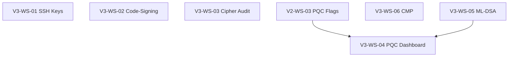

# Kryptkeeper V3 — Full Crypto Management Implementation Plan

**Date:** 2026-04-08
**Status:** IN PROGRESS
**Prerequisite:** V1 MVP + V2 ADCS complete

---

## Workstreams

| ID | Workstream | Complexity | Depends On |
|----|-----------|------------|------------|
| V3-WS-01 | SSH Key Inventory | L | — |
| V3-WS-02 | Code-Signing Certificate Tracking | M | — |
| V3-WS-03 | Cipher Suite Auditing | M | — |
| V3-WS-04 | PQC Migration Planning Dashboard | M | V2-WS-03 (PQC flags) |
| V3-WS-05 | ML-DSA Certificate Issuance | L | — |
| V3-WS-06 | CMP Protocol (RFC 4210) | L | — |

All 6 workstreams are independent except V3-WS-04 which builds on existing PQC flags.

---

## Dependency Graph

